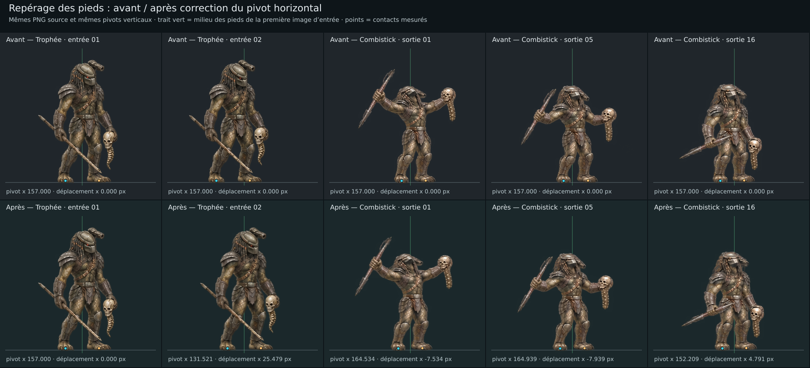

# Postures, rugissement et victoires — livraison V2.1

## Résultat

La V2.1 conserve les **288 PNG source**, les 18 atlas originaux, les 18 atlas d’import et les six poses fixes de V2. Elle corrige le placement horizontal des 144 images du rugissement et des deux victoires, harmonise le choix de sortie entre le lecteur et les manifestes natifs, et termine le comportement des séquences à lecture unique.

| Action | Entrée | Maintien animé | Sortie dédiée |
| --- | ---: | ---: | ---: |
| Accroupi sur une branche | 16 | 16 | 16 |
| Embuscade contre le tronc | 16 | 16 | 16 |
| Affût ouvert sur le tronc | 16 | 16 | 16 |
| Provocation — rugissement sans masque | 16 | 16 | 16 |
| Victoire — combistick et trophée levés | 16 | 16 | 16 |
| Victoire — trophée présenté près du visage | 16 | 16 | 16 |

Les 96 transitions V1 restent intactes. Aucun nouveau dessin n’est revendiqué pour V2.1 : les corrections concernent le placement et la lecture. Les identifiants des atlas, pages et clips existants restent stables.

## Correction des appuis

Les mesures précédentes utilisaient une zone horizontale limitée qui masquait une partie du déplacement des pieds. La nouvelle mesure considère toute la largeur du PNG et les huit rangées terminant à la ligne d’appui existante, au seuil alpha 128/255. Les 144 images présentent deux composantes de pieds identifiables selon ce critère.

Le milieu des deux appuis est aligné sur celui de la première entrée de la même action, en modifiant uniquement `pivot.x`. Les pivots verticaux, l’échelle et les pixels source restent identiques. `contact_registration.json` conserve les empreintes, les mesures, la formule, les valeurs antérieures et les limites.

| Séquence | Étendue de déplacement par pied avant | Après, pivots fractionnaires | Après arrondi au pixel, maximum |
| --- | ---: | ---: | ---: |
| Victoire au trophée — entrée | 26,16–26,83 px | 0,58 px | 1,34 px |
| Victoire au trophée — sortie | 26,96–27,92 px | 0,91 px | 1,08 px |
| Victoire au combistick — sortie | 13,19–14,12 px | 0,66 px | 1,06 px |

Ces valeurs concernent les centroïdes de silhouettes de pieds, pas une approbation anatomique humaine. Les écarts d’écartement, de pose, de proportions et d’équipement demeurent distincts de la translation corrigée. Le rugissement change notamment l’écartement de ses pieds.



## Lecture et manifestes natifs

Les transitions jouent à **16 i/s** et les maintiens à **10 i/s**. Le maintien en aller-retour suit 1 → 16 → 2, soit 30 positions de lecture et trois secondes pour 16 dessins.

Le lecteur expose une case **Stabiliser les appuis**, activée par défaut, permettant la comparaison avec le placement V2. Les modes **Entrée uniquement** et **Sortie uniquement** terminent après leur dernière image et la maintiennent à l’écran. Le bouton, la barre d’espace et Recommencer relancent correctement une séquence terminée. Les cycles et les maintiens restent bouclés ; l’inspection manuelle des séquences seules ne reboucle pas aux extrémités.

Chaque manifeste natif conserve son clip de sortie dédiée `<action>_exit` et ajoute `<action>_exit_reversible`, constitué des mêmes rectangles, pivots et durées que l’entrée dans l’ordre inverse. `runtime_atlases/index.json` contient `defaultPlayback` : entrée, maintien, sortie réversible conseillée et sortie dédiée alternative. Les six manifestes contiennent **18 pages, 24 clips et 468 références de lecture pour 288 dessins source**.

Les 18 planches d’import conservent leurs cellules de 318 × 318, leur garde transparente de deux pixels et leurs 1272 × 1272 pixels. Le pivot natif vaut le nouveau pivot source plus `(2,2)`. Aucun champ d’échelle non pris en charge n’est ajouté au schéma.

## Fichiers et aperçus

- Ressources, lecteur et vidéos : `public/game/sprites/hunter-postures-emotes/v1/`.
- Provenance et outils : `art-source/hunter-postures-emotes/v1/`.
- Lecteur servi : `/game/sprites/hunter-postures-emotes/v1/preview.html`.
- Réglage conseillé : `Yautja_Postures_V2_1_Apercu.mp4`, 11 secondes, **192 dessins distincts** puisque la sortie réutilise l’entrée.
- Revue de toutes les sources : `Yautja_Postures_V2_1_Sorties_Dediees.mp4`, 11 secondes, **288 dessins distincts**.
- Rapports vidéo : `video_preview.json` et `video_preview_dedicated.json`.

L’ancienne vidéo V2 est conservée comme référence de la livraison précédente. Les nouveaux aperçus répètent les images dans un conteneur à 80 i/s afin de représenter exactement les cadences 16/10 ; leurs 880 images encodées ne constituent pas de nouveaux sprites.

## Vérification ciblée

```bash
node --experimental-strip-types art-source/hunter-postures-emotes/v1/check_runtime_manifests.mjs
node art-source/hunter-postures-emotes/v1/check_preview_behavior.mjs public/game/sprites/hunter-postures-emotes/v1/preview.html
git diff --check
```

Le premier contrôle valide les six manifestes avec le contrat du dépôt, les inversions, le choix par défaut, les durées et la conservation des sorties dédiées. Il vérifie que la résolution des brouillons reste refusée.

Le second exécute le JavaScript réel du lecteur avec un DOM, des images et une horloge simulés. Il vérifie les fins de séquence, les reprises, la pause, les boucles, la vitesse et les placements avant/après. Ce contrôle n’est pas un essai navigateur. Les vidéos sont composées hors navigateur.

La comparaison indépendante vérifie les 330 PNG V2, les 144 nouveaux pivots horizontaux, les pivots verticaux conservés, les 144 pivots arboricoles inchangés et la garde des atlas. Les résultats sont consignés dans `contact-registration-verification-v2_1.json`.

## Réexport

```bash
node art-source/hunter-postures-emotes/v1/export_sprites.cjs
node art-source/hunter-postures-emotes/v1/build_runtime_manifests.cjs
node art-source/hunter-postures-emotes/v1/render_preview.cjs
node art-source/hunter-postures-emotes/v1/render_preview.cjs --dedicated
```

Le dossier public est déduit de l’emplacement des scripts ; un autre dossier peut être passé explicitement avant les options. Les scripts utilisent Node.js, `sharp`, `ffmpeg` et `ffprobe`, sans génération ou retouche des images.

## Statut artistique

Les atlas, pages et clips restent **draft**. Le contrat de `hunterSpriteAtlas.ts` réserve `validated` à une revue artistique humaine. Le personnage `reference-yautja`, ses variantes de revue et l’orientation provisoire `right` ne sont pas associés automatiquement au roster.

Le recalage retire les translations communes des appuis ; il ne garantit pas les raccords d’anatomie, de pose, d’équipement ou d’échelle entre les planches générées séparément. Ces points, les occlusions et l’apparence dans une scène réelle restent à examiner. Aucun parcours navigateur, test de combat ou relevé de performance en jeu n’est revendiqué.
