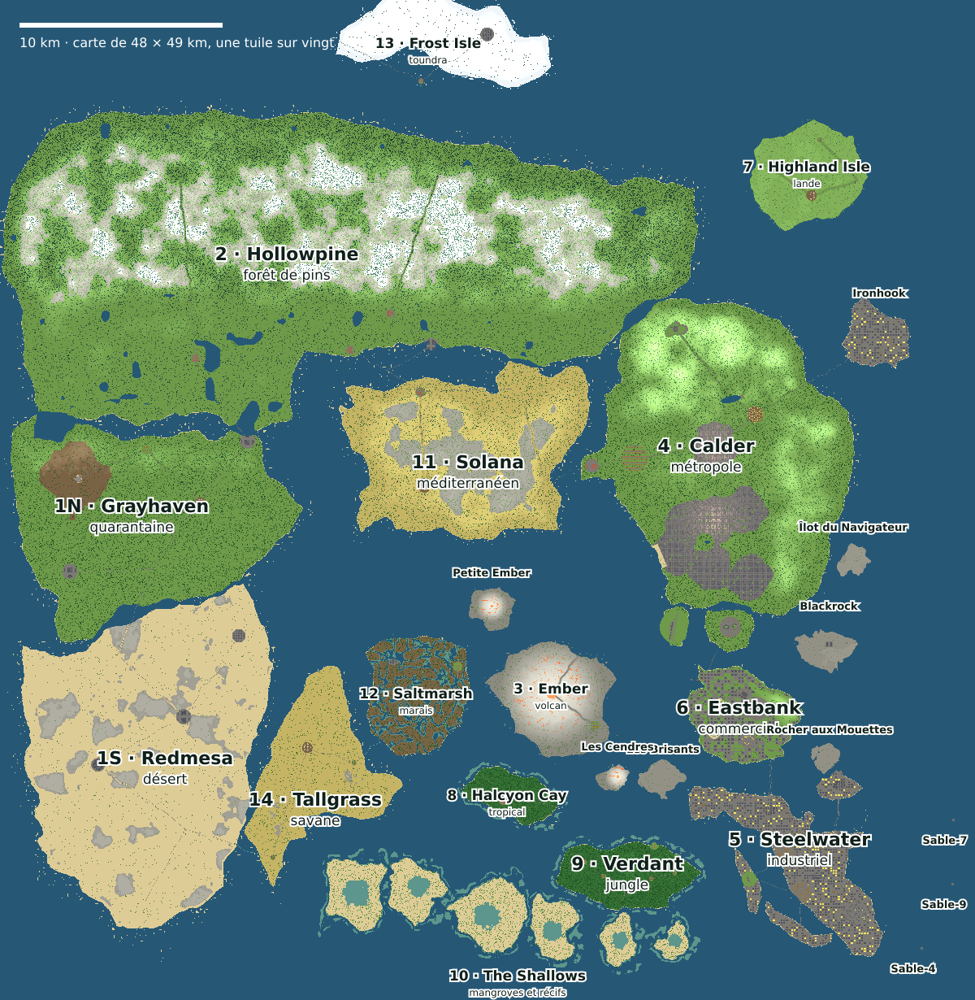
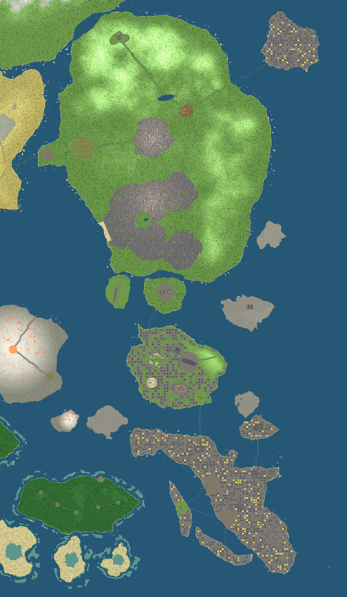

# The Isles — L'archipel, île par île : zones et sous-zones

28 novembre 2026 · @darknigthmare

Cette fiche fixe la **forme de l'archipel** et le **contenu attendu de chaque zone et sous-zone**. Elle reprend les notes d'origine du propriétaire et les réunit avec ce que la Bible avait déjà écrit pour le [mode The Isles](MODE_THE_ISLES_20261121.md), sa [métropole et sa zone de quarantaine](ISLES_EXTENSION_METROPOLE_QUARANTAINE_20261122.md) et son [level design](ISLES_MONDE_LEVEL_DESIGN_20261122.md).

**Sources du propriétaire**

| Document | Date | Ce qu'il donne |
| --- | --- | --- |
| « The Isle » (croquis et listes) | 21 juin 2022 | cinq îles, la liste des zones et de leurs sous-zones, les modes de jeu, les événements de la grande ville, les types d'ennemis, les lieux inspirés d'un tournage en ville |
| « Plan » (vues de travail) | 8 février 2023 | le relief de l'île de la grande ville, avec sa grille de rues, et celui de l'île industrielle |
| « Big City », « Comercial Zone », « Industrial zone » (plans annotés) | 24 octobre 2022 | le contour, les sous-zones, les routes et la liste des lieux de la grande ville, de l'île commerciale et de l'île industrielle, chacun avec une barre d'échelle de 1 km |
| « Plan 2 » (schéma) | 17 mai 2023 | la **multitude d'îles** : quatorze îles numérotées, des îlots, une zone de mer avec trois plateformes, deux îles bonus |

**Règle de lecture.** La colonne « Origine » dit d'où vient chaque sous-zone :
- **notes** : écrit dans les documents ci-dessus ;
- **Bible** : déjà écrit dans les documents du mode ;
- **proposé** : ajouté ici pour compléter, à valider.

Les noms d'îles absents des notes sont *(proposés)*. Les notes citaient des packs de décors d'un autre moteur : ils servent seulement de référence d'ambiance, puisque le mode est produit en three.js avec ses propres modèles.

---

## 1. La forme de l'archipel

**Décision :** l'archipel suit le **Plan 2**. Ce n'est plus une grille de dix grandes îles reliées par des ponts, mais une multitude d'îles de tailles très différentes. Depuis le 28 novembre, la carte est à **taille réelle** : 48 km d'ouest en est et 49 km du nord au sud, jouable d'un seul tenant dans le mode « L'archipel entier » (section 1.4).

*Vue rapprochée (une tuile sur dix, 20 m par point) : Calder et ses deux Jumelles en haut, Eastbank au milieu, Steelwater et ses îles-barrières en bas ; Ironhook au nord-est, Blackrock à l'est d'Eastbank.*

Les deux plans ci-dessus ne sont pas des dessins : `scripts/build-isles-archipelago-map-v1.mjs` interroge le vrai générateur (`app/game/isles/islesArchipelagoGenV1.ts`) une tuile sur vingt et colorie ce qu'il répond. Les données sont dans `app/game/data/islesArchipelagoV1.json` : contours relevés sur le Plan 2, climat de chaque île, ancre et type de chaque zone, liaisons. Le générateur déforme ces contours pour en faire des côtes naturelles (section 1.4) ; aucune île n'est un carré ni un rond.

**Placement par climat.** Le Plan 2 donnait les voisinages ; la latitude de chaque île suit maintenant la logique d'un archipel terrestre de l'hémisphère nord, froid en haut, tropical en bas.

| Bande | Îles | Modèle terrestre |
| --- | --- | --- |
| extrême nord, polaire | Frost Isle | une île arctique basse, glacier et toundra, du côté du courant froid |
| nord, tempéré froid et océanique | Hollowpine, Highland Isle | forêt de conifères et montagne de la côte pacifique nord ; lande et falaises des îles atlantiques |
| milieu, tempéré et méditerranéen | Grayhaven, Calder, Solana | ville de baie sur un estuaire abrité ; île sèche à maquis sous le vent des reliefs |
| ouest, aride | Redmesa | désert côtier de façade ouest, là où un courant froid assèche la côte |
| sud-ouest, tropical sec | Tallgrass | savane entre le désert et la zone humide |
| sud, subtropical et tropical humide | Saltmarsh, Eastbank, Steelwater, Ember, Halcyon Cay, Verdant | marais de delta, arc volcanique, jungle au vent |
| extrême sud, récifs | The Shallows | chapelet de cayes, mangroves côté abrité, récif frangeant et lagons |

Ember, Petite Ember et Les Cendres sont alignées : c'est un **arc volcanique**, comme en produit une zone de subduction. Les îlots et écueils se serrent près des grandes côtes, là où le socle est peu profond ; la pleine mer est à l'est, où sont les plateformes.

| N° du Plan 2 | Note d'origine | Île | Biome | Place sur la carte |
| --- | --- | --- | --- | --- |
| 1 (nord) | partie haute, forêt brûlée / aftermath | **Grayhaven** | zone de quarantaine | ouest |
| 1 (sud) | désert | **Redmesa** | désert et canyons | sud-ouest |
| 2 | forêt de pin, neighborhood | **Hollowpine** | forêt de pins et montagne, avec Maple Hollow | nord et nord-ouest |
| 3 | volcan, port | **Ember** | volcan | centre-sud |
| 4 | big city | **Calder** | métropole | est |
| 5 | zone industrielle | **Steelwater** *(proposé)* | industrie et port | sud-est |
| 6 | zone commerciale | **Eastbank** | commerces et loisirs | est, sous Calder |
| 7 | Highland Isle | **Highland Isle** | lande et falaises | nord-est |
| 8 | tropical island | **Halcyon Cay** | île tropicale privée | sud |
| 9 | tropical island | **Verdant** | jungle | sud |
| 10 | chain of islands | **The Shallows** | chapelet de mangroves et de récifs | extrême sud |
| 11 | Mediterranean | **Solana** *(proposé)* | île méditerranéenne | centre |
| 12 | swamp | **Saltmarsh** | marais | centre-sud-ouest |
| 13 | Northern island 2 | **Frost Isle** | toundra et glacier | extrême nord |
| 14 | savanna | **Tallgrass** | savane | sud-ouest, contre Redmesa |
| îlots | petits contours autour des îles 4, 5 et 6 | Ironhook, Blackrock, îlot du Navigateur, les Brisants, Rocher aux Mouettes, Les Cendres, Petite Ember | — | est et arc d'Ember |
| zone de mer | oil rigs, tentacle branch, variant | plateformes Sable-7, Sable-9 et Sable-4 | pleine mer | à l'est de Steelwater |
| bonus | Nihon, Méditerranée | **Nihon** (hors carte) ; la Méditerranée est devenue l'île 11 | — | plus tard |

### 1.1 Ce que ce plan change par rapport aux fiches du 21 et du 22 novembre

| Sujet | Avant | Maintenant | Statut |
| --- | --- | --- | --- |
| Forme | dix îles en grille | quatorze îles, un chapelet, six îlots, trois plateformes | décision (Plan 2) |
| Grayhaven | îlot à l'est, sous Eastbank | grande île de l'ouest, collée à Redmesa par le mur | proposé, d'après « forêt brûlée / aftermath » de l'île 1 |
| Maple Hollow et Harvest Flats | sur Eastbank et sur Tallgrass | sur Hollowpine, au sud de la forêt de pins | proposé, d'après la « Neighborhood zone » de l'île 2 |
| Zone industrielle et port de conteneurs | sur Eastbank | sur leur propre île, Steelwater | décision (île 5) |
| Aéroports | un aéroport international sur Eastbank | trois : l'aéroport de Calder sur la Jumelle ouest, l'aéroport de fret de Steelwater, le petit aéroport d'Eastbank | décision (plans du 24 octobre 2022) |
| Les Jumelles | deux îlots à part | deux terres de Calder : l'aéroport à l'ouest, le complexe sportif à l'est | décision (plan « Big City ») |
| Blackrock | rocher à l'est de Calder | île « ? » du plan de la zone commerciale, au nord-est d'Eastbank ; l'îlot du Navigateur prend sa place à l'est de Calder | proposé |
| Frost Isle | grande île du nord | île longue et basse de l'extrême nord, 12,8 km | décision (île 13) ; déplacée au nord le 28 novembre pour la cohérence du climat, à confirmer |
| Ironhook | île moyenne | îlot fortifié au nord-est de Calder | proposé |
| Halcyon Cay | îlot | île tropicale n° 8 | proposé |
| Highland Isle, Solana | absentes | nouvelles îles 7 et 11 ; Highland Isle au nord-est, sous le vent froid | décision pour les îles, noms, contenus et place de Highland Isle proposés |
| Les Cendres, Petite Ember | absentes | deux îlots volcaniques dans l'alignement d'Ember | proposé |

### 1.2 Tailles

La carte fait **48 km d'ouest en est et 49,2 km du nord au sud**, soit 24 000 × 24 600 tuiles de 2 m. Le relevé du Plan 2 (12 × 12,3 km) est multiplié par 4 (`scale` dans les données) : c'est l'échelle à laquelle Calder a la taille d'une vraie ville de baie et Hollowpine celle d'une vraie île de montagne.

| Île | Largeur × hauteur | Remarque |
| --- | --- | --- |
| Hollowpine | 32,6 × 15,5 km | la plus grande ; montagne et pins au nord, Maple Hollow et les champs au sud |
| Calder | 12,4 × 15,2 km | grille de rues au centre, tours jusqu'à 130 m, collines au nord |
| Solana | 15,5 × 7,8 km | |
| Grayhaven | 13,3 × 9,5 km | |
| Redmesa | 12,7 × 17,1 km | |
| Frost Isle | 12,8 × 4,2 km | |
| Steelwater | 9,5 × 9,3 km | étirée du nord-ouest au sud-est |
| Tallgrass | 7,0 × 11,6 km | |
| Verdant | 6,9 × 3,2 km | l'île de l'[étape 4](ISLES_VERDANT_CHASSE_LIBRE_20261128.md) reste sa carte à part de 2 km, voir section 1.4 |
| Ember | 6,4 × 5,7 km | cône et cratère de lave |
| Highland Isle, Eastbank | 6 × 4 à 5 km | |
| Saltmarsh, Halcyon Cay | 4,7 à 4,8 km | |
| îlots | 0,7 à 1,8 km | |

À pied (4,4 m/s en marche, 8,6 m/s en course), traverser la carte prend plus d'une heure et demie de course : le voyage par la carte (touche M) et, plus tard, le vaisseau sont nécessaires.

### 1.3 Liaisons

| De | Vers | Moyen |
| --- | --- | --- |
| Hollowpine | Grayhaven | pont gardé (poste militaire) |
| Hollowpine | Solana | pont routier |
| Grayhaven | Redmesa | poste du mur |
| Redmesa | Tallgrass | gué à marée basse |
| Tallgrass | Saltmarsh | gué |
| Solana | Calder | pont suspendu |
| Saltmarsh | Ember | ferry |
| Calder | Eastbank, par la Jumelle est | pont et métro |
| Eastbank | Steelwater | deux ponts : route et voie ferrée à l'ouest, second pont à l'est (plan « Comercial Zone ») |
| Calder | Ironhook | digue fermée |
| Hollowpine | Frost Isle | ferry du nord |
| Calder | Highland Isle | ferry |
| Highland Isle | Frost Isle | ferry |
| Halcyon Cay | Verdant | bateau privé |
| Verdant | The Shallows | gué à marée basse |
| Steelwater | plateformes | navettes et hélicoptères |

Le vaisseau personnel garde sa règle : voyage rapide entre repaires découverts, jamais à Calder ni à Ironhook.

### 1.4 Le monde en taille réelle : génération et chargement

**Ce qui est fait (code).** Le mode « L'archipel entier » de l'écran The Isles ouvre toute la carte d'un seul tenant.

| Sujet | Règle |
| --- | --- |
| Stockage | aucun : 590 millions de tuiles ne tiennent pas en mémoire. Chaque tuile est **calculée à la demande** à partir des données et d'une graine ; le même point donne toujours la même tuile |
| Chargement | par zones de 32 × 32 tuiles (64 m) autour du Predator, rayon de 3 zones, 4 zones construites par image ; les zones lointaines sont libérées. Le cache du générateur est borné à 900 zones |
| Côtes | contour du Plan 2 déformé par un bruit à grande échelle (caps et baies), puis par un bruit fin (criques) ; écueils au large des pointes, récif frangeant et lagons au sud, détroits gardés entre deux îles voisines |
| Relief | montagne et lac sur Hollowpine, glacier sur Frost Isle, falaises sur Highland Isle, mesas et canyons sur Redmesa, cône de 60 m et cratère de lave sur Ember, chenaux sur Saltmarsh |
| Végétation | pins au nord, feuillus au centre, maquis sur Solana, palmiers et jungle au sud, palétuviers dans The Shallows, arbres brûlés sur Grayhaven |
| Zones bâties | chaque zone a une ancre et un type (camp, village, ville, industrie, ruines, métropole) : rues, murs, toits, tours. Calder a une grille d'avenues, un parc central et des tours de 20 à 130 m |
| Îles en plusieurs terres | une île peut avoir plusieurs terres (`parts`) : Calder et ses deux Jumelles, Steelwater, son île du nord-est et ses deux îles-barrières. Une île relevée sur un plan détaillé (`fidelity`) garde un rivage proche du plan |
| Lieux nommés | `app/game/isles/islesArchipelagoFeaturesV1.ts` : vingt lieux construits tuile par tuile (aéroport, aérodrome, stades, circuit et Big Ball, lac et barrage, parc, quartier résidentiel, marina, jetée, port à conteneurs, raffinerie, zoo, parc d'attractions, parc aquatique, parking aérien, centre commercial, phare, prison, plage, chantier), orientables par un angle |
| Routes et ponts | toutes les zones d'une île sont reliées par le plus court réseau, plus les routes ajoutées d'après les plans ; chaque pont, digue ou poste des liaisons (section 1.3) devient un tablier de 14 m juste au-dessus de l'eau, chaque gué une bande d'eau peu profonde. Les routes sont planes : le relief est entaillé puis remonte sur 80 m de chaque côté. On va à pied de Calder à Steelwater |
| Carte | touche M : l'archipel entier, le nom des îles, la position ; un clic sur une terre y transporte le Predator (outil de repérage de cette étape, il deviendra le voyage par vaisseau) |
| Affichage | île, biome, zone, position en kilomètres |

**Ce qui n'est pas encore fait.**

- La chasse libre (gibier, primes, honneur, missions) tourne toujours sur la carte à part de Verdant (2 km). Dans l'archipel entier on se déplace, on grimpe, on nage et on se camoufle, mais le monde n'est pas encore peuplé.
- Hors de Calder, d'Eastbank, de Steelwater et de Blackrock, les zones sont des gabarits génériques par type : leurs lieux nommés (lycée, mine, station polaire…) ne sont pas encore construits un par un.
- Le relief est comprimé : le plus haut sommet, sur Calder, fait une centaine de mètres, contre 130 m pour ses tours.
- Les routes sont tracées automatiquement (voir ci-dessous) : sur les trois îles détaillées elles relient les mêmes zones que vos plans, sans en suivre le tracé exact. Ferries, bateaux, navettes, métro et lignes d'avion ne sont pas encore jouables.
- Pas de niveau de détail lointain : on voit 3 zones (192 m) autour de soi. Les performances n'ont été mesurées que sur le rendu logiciel de la recette, pas sur une vraie carte graphique.

---

## 2. Ce que chaque zone doit contenir

Chaque sous-zone est décrite par cinq choses :
- **Contenu** : les lieux, les bâtiments et les intérieurs visitables ;
- **Qui y est** : humains armés (proies dignes), non-combattants (interdits), faune ;
- **Hauteurs et dessous** : ce que le Yautja peut escalader et ce qui passe sous terre ;
- **Jeu** : ce qu'on y fait, événements et activités ;
- **Origine**.

Chaque île a aussi un **repaire**, un **repère visible de loin**, une **proie apex** ou une faction dominante, et au moins un **point de vue**.

---

## 3. Île 1 nord — Grayhaven, la zone de quarantaine

**Note d'origine :** « Incident Site (Self Destruct of an yautja aftermath zone) ». L'explosion de l'autodestruction de Vash'Tar, en 2003, a brûlé l'île. L'histoire complète est dans [l'extension](ISLES_EXTENSION_METROPOLE_QUARANTAINE_20261122.md), section 10.

- **Repère :** le cratère vitrifié, visible depuis les Hauts.
- **Faction :** garnison du mur, charognards, équipes ARGOS.
- **Apex :** meute de chiens errants ; ours revenu dans la forêt brûlée.
- **Repaire :** la cave d'une station-service de la banlieue figée.
- **Accès :** après l'arc Hale (réputation 9).

### 1N.1 Les Hauts

| Sous-zone | Contenu | Qui y est | Hauteurs et dessous | Jeu | Origine |
| --- | --- | --- | --- | --- | --- |
| Plateau | lande rase, route de crête, pylônes électriques tombés, ferme d'altitude abandonnée | faune revenue (cerfs, renards) | pylônes | meilleure vue sur le cratère ; arrivée discrète par le nord | notes (« partie haute ») |
| Relais radio | antenne, local technique, groupe électrogène | deux soldats de garde | antenne (point de vue) | couper le relais retarde les renforts du mur | proposé |
| Belvédère | parking, table d'orientation de 2003, longue-vue | personne | — | révèle la carte de l'île | proposé |

### 1N.2 Le mur

| Sous-zone | Contenu | Qui y est | Hauteurs et dessous | Jeu | Origine |
| --- | --- | --- | --- | --- | --- |
| Mur et miradors | béton, barbelés, projecteurs, panneaux de danger | garnison | chemin de ronde | être vu fait monter l'alerte à 3 | Bible |
| Postes de contrôle | barrières, guérites, sas de décontamination | garnison, médecins militaires | toits plats | deux postes : pont de Hollowpine et poste de Redmesa | Bible |
| La brèche | pan de mur effondré, caché par des tôles | charognards | conduite d'eau sous le mur | seule entrée sans alerte | Bible |

### 1N.3 Site de l'incident

| Sous-zone | Contenu | Qui y est | Hauteurs et dessous | Jeu | Origine |
| --- | --- | --- | --- | --- | --- |
| Cratère (Point zéro) | cuvette au sol vitrifié, silence, restes de Vash'Tar au fond | personne | aucune couverture | contamination forte (jauge) ; fin de l'arc de Grayhaven | notes, Bible |
| Forêt brûlée | troncs noirs debout, sol de cendres, repousses vertes | ours, cerfs | troncs fragiles | branches qui tombent ; thermique brouillé par les cendres chaudes | notes, Bible |
| Forêt de cendres | anneau extérieur, arbres couchés en étoile autour du cratère, poussière grise | chiens errants | troncs couchés | traces très lisibles : tout le monde y laisse des pas | notes |
| Base de recherche | camp ARGOS dans un parking souterrain, tentes, capteurs | ARGOS, synthétiques | parking sur trois niveaux | infiltration ; relevés à voler | Bible |

### 1N.4 Ashgrove, ville abandonnée

Note d'origine : « Abandonned City (Tchernobyl like) ».

| Sous-zone | Contenu | Qui y est | Hauteurs et dessous | Jeu | Origine |
| --- | --- | --- | --- | --- | --- |
| Centre abandonné | immeubles éventrés, voitures brûlées, bus renversés, enseignes de 2003 | charognards | façades, toits troués | effondrements ; planchers qui cèdent | notes, Bible |
| Intérieurs d'immeubles | appartements restés en l'état, cages d'escalier, bureaux | charognards (pillage) | étages, gaines d'ascenseur | fouille ; embuscades d'étage en étage | notes |
| Parc abandonné | fête foraine rouillée, grande roue figée, autos tamponneuses | chiens errants | grande roue | repère de la ville ; épreuve d'escalade | notes |
| Abattoir | chaînes, crochets, chambres froides éteintes | chef des charognards | rails au plafond | combat dans le noir ; trophées humains déjà suspendus par les charognards | notes |
| Atelier abandonné | établis, fosse, pièces détachées | charognards (armurerie) | fosse, mezzanine | source de composants | notes |
| Motel abandonné | chambres en enfilade, piscine vide, néon cassé | charognards (dortoir) | toit plat | approche chambre par chambre | notes |
| Hôpital d'Ashgrove | centre d'évacuation de 2003, lits, tentes militaires | base des charognards | toit, sous-sol, morgue | archives de l'évacuation (codex) | Bible |
| Métro noyé | ligne inondée, rames à moitié sous l'eau | charognards (planque) | tunnels | nage ; l'eau révèle le camouflage | Bible |

### 1N.5 Banlieue figée

| Sous-zone | Contenu | Qui y est | Hauteurs et dessous | Jeu | Origine |
| --- | --- | --- | --- | --- | --- |
| Quartier résidentiel | maisons envahies par la végétation, voitures dans les allées, jouets dans les jardins | chiens errants, charognards isolés | toits de maisons | chasse silencieuse de jardin en jardin | notes (« abandonned neighboorhood »), Bible |
| École et terrain de sport | classes, gymnase effondré | personne | charpente | fragments de l'histoire de 2003 | proposé |
| Station-service | pompes, boutique, cave | personne | cave | **repaire** de l'île | proposé |

### 1N.6 Port d'Ashgrove

| Sous-zone | Contenu | Qui y est | Hauteurs et dessous | Jeu | Origine |
| --- | --- | --- | --- | --- | --- |
| Quais | navires échoués, grues tordues, conteneurs éventrés | charognards | grues | arrivée par la mer, de nuit | Bible |
| Chalutier des pillards | bateau en état de marche, caisses | charognards armés | cale | le couler coupe leur ravitaillement | proposé |

---

## 4. Île 1 sud — Redmesa, le désert

**Note d'origine :** « Desert Zone ».

- **Repère :** la mesa du Chef et son antenne.
- **Faction :** bikers, milice de la mine, shérif de Dustwater.
- **Apex :** puma.
- **Repaire :** une grotte cachée dans un canyon.
- **Particularité :** la chaleur brouille le thermique le jour ; tempêtes de sable.

### 1S.1 Désert ouvert et canyons

| Sous-zone | Contenu | Qui y est | Hauteurs et dessous | Jeu | Origine |
| --- | --- | --- | --- | --- | --- |
| Dunes et plaine | sable, buissons secs, carcasses de voitures | coyotes, crotales | rochers isolés | aucun couvert : chasse de nuit | notes (« desert ») |
| Canyons | gorges étroites, arches, sources | puma, chevaux sauvages | parois à escalader | épreuve du canyon ; embuscades d'en haut | Bible |
| Mesa du Chef | plateau, antenne, cabane du gardien | un gardien armé | antenne (point de vue) | révèle la carte | Bible |
| Cimetière d'avions | carlingues alignées, pièces | ferrailleurs | ailes, dérives | cache de prime | Bible |

### 1S.2 La Route 9

| Sous-zone | Contenu | Qui y est | Hauteurs et dessous | Jeu | Origine |
| --- | --- | --- | --- | --- | --- |
| Station-service | pompes, boutique, garage, citerne | pompiste (civil), routiers | auvent, toit | l'explosion de la citerne alerte toute la route | notes (« fuel ») |
| Motel au néon | douze chambres, bureau, piscine | clients (civils), un trafiquant | toit, enseigne | cible isolée dans une chambre | notes |
| Strip-club | salle, scène, loges, bureau du patron, parking | videurs armés, clients (civils) | toit, réserve en sous-sol | rendez-vous de la prime « Lourd » | notes |
| Repaire de bikers | bar, atelier de motos, cour fermée | bikers armés | toits de tôle, fosse | gros combat ; motos qui poursuivent | notes (« biker den ») |
| Parc de caravanes | caravanes, auvents, chiens attachés | civils, deux dealers | toits de caravanes | les chiens aboient : alerte de voisinage | notes (« trailerpark ») |
| Relais routier et drive-in | parking de camions, diner, écran géant | routiers (civils) | écran du drive-in | camions en marche comme transport | Bible |

### 1S.3 Dustwater

Note d'origine : « Old farwest town ».

| Sous-zone | Contenu | Qui y est | Hauteurs et dessous | Jeu | Origine |
| --- | --- | --- | --- | --- | --- |
| Rue principale | saloon, banque, épicerie, église en bois | civils, adjoints | toits plats reliés, balcons | deuxième terrain urbain, bas et horizontal | notes, Bible |
| Bureau du shérif | bureau, deux cellules, râtelier d'armes | shérif et adjoints | toit | libérer ou non un prisonnier | Bible |
| Gare de minerai | quai, wagons, château d'eau | mineurs (civils), milice | wagons, château d'eau | train de minerai (Chasse inversée) | Bible |
| Cité ouvrière | baraquements, cantine | mineurs (civils) | — | zone presque entièrement civile | Bible |
| Ville fantôme | ancienne Dustwater, façades vides, mine d'argent fermée | trafiquants | charpentes | cache d'armes | Bible |

### 1S.4 Mine et Speedway

| Sous-zone | Contenu | Qui y est | Hauteurs et dessous | Jeu | Origine |
| --- | --- | --- | --- | --- | --- |
| Mine à ciel ouvert | gradins, camions géants, concasseur, convoyeurs | milice privée, mineurs (civils) | convoyeurs, grues | camions de mine en marche | Bible |
| Camp de travail | préfabriqués, clôture | milice | toits | sabotage possible | Bible |
| Redmesa Speedway | piste ovale, stands, tribunes | pilotes et public (civils) les jours de course | tribunes, tour de chronométrage | interdit au combat pendant une course ; vide la nuit | Bible |
| Ferme solaire | champs de panneaux, poste électrique | deux gardes | — | couper le courant de Dustwater | Bible |

### 1S.5 Zone militaire cachée

| Sous-zone | Contenu | Qui y est | Hauteurs et dessous | Jeu | Origine |
| --- | --- | --- | --- | --- | --- |
| Périmètre | clôture, capteurs, panneaux « terrain privé », piste en terre | patrouilles en 4×4 | tour de guet | entrer fait monter l'alerte à 2 | notes (« hidden military zone ») |
| Hangars camouflés | filets, hélicoptère, véhicules | militaires | toits de hangars | détruire l'hélicoptère retarde l'alerte | proposé |
| Antenne d'écoute | dôme, local de transmission | techniciens (civils), gardes | dôme | écoute des radios de l'archipel | proposé |

### 1S.6 Sous-sols du désert

| Sous-zone | Contenu | Qui y est | Hauteurs et dessous | Jeu | Origine |
| --- | --- | --- | --- | --- | --- |
| Vieux bunker souterrain | abri de la guerre froide, couchettes, salle des cartes | personne ; un ermite armé | puits d'accès | fragment de l'autel ; cache | notes (« underground old bunker ») |
| Installation souterraine | laboratoire relié à la zone militaire, ascenseur, couloirs, salle froide | ARGOS, scientifiques (civils) | gaines techniques | pièces de technologie yautja récupérées en 2003 | notes (« underground facility ») |
| Grotte cachée | entrée derrière un éboulis, source, peintures anciennes | puma | cheminée naturelle | **repaire** de l'île | notes (« hidden cave ») |

---

## 5. Île 2 — Hollowpine et Maple Hollow

**Notes d'origine :** « Forêt de pin », « Neighborhood zone ». C'est la plus grande île : la forêt et la montagne au nord, les quartiers habités et les fermes au sud.

- **Repère :** le barrage du lac.
- **Faction :** gardes forestiers et bûcherons au nord ; police du comté au sud.
- **Apex :** ours brun.
- **Repaire :** une galerie de la vieille mine.
- **Particularité :** brouillard, dénivelé ; Maple Hollow est presque entièrement civil.

### 2.1 Forêt de pins

| Sous-zone | Contenu | Qui y est | Hauteurs et dessous | Jeu | Origine |
| --- | --- | --- | --- | --- | --- |
| Parc national | entrée avec guérite, sentiers balisés, lac glaciaire, poste des rangers, tour de guet anti-incendie, aire de camping | gardes forestiers armés, campeurs (civils) | tour de guet, grands pins | chasse à l'ours et à l'élan ; les campeurs sont des témoins | notes (« national park ») |
| Motel de la forêt | motel isolé au bord de la route, brume, néon | gérant (civil), chasseurs de passage | toit, grenier | ambiance pesante ; prime qui s'y cache | notes (« atmospherical hotel ») |
| Carrière | fronts de taille, pelleteuses, bassin d'eau verte | ouvriers (civils) le jour, trafiquants la nuit | gradins de roche | échanges nocturnes à surprendre | notes (« quarry ») |
| Vieille mine | entrée étayée, galeries, wagonnets, puits | chauves-souris, un ours en hiver | galeries sur deux niveaux | **repaire** ; fragment de l'autel | notes (« old mine ») |
| Entrée cachée des égouts | grille sous un pont de la forêt, collecteur | contrebandiers | collecteur jusqu'à Maple Hollow | passage sans témoin entre la forêt et la petite ville | notes (« hidden entrence sewer ») |
| Scierie et camp de bûcherons | hangar, grumes, scies, baraquements | bûcherons et leurs gardes | piles de grumes, grue | bruit des scies qui couvre les pas | Bible |

### 2.2 Montagne et lac

| Sous-zone | Contenu | Qui y est | Hauteurs et dessous | Jeu | Origine |
| --- | --- | --- | --- | --- | --- |
| Lac et barrage | barrage voûte, salle des turbines, relais du cordon | gardes, techniciens (civils) | crête du barrage, galeries | sabotage du relais (ouverture d'îles) | Bible |
| Pinecrest | village de chalets, auberge, église | civils, bûcherons | toits pentus | village civil | Bible |
| Station de ski | remontées, pistes, tremplin, chalets | skieurs (civils) en hiver | pylônes, cabines | téléphérique (Chasse inversée) | Bible |
| Cabanes de trappeurs et camp de vacances | cabanes, dortoirs, ponton | trappeurs armés ; enfants en été (interdits) | — | le camp d'été est une zone interdite au combat | Bible |

### 2.3 Maple Hollow, zone résidentielle

| Sous-zone | Contenu | Qui y est | Hauteurs et dessous | Jeu | Origine |
| --- | --- | --- | --- | --- | --- |
| Quartier pavillonnaire | rues en arc, impasses, maisons à porche, pelouses, clôtures blanches, piscines | familles (civils), chiens de jardin | toits de maisons, arbres | terrain de test du code ; les chiens aboient la nuit | notes (« neighborhood »), Bible |
| Maisons visitables | salon, cuisine, chambres, grenier, cave | habitants ; parfois un voisin armé chez lui | grenier, cave | cambriolage armé (événement) | notes (« house ») |
| Garages | garage double, établi, voiture, porte basculante | un receleur dans l'un d'eux | — | planque d'une prime | notes (« garage interior ») |

### 2.4 Petite ville de Maple Hollow

| Sous-zone | Contenu | Qui y est | Hauteurs et dessous | Jeu | Origine |
| --- | --- | --- | --- | --- | --- |
| Centre-ville | Main Street : diner ouvert jour et nuit, station-service, quincaillerie, banque, cinéma ancien, caserne de pompiers, bibliothèque | civils, police du comté | toits de deux étages, enseignes | petite ville tranquille ; peu de proies | notes (« little city »), Bible |
| Commissariat et cellules | accueil, bureaux, armurerie ; **cellules de garde à vue au sous-sol** | policiers, détenus désarmés (interdits) | sous-sol | un détenu armé par un complice devient une proie | notes (« holding cells ») |
| Prison du comté | bâtiment bas, cour grillagée, parloir | gardiens armés, détenus (interdits) | toit, miradors bas | évasion (événement) | notes |
| Prison fédérale | hors de la ville : double enceinte, miradors, blocs, atelier, quartier d'isolement | gardiens armés, détenus (interdits, sauf mutins armés) | miradors, toits des blocs | mutinerie ; cible retenue à l'isolement | notes |

### 2.5 Zone du lycée

| Sous-zone | Contenu | Qui y est | Hauteurs et dessous | Jeu | Origine |
| --- | --- | --- | --- | --- | --- |
| Lycée | couloirs à casiers, salles de classe, cantine, bureau du proviseur | élèves et professeurs le jour (interdits) | toit, faux plafonds | **zone interdite au combat** de jour | notes |
| Salles de classe | tables, tableau, laboratoire de sciences | — | — | de nuit : gardien seul, lieu de rendez-vous | notes |
| Piscine | bassin couvert, vestiaires, local technique | — | charpente | l'eau révèle le camouflage | notes |
| Gymnase de basket | parquet, gradins rétractables, tableau d'affichage | public le soir de match (interdit) | passerelles techniques | match du vendredi : foule | notes (« stadium basket ») |
| Stade du lycée | terrain de football américain, gradins de 3 000 places | public le vendredi soir (interdit) | mâts d'éclairage | vide en semaine : épreuve de toit de tribune | Bible |

### 2.6 Parc de Maple Hollow

| Sous-zone | Contenu | Qui y est | Hauteurs et dessous | Jeu | Origine |
| --- | --- | --- | --- | --- | --- |
| Parc | étang, kiosque, aire de jeux, terrain de baseball de quartier, sentier | promeneurs (civils) ; dealers la nuit | arbres | seul lieu de Maple Hollow où une proie armée vient de nuit | notes (« park zone ») |

### 2.7 Harvest Flats, zone agricole

| Sous-zone | Contenu | Qui y est | Hauteurs et dessous | Jeu | Origine |
| --- | --- | --- | --- | --- | --- |
| Ferme | maison, grange rouge, silo, tracteurs, poulailler | fermiers (civils, armés pour la battue) | grange, silo | les fermiers ne sont des proies que s'ils menacent | notes (« farm ») |
| Ranch de chevaux | écuries, manège, paddocks | palefreniers (civils), chevaux | charpente des écuries | les chevaux s'affolent et trahissent le joueur | notes (« horse ranch ») |
| Champs | maïs (labyrinthe à l'automne), blé, vergers, éoliennes de pompage | — | éoliennes | couvert parfait mais bruyant | notes (« crop field ») |
| Bourg agricole | coopérative, silo géant, champ de foire, arène de rodéo | civils, forains | silo | foire et rodéo : foule | Bible |

---

## 6. Île 3 — Ember, le volcan

**Notes d'origine :** « Volcan », « port », et dans le groupe « Volcano/HighGrassLand » : « Old Port », « Volcano zone ».

- **Repère :** le volcan, visible de toutes les îles.
- **Faction :** scientifiques et leurs gardes, pilleurs d'obsidienne.
- **Apex :** aucun ; dangers naturels.
- **Repaire :** un tunnel de lave fermé au public.

### 3.1 Le volcan

| Sous-zone | Contenu | Qui y est | Hauteurs et dessous | Jeu | Origine |
| --- | --- | --- | --- | --- | --- |
| Cratère | lac de lave, fumerolles, radar du cordon | gardes du radar | lèvre du cratère (point de vue) | sabotage du radar (I-MP-06) | notes, Bible |
| Coulées | champs de lave figée, cheminées chaudes | pilleurs d'obsidienne | — | le sol chaud brouille le thermique | Bible |
| Grottes et tunnels de lave | tunnels aménagés pour touristes, tunnels sauvages | guides et touristes (civils), chauves-souris | réseau souterrain | **repaire** ; passage sous l'île | Bible |
| Observatoire sismique | coupole, salle des instruments | volcanologues (civils), gardes | coupole | prévoir l'éruption de la session | Bible |

### 3.2 Sulfur Springs et la géothermie

| Sous-zone | Contenu | Qui y est | Hauteurs et dessous | Jeu | Origine |
| --- | --- | --- | --- | --- | --- |
| Station thermale | bassins, hôtel, spa | curistes (civils) | toits | zone civile | Bible |
| Centrale géothermique | tours de vapeur, turbines, conduites | ingénieurs (civils), gardes | conduites, tours | la vapeur cache le camouflage et le révèle à la sortie | Bible |

### 3.3 Le Vieux Port

| Sous-zone | Contenu | Qui y est | Hauteurs et dessous | Jeu | Origine |
| --- | --- | --- | --- | --- | --- |
| Port | quais de pierre, entrepôts, grues anciennes, bateaux de pêche | pêcheurs (civils), contrebandiers | grues, toits | arrivée des ferries de Saltmarsh et de Frost Isle | notes (« port ») |
| Port scandinave | maisons de bois peintes sur pilotis, séchoirs à poisson, ponton | pêcheurs (civils) | toits pentus, pilotis | sous les pontons : passage sans témoin | notes |
| Prison du port | ancienne prison de pierre face à la mer, cour, coursives | gardiens armés, détenus (interdits) | remparts, tour | cible retenue ; l'évasion lâche des prisonniers dans le port | notes (« prison ») |
| Intérieur de la prison | cellules, réfectoire, parloir, mitard | — | galeries d'étage | combat en coursives | notes (« prison interior ») |

---

## 7. Île 4 — Calder, la grande ville

**Note d'origine :** plan « Big City » du 24 octobre 2022. L'île fait environ 12 × 15 km. Une montagne et son lac de retenue occupent le nord, une ligne de collines borde l'est ; la ville elle-même tient en deux ensembles, le centre d'affaires au milieu de l'île et la grille de rues au sud. À l'ouest, une presqu'île porte Richou, son quartier riche et sa marina. Au sud, deux îles proches, les Jumelles, portent l'aéroport et le complexe sportif. Les huit quartiers de la grille sont décrits dans [l'extension](ISLES_EXTENSION_METROPOLE_QUARANTAINE_20261122.md), section 3.

- **Repère :** la tour Hale, dans le centre d'affaires.
- **Factions :** police, deux gangs (les Docks et les Hauteurs), cartel, sécurité privée.
- **Apex :** aucun ; humains seulement.
- **Repaire :** aucun vaisseau à Calder ; un toit-refuge à découvrir dans The Heights.

**Du plan au monde généré**

| Repère du plan | Zone | Ce que le générateur construit |
| --- | --- | --- |
| « Big Ball / The Racing Track » | 4.14 | dôme de 39 m au centre d'un circuit fermé à virages, stand le long de la ligne droite, parkings |
| montagne et lac, « Dam is a big city » | 4.9 | relief jusqu'à une centaine de mètres, lac de retenue de 1 km fermé par un barrage de 18 m, cité du barrage en aval |
| « Construction site / old city » | 4.15 | ossatures de poteaux à hauteurs variées, palissades, grue de 45 m, îlots de la vieille ville en ruine |
| « Centre d'affaire » | 4.1 | grille de rues et tours de 12 à 130 m |
| « Richou residential » | 4.11 | villas avec jardin, une sur trois avec piscine |
| « Richou marina » | 4.12 | quais bâtis, pontons parallèles sur l'eau, bateaux à l'amarre |
| grille de rues | 4.2, 4.3, 4.5 à 4.8 | six quartiers en grille, avenues, immeubles, squares |
| parc du centre | 4.4 | pelouses, allées en croix, étang, arbres |
| « Big city beach » | 4.13 | 1,2 km de sable et de palmiers, promenade, rangée d'hôtels de 18 à 45 m |
| « underground » | 4.10 | point d'entrée seulement ; le dessous n'est pas encore généré |
| « Big city airport » | 4.16 | piste de 1,4 km, voie de circulation, tarmac, terminal, hangars, tour de contrôle de 36 m, parking |
| « Parking », « Stade Baseball », « Sportif Complex » | 4.17 | stade de football américain à gradins, stade de baseball et son losange, petit terrain clos, parkings |

| Zone | Sous-zone | Contenu | Qui y est | Jeu | Origine |
| --- | --- | --- | --- | --- | --- |
| 4.1 Downtown, le centre d'affaires | Gratte-ciel | tours de bureaux, halls, étages techniques, tour Hale | sécurité privée, employés (civils) | chasse de toit en toit au grappin | notes (« skyscaper city ») |
| | Banque et chambre forte | hall, guichets, salle des coffres au sous-sol | sécurité ; braqueurs pendant l'événement | événement « braquage en cours » | notes (« bank vault ») |
| | Penthouse | appartement-terrasse au sommet d'une tour, piscine, héliport | chef de cartel et ses gardes | cible de prime ; arrivée par le toit | notes |
| 4.2 Old Harbor | Quais et entrepôts de brique | marché aux poissons, pub, musée maritime | les Docks | caves et tunnels de contrebande | Bible |
| | Complexe de viande | abattoir, chambres froides, quai de chargement | bouchers (civils), gardes | **source de viande** du joueur ; l'OWLF peut y tendre un piège | notes (« meat complex », « slaughterhouse ») |
| 4.3 Midtown | Centre et petit parc | Lumen Square, gare centrale, square arboré | foule (civils), police | presque impossible de jour | notes (« center of the big city with a little park ») |
| | Calder Arena | salle de basket et de hockey au-dessus de la gare | public (civil) | passerelles techniques | Bible |
| 4.4 Commons Park | Grand parc | étang, bois, kiosque (le zoo est sur Eastbank, section 9) | civils, police montée | canopée urbaine | Bible |
| | Cimetière | allées, caveaux, chapelle | fossoyeur (civil) ; cartel la nuit | échange nocturne entre les tombes | notes (« cemetary ») |
| 4.5 Uptown | Immeubles et musées | musée d'histoire, université | sécurité, civils | toits résidentiels ; musée fermé la nuit | Bible |
| | Appartements visitables | salon, cuisine, chambre, escalier de secours | habitants (civils) ; une cible | approche par l'escalier de secours | notes (« apartment interior ») |
| 4.6 The Heights | Immeubles de brique | terrains de basket, épiceries, métro aérien | les Hauteurs | toits continus | Bible |
| | Tour du gang vaudou | immeuble tenu par un gang, autel, étages piégés | gang armé | montée étage par étage | notes (« voodo gang in highrise building ») |
| | Ring de boxe | salle en sous-sol, ring, vestiaires, paris | organisateurs armés, public (civil) | **sauver un jeune Yautja** forcé de combattre | notes (« boxer ring ») |
| 4.7 Little Harbor | Marchés de nuit | restaurants, temples, salons de thé | civils, petit crime | foule dense la nuit ; enseignes à escalader | Bible |
| | Repaire du cartel | immeuble fortifié, laboratoire, toit gardé | cartel | assaut ; otages possibles | notes (« cartel holdout ») |
| | Rue tenue par le cartel | barrages de voitures, guetteurs aux fenêtres | cartel | traversée par les toits | notes |
| 4.8 Riverside | Lofts et boîtes de nuit | autoroute surélevée, entrepôts reconvertis | gangs la nuit | passage sous l'autoroute, sans témoin | Bible |
| | Ruelle sombre | impasse, bennes, sortie de secours | dealers, acheteurs | événement « vente d'armes » | notes (« dark alley », « back alley ») |
| | Motel | motel de passage sous l'autoroute | clients (civils), un indicateur | cible dans une chambre | notes |
| | Chantier | immeuble en construction, grue, échafaudages | ouvriers (civils) le jour ; gang la nuit | combat sur les poutres | notes (« construction site ») |
| 4.9 Les collines du nord, le lac et le barrage | Montagne et lac | montagne boisée, lac de retenue, routes en lacets | gardes forestiers, civils | vue sur toute l'île | notes (plan « Big City ») |
| | Barrage et cité du barrage | mur de 18 m, salle des turbines, galerie de visite ; petite ville en aval (« Dam is a big city ») | techniciens (civils), sécurité privée | couper le courant de Calder ; chute depuis la crête | notes |
| | Aérodrome privé | piste courte, hangars | pilotes, gardes | fuite d'une cible en avion | proposé |
| 4.10 Le dessous de Calder | Métro | stations, rames, tunnels, dépôt | usagers (civils), police | événements « attaque de punks » et « prise d'otages » | notes (« metro », « train ») |
| | Souterrains | égouts, parkings, anciens tunnels de contrebande, tunnels routiers | sans-abri (civils), contrebandiers | réseau complet sous la ville | notes (« underground », « modular tunnels ») |
| 4.11 Richou, quartier résidentiel | Villas | maisons modernes, jardins, piscines, portails, rues en courbe | habitants riches (civils), sécurité privée | cible de prime chez elle ; alarmes et chiens | notes (« Richou residential », « modern house ») |
| 4.12 Marina de Richou | Pontons et capitainerie | pontons, yachts, club nautique, restaurant du port | plaisanciers (civils), gardes d'un yacht | « boat departure in dock » : une cible s'enfuit par bateau | notes (« Richou marina ») |
| 4.13 Calder Beach | Plage et front de mer | longue plage, postes de secours, promenade, hôtels, skatepark | baigneurs (civils), police de plage | foule le jour ; déserte la nuit | notes (« Big city beach », « long seaside », « skatepark ») |
| 4.14 Le Big Ball et le circuit | Big Ball | grande salle en dôme : hockey, basket, concerts | public (civil), sécurité | passerelles sous la voûte | notes (« Big Ball », « hockey stadium », « basketball stadium ») |
| | Circuit | piste, stands, tribune, paddock | pilotes et public (civils) | « racing circuit with course in progress » : traverser la piste pendant une course | notes |
| 4.15 Le chantier et la vieille ville | Chantier | tours en construction, grue, échafaudages, bungalows | ouvriers (civils) le jour ; gang la nuit | combat sur les poutres | notes (« construction site ») |
| | Vieille ville | rues étroites, immeubles murés, cinéma à devanture ancienne, musée historique | squatteurs, gang | embuscades de ruelle | notes (« old city », « cinéma », « historical museum ») |
| 4.16 Aéroport de Calder (Jumelle ouest) | Terminal, pistes et tour | piste, terminal, hangars, tour de contrôle, parking | voyageurs (civils), police | lignes d'avion vers les autres aéroports (section 7.2) ; très surveillé | notes (« Big city airport ») |
| 4.17 Complexe sportif des Jumelles (Jumelle est) | Stades et parkings | stade de football américain (70 000 places), stade de baseball (40 000 places), petit terrain de baseball, courts de tennis, parkings, station de métro | public (civil) les soirs de match | interdits au combat les jours de match ; vides la nuit | notes (« Stade Baseball », « Sportif Complex », « Parking », « tennis court ») |

### 7.1 Événements de la grande ville

| Lieu | Événement | Règle du code |
| --- | --- | --- |
| Banlieue | dealer dans la rue | le dealer armé est une proie ; ses clients non |
| Tour d'habitation | gang vaudou retranché | tous armés |
| Commissariat | poste de police sous tension | policiers armés : proies dignes, forte alerte |
| Banque | braquage en cours | braqueurs : proies ; otages et employés : interdits |
| Ring de boxe | jeune Yautja forcé de combattre | le sauver rapporte de l'honneur ; le public est interdit |
| Complexe de viande | piège de l'OWLF | commando armé |
| Ruelle | vente d'armes entre gangs | tous armés |
| Métro | attaque de punks | punks armés d'armes blanches : proies ; usagers : interdits |
| Métro | prise d'otages | preneurs d'otages : proies ; un otage tué par le joueur est une faute |
| Tour de bureaux | prise d'otages d'employés | idem |
| Rue | poursuite en voiture, tireurs armés | les tireurs sont des proies ; attention aux passants |

### 7.2 Autres lieux de la liste « Big City »

| Lieu des notes | Où | Statut |
| --- | --- | --- |
| Gare routière avec entrée de métro (deux modèles) | centre d'affaires (4.1) et sortie du dessous de Calder (4.10) | à construire |
| Bureaux, bibliothèque moderne | centre d'affaires (4.1) | à construire (intérieurs) |
| Commissariats | un par quartier de la grille | à construire |
| Parkings modulaires, station-service, péage routier | entrées de la grille et tête des ponts | à construire |
| Boîte de nuit dans une usine | Riverside (4.8) | à construire |
| Lignes d'avion : « industrial ⇒ commercial ⇒ neighbor ⇒ old town ⇒ desert » | aéroport de Calder → Steelwater → Eastbank → Maple Hollow → Ashgrove → Redmesa | à construire ; les pistes de Calder, de Steelwater et d'Eastbank existent |
| Départ de bateaux au dock, départ de camions à l'usine | marina de Richou (4.12), Steelwater (5.3) | à construire |

---

## 8. Île 5 — Steelwater, la zone industrielle

**Note d'origine :** plan « Industrial zone » du 24 octobre 2022. L'île fait environ 9 km. Le corps principal descend du nord-ouest au sud-est ; une presqu'île à l'ouest porte le phare, une île au nord-est est reliée par un pont, et deux îles-barrières ferment le port à l'ouest : celle de l'aéroport et une longue langue au sud. Les trois plateformes sont au large, à l'est.

- **Repère :** les portiques du port et la torchère de la raffinerie.
- **Faction :** les Docks (trafics), sécurité privée, douane.
- **Apex :** aucun.
- **Repaire :** une cale sèche désaffectée du port.

**Du plan au monde généré**

| Repère du plan | Zone | Ce que le générateur construit |
| --- | --- | --- |
| « Phare » | 5.9 | phare de 33 m sur sa pointe rocheuse, maison du gardien |
| « WareHouse Zone » | 5.1 | grands entrepôts de 9 à 15 m sur une trame de rues |
| « Container Zone » | 5.7 | piles de conteneurs sur un à quatre niveaux, allées, portiques de 33 m |
| « Meat Factory » | 5.3 | usines et halles |
| « WareHouse Zone 02 » | 5.4 | entrepôts et ateliers |
| « Port » | 5.2 | terre-plein de conteneurs et portiques le long du chenal |
| « Airport » | 5.5 | piste de 680 m sur l'île-barrière, hangars, petite tour |
| « Heavy Industrial Oil Raffinary » | 5.8 | cuves rondes, colonnes de 24 à 42 m, conduites, torchère de 48 m |
| île du nord-est (sans nom sur le plan) | 5.10 | entrepôts ; le hangar du vaisseau caché des notes |
| langue de terre du sud | 5.6 | île-barrière |
| « Oil Rig 01, 02, 03 » | zone de mer | trois plateformes sur pilotis (section 8.1) |

### 5.1 Zone des entrepôts

| Sous-zone | Contenu | Qui y est | Hauteurs et dessous | Jeu | Origine |
| --- | --- | --- | --- | --- | --- |
| Entrepôt 1 (en chantier) | charpente métallique nue, échafaudages, matériaux, bungalows de chantier | ouvriers (civils) le jour ; trafiquants la nuit | poutres, échafaudages | combat en hauteur | notes |
| Entrepôt 2 (stockage) | rayonnages hauts, chariots élévateurs, quais de chargement, bureau vitré | caristes (civils), receleurs | rayonnages (trois niveaux) | cache d'armes ; labyrinthe de palettes | notes |
| Grande distribution | plateforme logistique d'une enseigne, quais à camions | chauffeurs (civils), vigiles | toits plats | « big retail, style metro retailer » | notes |

### 5.2 Le port

| Sous-zone | Contenu | Qui y est | Hauteurs et dessous | Jeu | Origine |
| --- | --- | --- | --- | --- | --- |
| Quais et bassins | quais, bittes, grues, porte-conteneurs à quai | dockers (civils), les Docks, douane | grues et ponts des navires | vedette (Chasse inversée) ; monter à bord d'un navire | notes (« harbor », « port », « container ships ») |
| Douane et capitainerie | bureaux, scanner à camions, tour de contrôle du port | douaniers armés | tour | voler les manifestes révèle les trafics | proposé |
| Cale sèche | bassin vide, coque en réparation | personne la nuit | coque, grues | **repaire** de l'île | proposé |

### 5.3 Usine de viande et quartier des usines

| Sous-zone | Contenu | Qui y est | Hauteurs et dessous | Jeu | Origine |
| --- | --- | --- | --- | --- | --- |
| Usine de viande | abattoir, chaîne de découpe, chambres froides, quai des camions frigorifiques | ouvriers (civils), gardes | rails à crochets, toit | **source de viande** du joueur ; froid qui trahit moins la chaleur | notes (« meat factory ») |
| Chaîne automobile | ligne d'assemblage, robots, parc de voitures neuves | ouvriers (civils), sécurité privée | convoyeurs, ponts roulants | convoyeurs en marche | notes (« automobile assembly line ») |
| Usine de camions | halls, cabines en cours de montage, « truck departure in factory » | ouvriers (civils), un passeur | charpente | suivre un camion jusqu'à sa livraison | notes (« truck factory ») |
| Centrale électrique | salle des machines, transformateurs, tour de refroidissement | techniciens (civils), gardes | tour | couper le courant de l'île | Bible |

### 5.4 Entrepôts sud et zone d'usine

| Sous-zone | Contenu | Qui y est | Hauteurs et dessous | Jeu | Origine |
| --- | --- | --- | --- | --- | --- |
| Entrepôt 3 | silos, hangars réfrigérés, stockage de produits | caristes (civils), receleurs | silos | « stockage product : refregirator, silo, hangar » | notes |
| Atelier abandonné | établis, machines-outils rouillées, verrière brisée | squatteurs, gang | verrière | embuscade par le toit | notes (« old factory ») |
| Parc à camions | parking de poids lourds, station de lavage, stock | routiers (civils) | toits des remorques | « truck stockage : wash, stock » | notes |
| Centre de nettoyage de citernes | cuves, portiques de lavage, fosses, camions-citernes | employés (civils), deux gardes | passerelles au-dessus des cuves | vapeur et eau : le camouflage se voit | notes (« tank cleaner ») |
| Motel des routiers | motel au bord de la zone | routiers (civils), un passeur | toit | cible de prime de passage | notes |

### 5.5 Aéroport de fret

| Sous-zone | Contenu | Qui y est | Hauteurs et dessous | Jeu | Origine |
| --- | --- | --- | --- | --- | --- |
| Piste et hangars | piste, hangars d'avions, fret, citernes de carburant | mécaniciens (civils), sécurité | hangars | hangars de nuit ; avion d'une cible ; escale des lignes d'avion | notes (« Airport », « airplane hangar ») |

### 5.6 Îles-barrières

| Sous-zone | Contenu | Qui y est | Hauteurs et dessous | Jeu | Origine |
| --- | --- | --- | --- | --- | --- |
| Langue du sud | sable et roche, feux de navigation, épaves de barges | oiseaux marins, contrebandiers en canot | feux de navigation | approche discrète du port par l'ouest | notes (plan « Industrial zone ») |

### 5.7 Zone des conteneurs

| Sous-zone | Contenu | Qui y est | Hauteurs et dessous | Jeu | Origine |
| --- | --- | --- | --- | --- | --- |
| Parc à conteneurs | piles de conteneurs, portiques, cavaliers, voies ferrées | dockers (civils), les Docks | sommet des piles, portiques | labyrinthe ; conteneur piégé | notes (« container stockage ») |

### 5.8 Raffinerie lourde

| Sous-zone | Contenu | Qui y est | Hauteurs et dessous | Jeu | Origine |
| --- | --- | --- | --- | --- | --- |
| Raffinerie et usine chimique | colonnes de distillation, cuves, conduites, torchère, salle de contrôle | opérateurs (civils), sécurité privée | colonnes, passerelles | le plasma près des cuves déclenche un incendie ; fumée qui gêne la vue thermique | notes (« oil refinery », « chemical plant ») |
| Carrière | front de taille, concasseur, tapis | ouvriers (civils) | gradins de roche | tirs de mine à heures fixes | notes (« quarry ») |

### 5.9 Le phare

| Sous-zone | Contenu | Qui y est | Hauteurs et dessous | Jeu | Origine |
| --- | --- | --- | --- | --- | --- |
| Phare | tour, lanterne, maison du gardien, ponton | gardien (civil) | lanterne (point de vue) | révèle la carte de l'île ; le plan note « ? Phare » : la prison citée en tête de liste est Blackrock (section 18) | notes |

### 5.10 L'île du hangar caché

| Sous-zone | Contenu | Qui y est | Hauteurs et dessous | Jeu | Origine |
| --- | --- | --- | --- | --- | --- |
| Hangar du vaisseau | entrepôt gardé ; un vaisseau y est caché | ARGOS, sécurité privée | charpente | récupérer ou détruire le vaisseau | notes (« warehouse, hidden ship inside an hangar ») ; placement proposé |

### 8.1 Zone de mer : les plateformes

| Plateforme | Contenu | Qui y est | Jeu | Origine |
| --- | --- | --- | --- | --- |
| **Sable-7** | plateforme pétrolière en service : pont de forage, quartiers de vie, héliport, grues, torchère | ouvriers (civils), sécurité privée | tempêtes ; chute à la mer ; arrivée par les piliers | notes (« oil rigs »), Bible |
| **Sable-9 « la Pieuvre »** | plateforme centrale reliée à des satellites par des passerelles et des conduites en étoile | sécurité renforcée, équipe ARGOS | combat sur les passerelles au-dessus de l'eau ; conduites à suivre | notes (« tentacle branch ») |
| **Sable-4** | variante désaffectée, à moitié démontée, rouillée | trafiquants, squatteurs | planque de prime ; structure qui cède | notes (« variant ») |

---

## 9. Île 6 — Eastbank, la zone commerciale

**Note d'origine :** plan « Comercial Zone » du 24 octobre 2022. L'île fait environ 6 × 5 km. Une boucle de route en fait le tour ; des hauteurs bordent le nord et l'est. Un pont la relie au nord à la Jumelle est de Calder, deux ponts au sud à Steelwater.

- **Repère :** la grande roue de Gull Pier.
- **Faction :** sécurité des commerces ; gangs la nuit.
- **Apex :** aucun en liberté ; les fauves du zoo.
- **Repaire :** le local technique de la grande roue.

**Du plan au monde généré**

| Repère du plan | Zone | Ce que le générateur construit |
| --- | --- | --- |
| « Commercial store pier » | 6.4 | jetée de 600 m au-dessus de l'eau, stands, plate-forme, grande roue de 30 m |
| « Parking aerial » | 6.6 | parking à étages de 15 m, rangée de boutiques, parkings |
| « Commercial Zone Shop » | 6.1 | centre commercial de 600 m de long, deux grands magasins, parkings, route de ceinture |
| « Zoo » | 6.2 | enclos murés avec bassin, rocher ou bosquet, allées |
| « sewer hole » | 6.9 | point d'entrée seulement |
| « Water Park » | 6.5 | bassins, rivière en anneau, tour et toboggan |
| « Amusement Park » | 6.3 | montagnes russes sur pylônes, carrousel, grande roue, stands |
| « Little Airport » | 6.7 | piste de 680 m, hangars, petite tour |
| « Mountain » (nord et est) | 6.8 | relief d'une trentaine de mètres |

| Zone | Sous-zone | Contenu | Qui y est | Jeu | Origine |
| --- | --- | --- | --- | --- | --- |
| 6.1 Bayview, le grand centre commercial | Galerie marchande | deux étages, verrière, boutiques de vêtements, téléphonie, aire de restauration | clients (civils), vigiles | fermé la nuit : terrain de chasse vide et éclairé | notes (« big shopping mall », « hall stores », « modern clothes shop », « mobile shop ») |
| | Grandes surfaces | hypermarché, concessionnaire automobile, magasins de scooters et de BMX, station de lavage, station-service | civils | toits plats immenses | notes (« car dealer », « scooter shop », « bmx store », « car wash box », « gas station ») |
| 6.2 Le zoo et le grand parc | Zoo | enclos des fauves, volière, bassin des otaries, vivarium | visiteurs (civils), soigneurs ; **fauves** | ouvrir un enclos lâche un prédateur dans l'île ; les fauves sont des proies dignes | notes (« zoo ») |
| | Grand parc | pelouses, lac, amphithéâtre de plein air, serres | promeneurs (civils) | concerts : foule | notes (« big park ») |
| 6.3 Parc d'attractions | Manèges | montagnes russes, carrousel, maison des miroirs, train fantôme | forains et visiteurs (civils) ; gang la nuit | combats sur les rails, dans le noir, parmi les miroirs | notes (« amusement park ») |
| 6.4 Gull Pier et les boutiques du front de mer | Gull Pier | jetée de 600 m, grande roue, stands, aquarium, arcade | forains et visiteurs (civils) | Chasse inversée « Gull Pier de nuit » | notes (« Commercial store pier »), Bible |
| | Front de mer | magasins généraux, café, restaurant, bibliothèque | civils, police | cible suivie dans la foule | notes (« general stores », « coffee shop », « restaurant », « library ») |
| 6.5 Parc aquatique | Bassins et toboggans | piscine à vagues, rivière lente, tour des toboggans, vestiaires | baigneurs (civils), maîtres-nageurs | l'eau trahit le camouflage ; fermé la nuit | notes (« waterpark ») |
| 6.6 Parking aérien et rue commerçante | Parking à étages | rampes, niveaux ouverts, toit | clients (civils) ; dealers la nuit | étages ouverts : tir d'un niveau à l'autre | notes (« Parking aerial ») |
| | Rue commerçante | boutiques, cinéma, hôtel, marché couvert | civils, police | toits bas continus | notes (« commercial town ») |
| 6.7 Petit aéroport d'Eastbank | Aérodrome | piste courte, hangars, aéroclub | pilotes (civils), gardes d'un jet privé | fuite d'une cible en avion ; escale des lignes d'avion | notes (« Little Airport ») |
| 6.8 Les hauteurs | Collines | crêtes boisées au nord et à l'est, belvédère, antenne | randonneurs (civils) | seul point de vue sur toute l'île ; approche à couvert | notes (« Mountain ») |
| 6.9 Bouche d'égout et collecteurs | Égouts | collecteur central sous la boucle, sorties vers la mer | sans-abri (civils), contrebandiers | traverser l'île sans être vu | notes (« sewer hole ») |

Les stades, que la fiche plaçait sur Eastbank, sont sur la Jumelle est de Calder (zone 4.17).

---

## 10. Île 7 — Highland Isle

**Notes d'origine :** « HighLand Isle », et dans le groupe « Volcano/HighGrassLand » : « Old Church », « Cemetary », « HighGrass_Zone », « CliffZone », « Lighthouse ». Petite île de lande et de falaises.

- **Repère :** le phare.
- **Faction :** quelques bergers ; contrebandiers de passage.
- **Apex :** un grand cerf nommé *(proposé)*.
- **Repaire :** la crypte de la vieille église.

| Zone | Sous-zone | Contenu | Qui y est | Jeu | Origine |
| --- | --- | --- | --- | --- | --- |
| 7.1 La lande | Hautes herbes | lande ondulée, herbes à hauteur d'homme, murets de pierre, tourbières | moutons, cerfs, un berger armé | les herbes couvrent mais plient au passage | notes (« highgrass zone ») |
| | Bergerie | maison basse, enclos, chien | berger (civil s'il ne tire pas) | le chien donne l'alerte | proposé |
| 7.2 Les falaises | Falaises | parois à pic, corniches, grotte marine | oiseaux marins | escalade ; chute mortelle ; arrivée par la mer | notes (« cliff zone ») |
| 7.3 L'église et le cimetière | Vieille église | nef sans toit, clocher, crypte | personne ; contrebandiers la nuit | **repaire** dans la crypte ; fragment de l'autel | notes (« old church ») |
| | Cimetière | tombes anciennes, croix de pierre, if | — | échange nocturne à surprendre | notes |
| 7.4 Le phare | Phare | tour, lanterne, maison du gardien, ponton | gardien (civil) | point de vue : révèle les îles du sud | notes (« lighthouse ») |

---

## 11. Île 8 — Halcyon Cay, l'île privée

**Note d'origine :** « Tropical island ». C'est l'île privée d'Augustin Hale ([arc Hale](MODE_THE_ISLES_20261121.md), mission I-MP-07).

- **Repère :** le manoir blanc sur la colline.
- **Faction :** gardes d'élite de Hale.
- **Apex :** les animaux de la ménagerie de Hale.
- **Repaire :** aucun ; l'île se quitte à la nage ou en bateau.
- **Accès :** réputation 8.

| Zone | Sous-zone | Contenu | Qui y est | Jeu | Origine |
| --- | --- | --- | --- | --- | --- |
| 8.1 Le manoir | Manoir | salons, bureau, salle des trophées humains de Hale, chambre forte | gardes d'élite, personnel (civil) | écho du Yautja : un humain qui collectionne | Bible |
| | Salle de contrôle | écrans des caméras de l'archipel, serveurs | techniciens (civils), gardes | couper les caméras de Hale sur toutes les îles | proposé |
| 8.2 Les jardins et la plage | Jardins | terrasses, piscine, serre, héliport | gardes | projecteurs, chiens | proposé |
| | Plage privée | ponton de bain, cabanes | — | arrivée à la nage | proposé |
| 8.3 La jungle privée | Ménagerie et enclos | cages, enclos, fosse | fauves, soigneurs (civils) | ouvrir les cages lâche les fauves sur les gardes | proposé |
| 8.4 L'embarcadère | Port privé | yacht, hangar à bateaux, vedettes | équipage, gardes | saboter le yacht empêche la fuite de Hale | proposé |

---

## 12. Île 9 — Verdant, la jungle

**Note d'origine :** « Tropical island ». C'est le point de départ du mode. L'île est jouable depuis l'[étape 4](ISLES_VERDANT_CHASSE_LIBRE_20261128.md) ; la colonne « État » dit ce qui existe déjà dans le jeu.

- **Repère :** la pyramide de l'autel.
- **Faction :** braconniers.
- **Apex :** jaguar ; légendaire : le Roi-de-Verdant.
- **Repaire :** la grotte derrière les chutes.

| Zone | Sous-zone | Contenu | Qui y est | Jeu | État |
| --- | --- | --- | --- | --- | --- |
| 9.1 L'autel yautja | Pyramide | quatre degrés, escalier, autel, glyphes | Sœur-de-Pierre | contrats, mission « L'appât », hub en ligne | jouable |
| 9.2 Les chutes et le repaire | Chutes | falaise, bassin, brume | — | la brume révèle le camouflage | terrain présent |
| | Grotte du repaire | salle des trophées, établi, aire du vaisseau | — | trophées rapportés, alerte effacée | jouable |
| | Petite centrale hydroélectrique | turbine, conduite forcée, local | un garde | couper le courant du camp | à produire |
| 9.3 Le fleuve | Gués et rives | deux gués, bassin de l'hydravion | crocodiles, caïmans | l'eau révèle le camouflage | jouable |
| | Pont de lianes | pont suspendu au-dessus du fleuve | — | passage en hauteur | à produire |
| 9.4 Camp des braconniers | Camp | tentes, radio, cages, véhicules, caisses d'armes | braconniers armés, leur chef | mission « L'appât » ; annexe « Les cages » | jouable, cages à produire |
| 9.5 Fouilles archéologiques | Chantier de fouilles | tentes, tranchées, tamis, groupe électrogène | Dre Mokoena et archéologues (interdits), gardes | annexe « L'archéologue » | peuplé, annexe à produire |
| | Mission abandonnée | chapelle, cloître envahi par la jungle | prêtre (civil) | fragment de l'autel | à produire |
| 9.6 Piste cachée | Piste | piste en herbe, avion, hangar, caisses | trafiquants, braconniers | annexe « La piste » | peuplé, annexe à produire |
| 9.7 Port-Tahren | Village de pêcheurs | quai, maisons, marché, éco-lodge | pêcheurs, touristes, guides (civils) | refuge des témoins : un témoin qui y arrive donne l'alerte | jouable |
| 9.8 La canopée | Trois niveaux | sol, sous-bois, canopée | singes, harpie | épreuve chronométrée | jouable |

---

## 13. Île 10 — The Shallows, le chapelet

**Note d'origine :** « Chain of island ». Six îlots en arc le long du bord sud, reliés par des passes que la marée ouvre et ferme.

- **Repère :** l'épave du cargo *Meridian*.
- **Faction :** trafiquants en bateaux rapides.
- **Apex :** crocodile marin ; requin dans les passes.
- **Repaire :** la cabine du commandant, dans l'épave.

| Zone | Sous-zone | Contenu | Qui y est | Jeu | Origine |
| --- | --- | --- | --- | --- | --- |
| 10.1 Coral Key | Hôtel de plage | bungalows, bar, piscine, centre de plongée | touristes, moniteurs (civils) | zone civile | Bible |
| | Aérodrome à hydravions | ponton, deux hydravions, cabane | pilotes (civils), un trafiquant | fuite d'une cible | Bible |
| 10.2 Les mangroves et les passes | Mangroves | racines aériennes, chenaux, vasières | crocodiles marins, crabes | marée : passages qui s'ouvrent et se ferment | Bible |
| | Lagon et avion échoué | eau claire, carlingue immergée | tortues, barracudas | plongée ; cache | Bible |
| 10.3 L'épave du Meridian | Cargo échoué | pont incliné, cales, salle des machines, cabine | trafiquants d'armes | **repaire** ; trafic d'armes | Bible |
| 10.4 Le ponton des trafiquants | Ponton | bateaux rapides, bidons, cabane sur pilotis | trafiquants, la Veuve (prime) | sabotage des bouées du sud | Bible |
| 10.5 Le phare des Shallows | Phare | tour, logement | Old Tom (civil) | point de vue ; rendez-vous des trafiquants | Bible |

---

## 14. Île 11 — Solana, l'île méditerranéenne

**Note d'origine :** « Mediterranean » ; elle reprend l'île bonus « Méditerranée ». Les notes ne listent pas de sous-zones : tout le contenu ci-dessous est *(proposé)*.

- **Repère :** le village blanc en gradins au-dessus du port.
- **Faction :** une famille de contrebandiers ; chasseurs de sangliers.
- **Apex :** sanglier corse ; loup.
- **Repaire :** une citerne antique sous les ruines.

| Zone | Sous-zone | Contenu | Qui y est | Jeu |
| --- | --- | --- | --- | --- |
| 11.1 Porto Solana | Port de plaisance | quai, voiliers, yachts, terrasses de cafés | plaisanciers et touristes (civils) | zone civile de jour |
| | Village blanc | ruelles en escaliers, maisons chaulées, toits-terrasses, église à coupole, place du marché | habitants (civils), hommes de main de la famille | toits-terrasses reliés ; ruelles trop étroites pour les véhicules |
| | Villa de la famille | villa fortifiée, cave à vin, bureau | contrebandiers armés | cible de prime |
| 11.2 Les terrasses | Vignes et oliviers | cultures en terrasses, murets, pressoir, moulin à huile | vignerons (civils) | murets comme couvert |
| | Monastère | cloître, cellules, bibliothèque, clocher | moines (interdits) | zone interdite ; fragment de l'autel dans la bibliothèque |
| 11.3 La garrigue | Collines sèches | maquis, pins parasols, bergeries, citernes | sangliers, chasseurs armés | battues de chasseurs ; risque d'incendie l'été |
| 11.4 Les ruines antiques | Théâtre et temple | gradins, colonnes, mosaïques, citerne | touristes de jour ; pilleurs de nuit | **repaire** dans la citerne ; épreuve d'escalade |
| 11.5 Les calanques | Criques et grottes marines | falaises blanches, eau turquoise, grottes | plongeurs (civils), contrebandiers en canot | livraisons de nuit à surprendre |

---

## 15. Île 12 — Saltmarsh, le marais

**Note d'origine :** « Swamp ».

- **Repère :** la torchère de la raffinerie abandonnée.
- **Faction :** contrebandiers, chasseurs d'alligators.
- **Apex :** alligator.
- **Repaire :** une cabane de chasse sur pilotis.

| Zone | Sous-zone | Contenu | Qui y est | Jeu | Origine |
| --- | --- | --- | --- | --- | --- |
| 12.1 Les bayous | Chenaux | cyprès, mousse espagnole, eau noire, brouillard du matin | alligators, pythons, panthère | hydroglisseurs bruyants | notes, Bible |
| | Cabane de chasse | cabane sur pilotis, peaux, ponton | chasseurs d'alligators armés | **repaire** | Bible |
| 12.2 Bayou Cross | Village sur pilotis | passerelles, église, bar de blues, cimetière en surface | civils, les Frères Kade (prime) | bal du samedi : foule | Bible |
| 12.3 La raffinerie | Raffinerie abandonnée | colonnes, cuves, torchère allumée, salle de contrôle | contrebandiers | hauteur ; cuves qui explosent | Bible |
| 12.4 Le delta | Bancs et crevettiers | bancs de vase, bateaux crevettiers, bateau de croisière | pêcheurs et touristes (civils) | bayou vers la mer (Chasse inversée) | Bible |

---

## 16. Île 13 — Frost Isle, l'île du nord

**Note d'origine :** « Northen island 2 ». Île longue et basse à l'extrême nord de l'archipel, au-dessus de Hollowpine : c'est la latitude et le courant froid qui la gardent sous la neige.

- **Repère :** le front du glacier.
- **Faction :** sécurité de la station polaire, chasseurs de fourrure.
- **Apex :** ours polaire.
- **Repaire :** la baleinière échouée.
- **Particularité :** froid (jauge de chaleur), blizzard.

| Zone | Sous-zone | Contenu | Qui y est | Jeu | Origine |
| --- | --- | --- | --- | --- | --- |
| 13.1 Northwick | Port de pêche | maisons sur pilotis, conserverie, musée baleinier | pêcheurs (civils) | village civil | Bible |
| | Baleinière échouée | coque couchée sur la grève | — | **repaire** | Bible |
| 13.2 La station polaire | Station de recherche | modules, dôme radar, garage à motoneiges | chercheurs (civils), sécurité | avion de la station (Chasse inversée) | Bible |
| 13.3 Le glacier | Glacier et crevasses | front de glace, crevasses, grotte bleue | ours polaire, loups arctiques, morses | fin de l'arc Hale (I-MP-08) ; chute en crevasse | Bible |

---

## 17. Île 14 — Tallgrass, la savane

**Note d'origine :** « Savanna ». La zone agricole de Harvest Flats passe sur Hollowpine (section 5) ; Tallgrass garde la savane et le ranch.

- **Repère :** le lodge abandonné de Halcyon, sur sa colline.
- **Faction :** chasseurs de gros gibier, guides.
- **Apex :** lion.
- **Repaire :** la cave du lodge.

| Zone | Sous-zone | Contenu | Qui y est | Jeu | Origine |
| --- | --- | --- | --- | --- | --- |
| 14.1 La savane | Herbes hautes | plaine, acacias, termitières, kopjes (amas de rochers) | lions, buffles, hyènes, guépards, troupeaux | chasse à découvert ; les troupeaux en fuite trahissent le joueur | notes, Bible |
| 14.2 Le lodge Halcyon | Lodge et enclos détruits | salle des archives, enclos éventrés, clôtures | chasseurs engagés | mission I-MP-02 ; **repaire** dans la cave | Bible |
| 14.3 Le ranch et le safari-camp | Ranch | maison, corral, étable | éleveurs (civils armés) | battues contre les lions | Bible |
| | Safari-camp | tentes de toile, feu, 4×4 | Torres (prime) et ses chasseurs | cible toujours à l'affût | Bible |
| 14.4 Le point d'eau | Mare | mare, boue, affût de chasse | toute la faune au crépuscule | point de chasse naturel | Bible |
| 14.5 L'aérodrome de brousse | Piste | piste en terre, hangar, citerne de carburant, poste vétérinaire | pilote et vétérinaire (civils) | aérodrome (Chasse inversée) | Bible |

---

## 18. Îlots

| Îlot | Contenu | Qui y est | Jeu | Origine |
| --- | --- | --- | --- | --- |
| **Ironhook** | îlot fortifié : base, chantier naval, abri de sous-marins, laboratoire ARGOS, piste, hôpital et prison militaires, radars, digue vers Calder | garnison, ARGOS | entrer met l'alerte à 3 ; siège d'Ironhook, sommet du mode | Bible |
| **Blackrock** (zone B.1 Prison fédérale de Blackrock) | prison fédérale sur l'île « ? » du plan de la zone commerciale : mur d'enceinte de 6 m, miradors, deux blocs, cour | gardiens armés, prisonniers (interdits, sauf mutins armés) | mutinerie | Bible |
| **Îlot du Navigateur** | statue, esplanade, petit musée | touristes (civils) | point de vue sur la baie | Bible |
| **Les Brisants** | rochers entre Eastbank et Steelwater, balise | — | passage à la nage ; cache | proposé |
| **Rocher aux Mouettes** | îlot nu, cabane de pêcheur | contrebandiers | rendez-vous en canot | proposé |
| **Les Cendres** | îlot de scories noires au sud-est d'Ember, fumerolles | oiseaux de mer | cache ; prélèvements d'ARGOS | proposé |
| **Petite Ember** | cône éteint au nord-ouest d'Ember, cratère envahi de végétation | — | point de vue sur le volcan ; repaire possible | proposé |

**Île bonus Nihon** *(hors carte, plus tard)* : île d'inspiration japonaise citée dans les notes. Contenu proposé : village de pêcheurs, sanctuaire, forêt de bambous, château en ruine, rizières en terrasses. Elle peut servir de carte de saison.

---

## 19. Ce que les notes disaient aussi

### 19.1 Modes de jeu des notes et modes de la Bible

| Mode des notes | Principe écrit dans les notes | Mode correspondant |
| --- | --- | --- |
| Hunt | chasser ce qu'on veut sur la carte, selon le code | Chasse libre |
| Infection Control | trouver l'infestation de xénomorphes et combattre la reine | **nouveau**, à écrire : contrat de groupe contre une ruche |
| Infestation | la carte est envahie par des hordes d'humains et quelques chasseurs | **nouveau**, à écrire : mode de survie par vagues |
| Xeno invasion | des humains apparaissent et cherchent les foyers d'infestation pour les éradiquer | **nouveau**, à écrire : course entre humains et Yautja vers les foyers |
| Hunt the hunters | des humains apparaissent et cherchent les chasseurs présents (alerte radio de police) | Chasse inversée |
| Reserve Hunt | — (titre seul) | à préciser ; proche du Grand gibier |
| BR Mode | bataille royale avec des survivants, des équipes de Yautja et des hordes ; le vaisseau dépose selon le chemin d'apparition | **nouveau**, à écrire |

Les trois modes avec des xénomorphes touchent à la décision « présent fixe, années 2020 » et aux ruches de la campagne : ils sont notés ici sans être tranchés.

### 19.2 Types d'ennemis des notes et statut au code

| Type des notes | Statut au code | Où |
| --- | --- | --- |
| Civil, civil apeuré | interdit | partout |
| Prisonnier | interdit tant qu'il est désarmé | prisons |
| Junkie | interdit s'il est désarmé | Calder, parc de caravanes |
| Voyou (thug), biker, gang, mafieux (mobsters) | proie digne s'il est armé | Calder, Redmesa, Steelwater |
| « Most wanted » | proie digne ; ce sont les primes | toutes les îles |
| Force locale (police) | proie digne | villes |
| Force armée lourde | proie digne ; unité tactique de l'alerte 3 | renforts |
| Force militaire | proie digne ; alerte 4 | Ironhook, zone cachée de Redmesa, mur de Grayhaven |
| Faune sauvage | proie selon l'espèce | îles sauvages |

### 19.3 « Choses à faire » des notes

| Point des notes | Où il en est |
| --- | --- |
| Circulation des véhicules | écrit dans le mode (section 9.3) ; pas encore produit |
| Circulation des piétons | routines civiles écrites ; peuplement par zone et par heure jouable sur Verdant |
| Cycle jour et nuit | jouable sur Verdant : un jour dure 24 minutes |
| À la tombée de la nuit, déclencher l'allumage des lumières | **à produire** : lampadaires, fenêtres, enseignes, phares |
| Temps aléatoire | météo par île écrite ; pas encore produite |

---

## 20. Points à valider

1. **Noms proposés** : Steelwater (île 5) et Solana (île 11).
2. **Grayhaven à l'ouest**, à la place de l'îlot de l'est, avec le site de l'incident des notes.
3. **Maple Hollow et Harvest Flats sur Hollowpine**, d'après la « Neighborhood zone » de l'île 2.
4. **Frost Isle à l'extrême nord et Highland Isle au nord-est** : le Plan 2 les plaçait au centre ; elles ont été déplacées pour que le climat soit cohérent. À confirmer.
5. **Ironhook en îlot** au nord-est de Calder, et **Halcyon Cay en île 8**.
6. **Trois aéroports** (Calder, Steelwater, Eastbank) et l'ordre des lignes d'avion de la section 7.2.
12. **Blackrock sur l'île « ? »** du plan de la zone commerciale, et **l'île du nord-est de Steelwater** comme hangar du vaisseau caché.
7. **Contenu de Solana et de Highland Isle**, presque entièrement proposé.
8. **Modes avec xénomorphes** (Infection Control, Xeno invasion) et **BR Mode** : à garder ou non.
9. **Échelle ×4** (48 × 49 km) : à confirmer, ou choisir plus petit (×2, 24 km) ou plus grand.
10. **Les Cendres et Petite Ember**, îlots ajoutés pour former l'arc volcanique.
11. **Ordre d'ouverture des îles** : le cordon d'ARGOS ([mode](MODE_THE_ISLES_20261121.md), section 14.1) cite des groupes d'îles de l'ancienne carte ; il faudra le redessiner sur ce plan.
