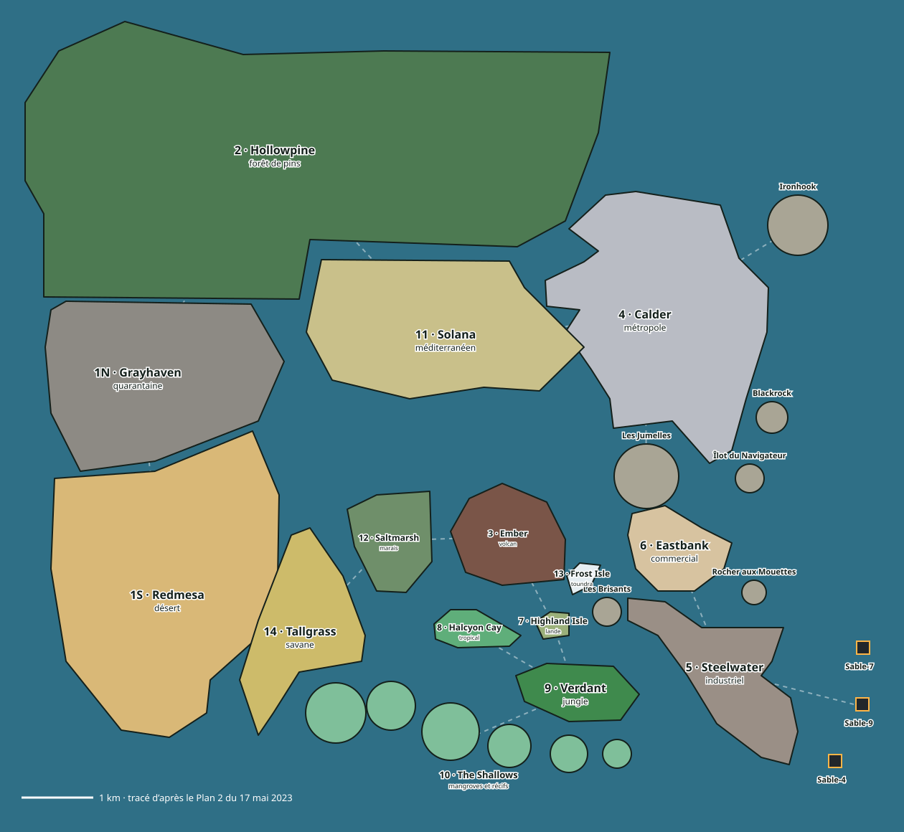

# The Isles — L'archipel, île par île : zones et sous-zones

28 novembre 2026 · @darknigthmare

Cette fiche fixe la **forme de l'archipel** et le **contenu attendu de chaque zone et sous-zone**. Elle reprend les notes d'origine du propriétaire et les réunit avec ce que la Bible avait déjà écrit pour le [mode The Isles](MODE_THE_ISLES_20261121.md), sa [métropole et sa zone de quarantaine](ISLES_EXTENSION_METROPOLE_QUARANTAINE_20261122.md) et son [level design](ISLES_MONDE_LEVEL_DESIGN_20261122.md).

**Sources du propriétaire**

| Document | Date | Ce qu'il donne |
| --- | --- | --- |
| « The Isle » (croquis et listes) | 21 juin 2022 | cinq îles, la liste des zones et de leurs sous-zones, les modes de jeu, les événements de la grande ville, les types d'ennemis, les lieux inspirés d'un tournage en ville |
| « Plan » (vues de travail) | 8 février 2023 | le relief de l'île de la grande ville, avec sa grille de rues, et celui de l'île industrielle |
| « Plan 2 » (schéma) | 17 mai 2023 | la **multitude d'îles** : quatorze îles numérotées, des îlots, une zone de mer avec trois plateformes, deux îles bonus |

**Règle de lecture.** La colonne « Origine » dit d'où vient chaque sous-zone :
- **notes** : écrit dans les documents ci-dessus ;
- **Bible** : déjà écrit dans les documents du mode ;
- **proposé** : ajouté ici pour compléter, à valider.

Les noms d'îles absents des notes sont *(proposés)*. Les notes citaient des packs de décors d'un autre moteur : ils servent seulement de référence d'ambiance, puisque le mode est produit en three.js avec ses propres modèles.

---

## 1. La forme de l'archipel

**Décision :** l'archipel suit le **Plan 2**. Ce n'est plus une grille de dix grandes îles reliées par des ponts, mais une multitude d'îles de tailles très différentes : trois grandes terres à l'ouest et au nord, la métropole à l'est, et un semis d'îles moyennes et petites au centre et au sud.

Le tracé est dans `app/game/data/islesArchipelagoV1.json` (contours en kilomètres, zones, liaisons). Le plan ci-dessus est produit à partir de ce fichier par `scripts/build-isles-archipelago-map-v1.mjs`. Le tracé a été relevé à la main sur le Plan 2 : il donne les positions et les proportions, pas un rivage définitif.

| N° du Plan 2 | Note d'origine | Île | Biome | Place sur la carte |
| --- | --- | --- | --- | --- |
| 1 (nord) | partie haute, forêt brûlée / aftermath | **Grayhaven** | zone de quarantaine | ouest |
| 1 (sud) | désert | **Redmesa** | désert et canyons | sud-ouest |
| 2 | forêt de pin, neighborhood | **Hollowpine** | forêt de pins et montagne, avec Maple Hollow | tout le nord |
| 3 | volcan, port | **Ember** | volcan | centre |
| 4 | big city | **Calder** | métropole | est |
| 5 | zone industrielle | **Steelwater** *(proposé)* | industrie et port | sud-est |
| 6 | zone commerciale | **Eastbank** | commerces et loisirs | est, sous Calder |
| 7 | Highland Isle | **Highland Isle** | lande et falaises | centre-sud |
| 8 | tropical island | **Halcyon Cay** | île tropicale privée | centre-sud |
| 9 | tropical island | **Verdant** | jungle | sud |
| 10 | chain of islands | **The Shallows** | chapelet de mangroves et de récifs | tout le sud |
| 11 | Mediterranean | **Solana** *(proposé)* | île méditerranéenne | centre-nord |
| 12 | swamp | **Saltmarsh** | marais | centre-ouest |
| 13 | Northern island 2 | **Frost Isle** | toundra | centre, à l'est d'Ember |
| 14 | savanna | **Tallgrass** | savane | sud-ouest, contre Redmesa |
| îlots | petits contours autour des îles 4, 5 et 6 | Ironhook, Blackrock, les Jumelles, îlot du Navigateur, les Brisants, Rocher aux Mouettes | — | est |
| zone de mer | oil rigs, tentacle branch, variant | plateformes Sable-7, Sable-9 et Sable-4 | pleine mer | à l'est de Steelwater |
| bonus | Nihon, Méditerranée | **Nihon** (hors carte) ; la Méditerranée est devenue l'île 11 | — | plus tard |

### 1.1 Ce que ce plan change par rapport aux fiches du 21 et du 22 novembre

| Sujet | Avant | Maintenant | Statut |
| --- | --- | --- | --- |
| Forme | dix îles en grille | quatorze îles, un chapelet, six îlots, trois plateformes | décision (Plan 2) |
| Grayhaven | îlot à l'est, sous Eastbank | grande île de l'ouest, collée à Redmesa par le mur | proposé, d'après « forêt brûlée / aftermath » de l'île 1 |
| Maple Hollow et Harvest Flats | sur Eastbank et sur Tallgrass | sur Hollowpine, au sud de la forêt de pins | proposé, d'après la « Neighborhood zone » de l'île 2 |
| Zone industrielle et port de conteneurs | sur Eastbank | sur leur propre île, Steelwater | décision (île 5) |
| Aéroport international | sur Eastbank | au nord de Steelwater | proposé |
| Frost Isle | grande île du nord | petite île du centre, près d'Ember | décision (île 13) ; sa taille réduite est à confirmer |
| Ironhook | île moyenne | îlot fortifié au nord-est de Calder | proposé |
| Halcyon Cay | îlot | île tropicale n° 8 | proposé |
| Highland Isle, Solana | absentes | nouvelles îles 7 et 11 | décision pour les îles, noms et contenus proposés |

### 1.2 Tailles

La carte fait environ 12 km d'ouest en est et 10,6 km du nord au sud. Une tuile vaut 2 m.

| Île | Largeur approximative | Remarque |
| --- | --- | --- |
| Hollowpine | 8 km | la plus grande ; moitié forêt, moitié habitée |
| Redmesa | 3,2 km | |
| Grayhaven | 3,3 km | |
| Calder | 3 km | grille de rues au centre, collines au nord |
| Solana | 3,8 km | |
| Steelwater | 2,4 km | étirée du nord-ouest au sud-est |
| Verdant | 1,7 km | l'île jouable de l'[étape 4](ISLES_VERDANT_CHASSE_LIBRE_20261128.md) fait 2 km |
| Tallgrass, Ember, Eastbank, Saltmarsh | 1,2 à 1,7 km | |
| Halcyon Cay, Highland Isle, Frost Isle | 0,5 à 1,2 km | |

### 1.3 Liaisons

| De | Vers | Moyen |
| --- | --- | --- |
| Hollowpine | Grayhaven | pont gardé (poste militaire) |
| Hollowpine | Solana | pont routier |
| Grayhaven | Redmesa | poste du mur |
| Redmesa | Tallgrass | gué à marée basse |
| Tallgrass | Saltmarsh | gué |
| Solana | Calder | pont suspendu |
| Saltmarsh | Ember | ferry |
| Ember | Frost Isle, Highland Isle | ferries |
| Calder | les Jumelles, puis Eastbank | ponts et métro |
| Eastbank | Steelwater | pont routier et voie ferrée |
| Calder | Ironhook | digue fermée |
| Highland Isle | Verdant | ferry |
| Halcyon Cay | Verdant | bateau privé |
| Verdant | The Shallows | gué à marée basse |
| Steelwater | plateformes | navettes et hélicoptères |

Le vaisseau personnel garde sa règle : voyage rapide entre repaires découverts, jamais à Calder ni à Ironhook.

---

## 2. Ce que chaque zone doit contenir

Chaque sous-zone est décrite par cinq choses :
- **Contenu** : les lieux, les bâtiments et les intérieurs visitables ;
- **Qui y est** : humains armés (proies dignes), non-combattants (interdits), faune ;
- **Hauteurs et dessous** : ce que le Yautja peut escalader et ce qui passe sous terre ;
- **Jeu** : ce qu'on y fait, événements et activités ;
- **Origine**.

Chaque île a aussi un **repaire**, un **repère visible de loin**, une **proie apex** ou une faction dominante, et au moins un **point de vue**.

---

## 3. Île 1 nord — Grayhaven, la zone de quarantaine

**Note d'origine :** « Incident Site (Self Destruct of an yautja aftermath zone) ». L'explosion de l'autodestruction de Vash'Tar, en 2003, a brûlé l'île. L'histoire complète est dans [l'extension](ISLES_EXTENSION_METROPOLE_QUARANTAINE_20261122.md), section 10.

- **Repère :** le cratère vitrifié, visible depuis les Hauts.
- **Faction :** garnison du mur, charognards, équipes ARGOS.
- **Apex :** meute de chiens errants ; ours revenu dans la forêt brûlée.
- **Repaire :** la cave d'une station-service de la banlieue figée.
- **Accès :** après l'arc Hale (réputation 9).

### 1N.1 Les Hauts

| Sous-zone | Contenu | Qui y est | Hauteurs et dessous | Jeu | Origine |
| --- | --- | --- | --- | --- | --- |
| Plateau | lande rase, route de crête, pylônes électriques tombés, ferme d'altitude abandonnée | faune revenue (cerfs, renards) | pylônes | meilleure vue sur le cratère ; arrivée discrète par le nord | notes (« partie haute ») |
| Relais radio | antenne, local technique, groupe électrogène | deux soldats de garde | antenne (point de vue) | couper le relais retarde les renforts du mur | proposé |
| Belvédère | parking, table d'orientation de 2003, longue-vue | personne | — | révèle la carte de l'île | proposé |

### 1N.2 Le mur

| Sous-zone | Contenu | Qui y est | Hauteurs et dessous | Jeu | Origine |
| --- | --- | --- | --- | --- | --- |
| Mur et miradors | béton, barbelés, projecteurs, panneaux de danger | garnison | chemin de ronde | être vu fait monter l'alerte à 3 | Bible |
| Postes de contrôle | barrières, guérites, sas de décontamination | garnison, médecins militaires | toits plats | deux postes : pont de Hollowpine et poste de Redmesa | Bible |
| La brèche | pan de mur effondré, caché par des tôles | charognards | conduite d'eau sous le mur | seule entrée sans alerte | Bible |

### 1N.3 Site de l'incident

| Sous-zone | Contenu | Qui y est | Hauteurs et dessous | Jeu | Origine |
| --- | --- | --- | --- | --- | --- |
| Cratère (Point zéro) | cuvette au sol vitrifié, silence, restes de Vash'Tar au fond | personne | aucune couverture | contamination forte (jauge) ; fin de l'arc de Grayhaven | notes, Bible |
| Forêt brûlée | troncs noirs debout, sol de cendres, repousses vertes | ours, cerfs | troncs fragiles | branches qui tombent ; thermique brouillé par les cendres chaudes | notes, Bible |
| Forêt de cendres | anneau extérieur, arbres couchés en étoile autour du cratère, poussière grise | chiens errants | troncs couchés | traces très lisibles : tout le monde y laisse des pas | notes |
| Base de recherche | camp ARGOS dans un parking souterrain, tentes, capteurs | ARGOS, synthétiques | parking sur trois niveaux | infiltration ; relevés à voler | Bible |

### 1N.4 Ashgrove, ville abandonnée

Note d'origine : « Abandonned City (Tchernobyl like) ».

| Sous-zone | Contenu | Qui y est | Hauteurs et dessous | Jeu | Origine |
| --- | --- | --- | --- | --- | --- |
| Centre abandonné | immeubles éventrés, voitures brûlées, bus renversés, enseignes de 2003 | charognards | façades, toits troués | effondrements ; planchers qui cèdent | notes, Bible |
| Intérieurs d'immeubles | appartements restés en l'état, cages d'escalier, bureaux | charognards (pillage) | étages, gaines d'ascenseur | fouille ; embuscades d'étage en étage | notes |
| Parc abandonné | fête foraine rouillée, grande roue figée, autos tamponneuses | chiens errants | grande roue | repère de la ville ; épreuve d'escalade | notes |
| Abattoir | chaînes, crochets, chambres froides éteintes | chef des charognards | rails au plafond | combat dans le noir ; trophées humains déjà suspendus par les charognards | notes |
| Atelier abandonné | établis, fosse, pièces détachées | charognards (armurerie) | fosse, mezzanine | source de composants | notes |
| Motel abandonné | chambres en enfilade, piscine vide, néon cassé | charognards (dortoir) | toit plat | approche chambre par chambre | notes |
| Hôpital d'Ashgrove | centre d'évacuation de 2003, lits, tentes militaires | base des charognards | toit, sous-sol, morgue | archives de l'évacuation (codex) | Bible |
| Métro noyé | ligne inondée, rames à moitié sous l'eau | charognards (planque) | tunnels | nage ; l'eau révèle le camouflage | Bible |

### 1N.5 Banlieue figée

| Sous-zone | Contenu | Qui y est | Hauteurs et dessous | Jeu | Origine |
| --- | --- | --- | --- | --- | --- |
| Quartier résidentiel | maisons envahies par la végétation, voitures dans les allées, jouets dans les jardins | chiens errants, charognards isolés | toits de maisons | chasse silencieuse de jardin en jardin | notes (« abandonned neighboorhood »), Bible |
| École et terrain de sport | classes, gymnase effondré | personne | charpente | fragments de l'histoire de 2003 | proposé |
| Station-service | pompes, boutique, cave | personne | cave | **repaire** de l'île | proposé |

### 1N.6 Port d'Ashgrove

| Sous-zone | Contenu | Qui y est | Hauteurs et dessous | Jeu | Origine |
| --- | --- | --- | --- | --- | --- |
| Quais | navires échoués, grues tordues, conteneurs éventrés | charognards | grues | arrivée par la mer, de nuit | Bible |
| Chalutier des pillards | bateau en état de marche, caisses | charognards armés | cale | le couler coupe leur ravitaillement | proposé |

---

## 4. Île 1 sud — Redmesa, le désert

**Note d'origine :** « Desert Zone ».

- **Repère :** la mesa du Chef et son antenne.
- **Faction :** bikers, milice de la mine, shérif de Dustwater.
- **Apex :** puma.
- **Repaire :** une grotte cachée dans un canyon.
- **Particularité :** la chaleur brouille le thermique le jour ; tempêtes de sable.

### 1S.1 Désert ouvert et canyons

| Sous-zone | Contenu | Qui y est | Hauteurs et dessous | Jeu | Origine |
| --- | --- | --- | --- | --- | --- |
| Dunes et plaine | sable, buissons secs, carcasses de voitures | coyotes, crotales | rochers isolés | aucun couvert : chasse de nuit | notes (« desert ») |
| Canyons | gorges étroites, arches, sources | puma, chevaux sauvages | parois à escalader | épreuve du canyon ; embuscades d'en haut | Bible |
| Mesa du Chef | plateau, antenne, cabane du gardien | un gardien armé | antenne (point de vue) | révèle la carte | Bible |
| Cimetière d'avions | carlingues alignées, pièces | ferrailleurs | ailes, dérives | cache de prime | Bible |

### 1S.2 La Route 9

| Sous-zone | Contenu | Qui y est | Hauteurs et dessous | Jeu | Origine |
| --- | --- | --- | --- | --- | --- |
| Station-service | pompes, boutique, garage, citerne | pompiste (civil), routiers | auvent, toit | l'explosion de la citerne alerte toute la route | notes (« fuel ») |
| Motel au néon | douze chambres, bureau, piscine | clients (civils), un trafiquant | toit, enseigne | cible isolée dans une chambre | notes |
| Strip-club | salle, scène, loges, bureau du patron, parking | videurs armés, clients (civils) | toit, réserve en sous-sol | rendez-vous de la prime « Lourd » | notes |
| Repaire de bikers | bar, atelier de motos, cour fermée | bikers armés | toits de tôle, fosse | gros combat ; motos qui poursuivent | notes (« biker den ») |
| Parc de caravanes | caravanes, auvents, chiens attachés | civils, deux dealers | toits de caravanes | les chiens aboient : alerte de voisinage | notes (« trailerpark ») |
| Relais routier et drive-in | parking de camions, diner, écran géant | routiers (civils) | écran du drive-in | camions en marche comme transport | Bible |

### 1S.3 Dustwater

Note d'origine : « Old farwest town ».

| Sous-zone | Contenu | Qui y est | Hauteurs et dessous | Jeu | Origine |
| --- | --- | --- | --- | --- | --- |
| Rue principale | saloon, banque, épicerie, église en bois | civils, adjoints | toits plats reliés, balcons | deuxième terrain urbain, bas et horizontal | notes, Bible |
| Bureau du shérif | bureau, deux cellules, râtelier d'armes | shérif et adjoints | toit | libérer ou non un prisonnier | Bible |
| Gare de minerai | quai, wagons, château d'eau | mineurs (civils), milice | wagons, château d'eau | train de minerai (Chasse inversée) | Bible |
| Cité ouvrière | baraquements, cantine | mineurs (civils) | — | zone presque entièrement civile | Bible |
| Ville fantôme | ancienne Dustwater, façades vides, mine d'argent fermée | trafiquants | charpentes | cache d'armes | Bible |

### 1S.4 Mine et Speedway

| Sous-zone | Contenu | Qui y est | Hauteurs et dessous | Jeu | Origine |
| --- | --- | --- | --- | --- | --- |
| Mine à ciel ouvert | gradins, camions géants, concasseur, convoyeurs | milice privée, mineurs (civils) | convoyeurs, grues | camions de mine en marche | Bible |
| Camp de travail | préfabriqués, clôture | milice | toits | sabotage possible | Bible |
| Redmesa Speedway | piste ovale, stands, tribunes | pilotes et public (civils) les jours de course | tribunes, tour de chronométrage | interdit au combat pendant une course ; vide la nuit | Bible |
| Ferme solaire | champs de panneaux, poste électrique | deux gardes | — | couper le courant de Dustwater | Bible |

### 1S.5 Zone militaire cachée

| Sous-zone | Contenu | Qui y est | Hauteurs et dessous | Jeu | Origine |
| --- | --- | --- | --- | --- | --- |
| Périmètre | clôture, capteurs, panneaux « terrain privé », piste en terre | patrouilles en 4×4 | tour de guet | entrer fait monter l'alerte à 2 | notes (« hidden military zone ») |
| Hangars camouflés | filets, hélicoptère, véhicules | militaires | toits de hangars | détruire l'hélicoptère retarde l'alerte | proposé |
| Antenne d'écoute | dôme, local de transmission | techniciens (civils), gardes | dôme | écoute des radios de l'archipel | proposé |

### 1S.6 Sous-sols du désert

| Sous-zone | Contenu | Qui y est | Hauteurs et dessous | Jeu | Origine |
| --- | --- | --- | --- | --- | --- |
| Vieux bunker souterrain | abri de la guerre froide, couchettes, salle des cartes | personne ; un ermite armé | puits d'accès | fragment de l'autel ; cache | notes (« underground old bunker ») |
| Installation souterraine | laboratoire relié à la zone militaire, ascenseur, couloirs, salle froide | ARGOS, scientifiques (civils) | gaines techniques | pièces de technologie yautja récupérées en 2003 | notes (« underground facility ») |
| Grotte cachée | entrée derrière un éboulis, source, peintures anciennes | puma | cheminée naturelle | **repaire** de l'île | notes (« hidden cave ») |

---

## 5. Île 2 — Hollowpine et Maple Hollow

**Notes d'origine :** « Forêt de pin », « Neighborhood zone ». C'est la plus grande île : la forêt et la montagne au nord, les quartiers habités et les fermes au sud.

- **Repère :** le barrage du lac.
- **Faction :** gardes forestiers et bûcherons au nord ; police du comté au sud.
- **Apex :** ours brun.
- **Repaire :** une galerie de la vieille mine.
- **Particularité :** brouillard, dénivelé ; Maple Hollow est presque entièrement civil.

### 2.1 Forêt de pins

| Sous-zone | Contenu | Qui y est | Hauteurs et dessous | Jeu | Origine |
| --- | --- | --- | --- | --- | --- |
| Parc national | entrée avec guérite, sentiers balisés, lac glaciaire, poste des rangers, tour de guet anti-incendie, aire de camping | gardes forestiers armés, campeurs (civils) | tour de guet, grands pins | chasse à l'ours et à l'élan ; les campeurs sont des témoins | notes (« national park ») |
| Motel de la forêt | motel isolé au bord de la route, brume, néon | gérant (civil), chasseurs de passage | toit, grenier | ambiance pesante ; prime qui s'y cache | notes (« atmospherical hotel ») |
| Carrière | fronts de taille, pelleteuses, bassin d'eau verte | ouvriers (civils) le jour, trafiquants la nuit | gradins de roche | échanges nocturnes à surprendre | notes (« quarry ») |
| Vieille mine | entrée étayée, galeries, wagonnets, puits | chauves-souris, un ours en hiver | galeries sur deux niveaux | **repaire** ; fragment de l'autel | notes (« old mine ») |
| Entrée cachée des égouts | grille sous un pont de la forêt, collecteur | contrebandiers | collecteur jusqu'à Maple Hollow | passage sans témoin entre la forêt et la petite ville | notes (« hidden entrence sewer ») |
| Scierie et camp de bûcherons | hangar, grumes, scies, baraquements | bûcherons et leurs gardes | piles de grumes, grue | bruit des scies qui couvre les pas | Bible |

### 2.2 Montagne et lac

| Sous-zone | Contenu | Qui y est | Hauteurs et dessous | Jeu | Origine |
| --- | --- | --- | --- | --- | --- |
| Lac et barrage | barrage voûte, salle des turbines, relais du cordon | gardes, techniciens (civils) | crête du barrage, galeries | sabotage du relais (ouverture d'îles) | Bible |
| Pinecrest | village de chalets, auberge, église | civils, bûcherons | toits pentus | village civil | Bible |
| Station de ski | remontées, pistes, tremplin, chalets | skieurs (civils) en hiver | pylônes, cabines | téléphérique (Chasse inversée) | Bible |
| Cabanes de trappeurs et camp de vacances | cabanes, dortoirs, ponton | trappeurs armés ; enfants en été (interdits) | — | le camp d'été est une zone interdite au combat | Bible |

### 2.3 Maple Hollow, zone résidentielle

| Sous-zone | Contenu | Qui y est | Hauteurs et dessous | Jeu | Origine |
| --- | --- | --- | --- | --- | --- |
| Quartier pavillonnaire | rues en arc, impasses, maisons à porche, pelouses, clôtures blanches, piscines | familles (civils), chiens de jardin | toits de maisons, arbres | terrain de test du code ; les chiens aboient la nuit | notes (« neighborhood »), Bible |
| Maisons visitables | salon, cuisine, chambres, grenier, cave | habitants ; parfois un voisin armé chez lui | grenier, cave | cambriolage armé (événement) | notes (« house ») |
| Garages | garage double, établi, voiture, porte basculante | un receleur dans l'un d'eux | — | planque d'une prime | notes (« garage interior ») |

### 2.4 Petite ville de Maple Hollow

| Sous-zone | Contenu | Qui y est | Hauteurs et dessous | Jeu | Origine |
| --- | --- | --- | --- | --- | --- |
| Centre-ville | Main Street : diner ouvert jour et nuit, station-service, quincaillerie, banque, cinéma ancien, caserne de pompiers, bibliothèque | civils, police du comté | toits de deux étages, enseignes | petite ville tranquille ; peu de proies | notes (« little city »), Bible |
| Commissariat et cellules | accueil, bureaux, armurerie ; **cellules de garde à vue au sous-sol** | policiers, détenus désarmés (interdits) | sous-sol | un détenu armé par un complice devient une proie | notes (« holding cells ») |
| Prison du comté | bâtiment bas, cour grillagée, parloir | gardiens armés, détenus (interdits) | toit, miradors bas | évasion (événement) | notes |
| Prison fédérale | hors de la ville : double enceinte, miradors, blocs, atelier, quartier d'isolement | gardiens armés, détenus (interdits, sauf mutins armés) | miradors, toits des blocs | mutinerie ; cible retenue à l'isolement | notes |

### 2.5 Zone du lycée

| Sous-zone | Contenu | Qui y est | Hauteurs et dessous | Jeu | Origine |
| --- | --- | --- | --- | --- | --- |
| Lycée | couloirs à casiers, salles de classe, cantine, bureau du proviseur | élèves et professeurs le jour (interdits) | toit, faux plafonds | **zone interdite au combat** de jour | notes |
| Salles de classe | tables, tableau, laboratoire de sciences | — | — | de nuit : gardien seul, lieu de rendez-vous | notes |
| Piscine | bassin couvert, vestiaires, local technique | — | charpente | l'eau révèle le camouflage | notes |
| Gymnase de basket | parquet, gradins rétractables, tableau d'affichage | public le soir de match (interdit) | passerelles techniques | match du vendredi : foule | notes (« stadium basket ») |
| Stade du lycée | terrain de football américain, gradins de 3 000 places | public le vendredi soir (interdit) | mâts d'éclairage | vide en semaine : épreuve de toit de tribune | Bible |

### 2.6 Parc de Maple Hollow

| Sous-zone | Contenu | Qui y est | Hauteurs et dessous | Jeu | Origine |
| --- | --- | --- | --- | --- | --- |
| Parc | étang, kiosque, aire de jeux, terrain de baseball de quartier, sentier | promeneurs (civils) ; dealers la nuit | arbres | seul lieu de Maple Hollow où une proie armée vient de nuit | notes (« park zone ») |

### 2.7 Harvest Flats, zone agricole

| Sous-zone | Contenu | Qui y est | Hauteurs et dessous | Jeu | Origine |
| --- | --- | --- | --- | --- | --- |
| Ferme | maison, grange rouge, silo, tracteurs, poulailler | fermiers (civils, armés pour la battue) | grange, silo | les fermiers ne sont des proies que s'ils menacent | notes (« farm ») |
| Ranch de chevaux | écuries, manège, paddocks | palefreniers (civils), chevaux | charpente des écuries | les chevaux s'affolent et trahissent le joueur | notes (« horse ranch ») |
| Champs | maïs (labyrinthe à l'automne), blé, vergers, éoliennes de pompage | — | éoliennes | couvert parfait mais bruyant | notes (« crop field ») |
| Bourg agricole | coopérative, silo géant, champ de foire, arène de rodéo | civils, forains | silo | foire et rodéo : foule | Bible |

---

## 6. Île 3 — Ember, le volcan

**Notes d'origine :** « Volcan », « port », et dans le groupe « Volcano/HighGrassLand » : « Old Port », « Volcano zone ».

- **Repère :** le volcan, visible de toutes les îles.
- **Faction :** scientifiques et leurs gardes, pilleurs d'obsidienne.
- **Apex :** aucun ; dangers naturels.
- **Repaire :** un tunnel de lave fermé au public.

### 3.1 Le volcan

| Sous-zone | Contenu | Qui y est | Hauteurs et dessous | Jeu | Origine |
| --- | --- | --- | --- | --- | --- |
| Cratère | lac de lave, fumerolles, radar du cordon | gardes du radar | lèvre du cratère (point de vue) | sabotage du radar (I-MP-06) | notes, Bible |
| Coulées | champs de lave figée, cheminées chaudes | pilleurs d'obsidienne | — | le sol chaud brouille le thermique | Bible |
| Grottes et tunnels de lave | tunnels aménagés pour touristes, tunnels sauvages | guides et touristes (civils), chauves-souris | réseau souterrain | **repaire** ; passage sous l'île | Bible |
| Observatoire sismique | coupole, salle des instruments | volcanologues (civils), gardes | coupole | prévoir l'éruption de la session | Bible |

### 3.2 Sulfur Springs et la géothermie

| Sous-zone | Contenu | Qui y est | Hauteurs et dessous | Jeu | Origine |
| --- | --- | --- | --- | --- | --- |
| Station thermale | bassins, hôtel, spa | curistes (civils) | toits | zone civile | Bible |
| Centrale géothermique | tours de vapeur, turbines, conduites | ingénieurs (civils), gardes | conduites, tours | la vapeur cache le camouflage et le révèle à la sortie | Bible |

### 3.3 Le Vieux Port

| Sous-zone | Contenu | Qui y est | Hauteurs et dessous | Jeu | Origine |
| --- | --- | --- | --- | --- | --- |
| Port | quais de pierre, entrepôts, grues anciennes, bateaux de pêche | pêcheurs (civils), contrebandiers | grues, toits | arrivée des ferries de Saltmarsh et de Frost Isle | notes (« port ») |
| Port scandinave | maisons de bois peintes sur pilotis, séchoirs à poisson, ponton | pêcheurs (civils) | toits pentus, pilotis | sous les pontons : passage sans témoin | notes |
| Prison du port | ancienne prison de pierre face à la mer, cour, coursives | gardiens armés, détenus (interdits) | remparts, tour | cible retenue ; l'évasion lâche des prisonniers dans le port | notes (« prison ») |
| Intérieur de la prison | cellules, réfectoire, parloir, mitard | — | galeries d'étage | combat en coursives | notes (« prison interior ») |

---

## 7. Île 4 — Calder, la grande ville

**Note d'origine :** « Big city », avec la grille de rues du « Plan ». Les huit quartiers sont décrits dans [l'extension](ISLES_EXTENSION_METROPOLE_QUARANTAINE_20261122.md), section 3. Ce tableau ajoute les sous-zones des notes.

- **Repère :** la tour Hale.
- **Factions :** police, deux gangs (les Docks et les Hauteurs), cartel, sécurité privée.
- **Apex :** aucun ; humains seulement.
- **Repaire :** aucun vaisseau à Calder ; un toit-refuge à découvrir dans The Heights.

| Zone | Sous-zone | Contenu | Qui y est | Jeu | Origine |
| --- | --- | --- | --- | --- | --- |
| 4.1 Downtown | Gratte-ciel | tours de bureaux, halls, étages techniques, tour Hale | sécurité privée, employés (civils) | chasse de toit en toit au grappin | notes (« skyscaper city ») |
| | Banque et chambre forte | hall, guichets, salle des coffres au sous-sol | sécurité ; braqueurs pendant l'événement | événement « braquage en cours » | notes (« bank vault ») |
| | Penthouse | appartement-terrasse au sommet d'une tour, piscine, héliport | chef de cartel et ses gardes | cible de prime ; arrivée par le toit | notes |
| 4.2 Old Harbor | Quais et entrepôts de brique | marché aux poissons, pub, musée maritime | les Docks | caves et tunnels de contrebande | Bible |
| | Complexe de viande | abattoir, chambres froides, quai de chargement | bouchers (civils), gardes | **source de viande** du joueur ; l'OWLF peut y tendre un piège | notes (« meat complex », « slaughterhouse ») |
| 4.3 Midtown | Centre et petit parc | Lumen Square, gare centrale, square arboré | foule (civils), police | presque impossible de jour | notes (« center of the big city with a little park ») |
| | Calder Arena | salle de basket et de hockey au-dessus de la gare | public (civil) | passerelles techniques | Bible |
| 4.4 Commons Park | Grand parc | lac, bois, zoo, kiosque | civils, police montée | canopée urbaine | Bible |
| | Cimetière | allées, caveaux, chapelle | fossoyeur (civil) ; cartel la nuit | échange nocturne entre les tombes | notes (« cemetary ») |
| 4.5 Uptown | Immeubles et musées | musée d'histoire, université | sécurité, civils | toits résidentiels ; musée fermé la nuit | Bible |
| | Appartements visitables | salon, cuisine, chambre, escalier de secours | habitants (civils) ; une cible | approche par l'escalier de secours | notes (« apartment interior ») |
| 4.6 The Heights | Immeubles de brique | terrains de basket, épiceries, métro aérien | les Hauteurs | toits continus | Bible |
| | Tour du gang vaudou | immeuble tenu par un gang, autel, étages piégés | gang armé | montée étage par étage | notes (« voodo gang in highrise building ») |
| | Ring de boxe | salle en sous-sol, ring, vestiaires, paris | organisateurs armés, public (civil) | **sauver un jeune Yautja** forcé de combattre | notes (« boxer ring ») |
| 4.7 Little Harbor | Marchés de nuit | restaurants, temples, salons de thé | civils, petit crime | foule dense la nuit ; enseignes à escalader | Bible |
| | Repaire du cartel | immeuble fortifié, laboratoire, toit gardé | cartel | assaut ; otages possibles | notes (« cartel holdout ») |
| | Rue tenue par le cartel | barrages de voitures, guetteurs aux fenêtres | cartel | traversée par les toits | notes |
| 4.8 Riverside | Lofts et boîtes de nuit | autoroute surélevée, entrepôts reconvertis | gangs la nuit | passage sous l'autoroute, sans témoin | Bible |
| | Ruelle sombre | impasse, bennes, sortie de secours | dealers, acheteurs | événement « vente d'armes » | notes (« dark alley », « back alley ») |
| | Motel | motel de passage sous l'autoroute | clients (civils), un indicateur | cible dans une chambre | notes |
| | Chantier | immeuble en construction, grue, échafaudages | ouvriers (civils) le jour ; gang la nuit | combat sur les poutres | notes (« construction site ») |
| 4.9 Les collines du nord | Collines et lac | relief du « Plan » : hauteurs boisées, lac de retenue, routes en lacets, villas | sécurité privée, civils | seul coin de nature de l'île ; vue sur toute la ville | notes (relief du « Plan ») |
| | Aérodrome privé | piste courte, hangars | pilotes, gardes | fuite d'une cible en avion | proposé |
| 4.10 Le dessous de Calder | Métro | stations, rames, tunnels, dépôt | usagers (civils), police | événements « attaque de punks » et « prise d'otages » | notes (« metro », « train ») |
| | Souterrains | égouts, parkings, anciens tunnels de contrebande | sans-abri (civils), contrebandiers | réseau complet sous la ville | notes (« underground ») |

### 7.1 Événements de la grande ville

| Lieu | Événement | Règle du code |
| --- | --- | --- |
| Banlieue | dealer dans la rue | le dealer armé est une proie ; ses clients non |
| Tour d'habitation | gang vaudou retranché | tous armés |
| Commissariat | poste de police sous tension | policiers armés : proies dignes, forte alerte |
| Banque | braquage en cours | braqueurs : proies ; otages et employés : interdits |
| Ring de boxe | jeune Yautja forcé de combattre | le sauver rapporte de l'honneur ; le public est interdit |
| Complexe de viande | piège de l'OWLF | commando armé |
| Ruelle | vente d'armes entre gangs | tous armés |
| Métro | attaque de punks | punks armés d'armes blanches : proies ; usagers : interdits |
| Métro | prise d'otages | preneurs d'otages : proies ; un otage tué par le joueur est une faute |
| Tour de bureaux | prise d'otages d'employés | idem |
| Rue | poursuite en voiture, tireurs armés | les tireurs sont des proies ; attention aux passants |

---

## 8. Île 5 — Steelwater, la zone industrielle

**Note d'origine :** « Industrial zone », île « LAND_IND » du « Plan » : une île longue, bordée à l'ouest de fines îles-barrières.

- **Repère :** les portiques du port de conteneurs.
- **Faction :** les Docks (trafics), sécurité privée, douane.
- **Apex :** aucun.
- **Repaire :** une cale sèche désaffectée.

### 5.1 Zone des entrepôts

| Sous-zone | Contenu | Qui y est | Hauteurs et dessous | Jeu | Origine |
| --- | --- | --- | --- | --- | --- |
| Entrepôt 1 (en chantier) | charpente métallique nue, échafaudages, matériaux, bungalows de chantier | ouvriers (civils) le jour ; trafiquants la nuit | poutres, échafaudages | combat en hauteur | notes |
| Centre de nettoyage de citernes | cuves, portiques de lavage, fosses, camions-citernes | employés (civils), deux gardes | passerelles au-dessus des cuves | vapeur et eau : le camouflage se voit | notes (« tank cleaning zone ») |
| Entrepôt 2 (stockage) | rayonnages hauts, chariots élévateurs, quais de chargement, bureau vitré | caristes (civils), receleurs | rayonnages (trois niveaux) | cache d'armes ; labyrinthe de palettes | notes |

### 5.2 Zone portuaire

| Sous-zone | Contenu | Qui y est | Hauteurs et dessous | Jeu | Origine |
| --- | --- | --- | --- | --- | --- |
| Port de conteneurs | terminaux, portiques, piles de conteneurs, navires à quai | dockers (civils), les Docks, douane | portiques à escalader | labyrinthe ; vedette (Chasse inversée) | notes (« port container »), Bible |
| Douane et capitainerie | bureaux, scanner à camions, tour de contrôle du port | douaniers armés | tour | voler les manifestes révèle les trafics | proposé |
| Cale sèche | bassin vide, coque en réparation | personne la nuit | coque, grues | **repaire** de l'île | proposé |

### 5.3 Quartier des usines

| Sous-zone | Contenu | Qui y est | Hauteurs et dessous | Jeu | Origine |
| --- | --- | --- | --- | --- | --- |
| Rues d'usines | usines de brique, cheminées, voies de fret, wagons | ouvriers (civils), sécurité privée | cheminées, toits en dents de scie | peu de civils la nuit | notes (« factory district ») |
| Centrale électrique | salle des machines, transformateurs, tour de refroidissement | techniciens (civils), gardes | tour | couper le courant de l'île | Bible |
| Station d'épuration, casse auto, cimenterie | bassins, piles d'épaves, silos | ferrailleurs armés à la casse | silos, grue de la casse | casse : presse qui écrase une épave où l'on se cache | Bible |

### 5.4 Zone d'usine

| Sous-zone | Contenu | Qui y est | Hauteurs et dessous | Jeu | Origine |
| --- | --- | --- | --- | --- | --- |
| Atelier abandonné | établis, machines-outils rouillées, verrière brisée | squatteurs, gang | verrière | embuscade par le toit | notes (« workshop ») |
| Usine | chaîne de montage, convoyeurs, salle de contrôle, vestiaires | ouvriers (civils), contremaîtres armés liés aux Docks | convoyeurs, ponts roulants | convoyeurs en marche | notes (« factory ») |
| Motel des routiers | motel au bord de la zone, parking de camions | routiers (civils), un passeur | toit | cible de prime de passage | notes (« motel2 ») |

### 5.5 Aéroport international

| Sous-zone | Contenu | Qui y est | Hauteurs et dessous | Jeu | Origine |
| --- | --- | --- | --- | --- | --- |
| Terminal | hall, portiques de sécurité, salles d'embarquement | voyageurs (civils), police | toit | zone très surveillée | Bible |
| Pistes et hangars | pistes, hangars de maintenance, fret | mécaniciens (civils), sécurité | hangars | hangars de nuit ; avion d'une cible | Bible |
| Tour de contrôle | vigie, salle radar | contrôleurs (civils) | sommet (point de vue) | révèle la carte | Bible |

### 5.6 Îles-barrières

| Sous-zone | Contenu | Qui y est | Hauteurs et dessous | Jeu | Origine |
| --- | --- | --- | --- | --- | --- |
| Bancs de sable | deux langues de sable et de roche, feux de navigation, épaves de barges | oiseaux marins, contrebandiers en canot | feux de navigation | approche discrète du port par l'ouest | notes (relief du « Plan ») |

### 8.1 Zone de mer : les plateformes

| Plateforme | Contenu | Qui y est | Jeu | Origine |
| --- | --- | --- | --- | --- |
| **Sable-7** | plateforme pétrolière en service : pont de forage, quartiers de vie, héliport, grues, torchère | ouvriers (civils), sécurité privée | tempêtes ; chute à la mer ; arrivée par les piliers | notes (« oil rigs »), Bible |
| **Sable-9 « la Pieuvre »** | plateforme centrale reliée à des satellites par des passerelles et des conduites en étoile | sécurité renforcée, équipe ARGOS | combat sur les passerelles au-dessus de l'eau ; conduites à suivre | notes (« tentacle branch ») |
| **Sable-4** | variante désaffectée, à moitié démontée, rouillée | trafiquants, squatteurs | planque de prime ; structure qui cède | notes (« variant ») |

---

## 9. Île 6 — Eastbank, la zone commerciale

**Note d'origine :** « Comercial Zone ». Les Jumelles, entre Calder et Eastbank, portent les stades.

- **Repère :** la grande roue de Gull Pier.
- **Faction :** sécurité des commerces ; gangs la nuit.
- **Apex :** aucun.
- **Repaire :** le local technique de la grande roue.

| Zone | Sous-zone | Contenu | Qui y est | Jeu | Origine |
| --- | --- | --- | --- | --- | --- |
| 6.1 Bayview, centre commercial | Galerie marchande | deux étages, verrière, boutiques, aire de restauration, parking couvert | clients (civils), vigiles | fermé la nuit : terrain de chasse vide et éclairé | notes (« shopping mall »), Bible |
| | Grandes surfaces et drive-in | hypermarché, parkings immenses, multiplexe, drive-in | civils | toits plats immenses | Bible |
| 6.2 Le grand parc | Parc | pelouses, lac, amphithéâtre de plein air, serres | promeneurs (civils) | concerts : foule | notes (« big park ») |
| 6.3 Parc d'attractions et Gull Pier | Parc d'attractions | montagnes russes en bois, carrousel, maison des miroirs, train fantôme | forains et visiteurs (civils) ; gang la nuit | combats sur les rails, dans le noir, parmi les miroirs | notes (« park tycoon »), Bible |
| | Gull Pier | ponton de 600 m, grande roue, stands, aquarium, arcade | idem | Chasse inversée « Gull Pier de nuit » | Bible |
| 6.4 Ville commerçante | Rue commerçante | boutiques, cafés, cinéma, hôtel, marché couvert | civils, police | cible suivie dans la foule | notes (« commercial town ») |
| 6.5 Les stades | Harbor Park et Calder Stadium | baseball (40 000 places) et football (70 000 places), sur les Jumelles | public (civil) les soirs de match | interdits au combat les jours de match | Bible |

---

## 10. Île 7 — Highland Isle

**Notes d'origine :** « HighLand Isle », et dans le groupe « Volcano/HighGrassLand » : « Old Church », « Cemetary », « HighGrass_Zone », « CliffZone », « Lighthouse ». Petite île de lande et de falaises.

- **Repère :** le phare.
- **Faction :** quelques bergers ; contrebandiers de passage.
- **Apex :** un grand cerf nommé *(proposé)*.
- **Repaire :** la crypte de la vieille église.

| Zone | Sous-zone | Contenu | Qui y est | Jeu | Origine |
| --- | --- | --- | --- | --- | --- |
| 7.1 La lande | Hautes herbes | lande ondulée, herbes à hauteur d'homme, murets de pierre, tourbières | moutons, cerfs, un berger armé | les herbes couvrent mais plient au passage | notes (« highgrass zone ») |
| | Bergerie | maison basse, enclos, chien | berger (civil s'il ne tire pas) | le chien donne l'alerte | proposé |
| 7.2 Les falaises | Falaises | parois à pic, corniches, grotte marine | oiseaux marins | escalade ; chute mortelle ; arrivée par la mer | notes (« cliff zone ») |
| 7.3 L'église et le cimetière | Vieille église | nef sans toit, clocher, crypte | personne ; contrebandiers la nuit | **repaire** dans la crypte ; fragment de l'autel | notes (« old church ») |
| | Cimetière | tombes anciennes, croix de pierre, if | — | échange nocturne à surprendre | notes |
| 7.4 Le phare | Phare | tour, lanterne, maison du gardien, ponton | gardien (civil) | point de vue : révèle les îles du sud | notes (« lighthouse ») |

---

## 11. Île 8 — Halcyon Cay, l'île privée

**Note d'origine :** « Tropical island ». C'est l'île privée d'Augustin Hale ([arc Hale](MODE_THE_ISLES_20261121.md), mission I-MP-07).

- **Repère :** le manoir blanc sur la colline.
- **Faction :** gardes d'élite de Hale.
- **Apex :** les animaux de la ménagerie de Hale.
- **Repaire :** aucun ; l'île se quitte à la nage ou en bateau.
- **Accès :** réputation 8.

| Zone | Sous-zone | Contenu | Qui y est | Jeu | Origine |
| --- | --- | --- | --- | --- | --- |
| 8.1 Le manoir | Manoir | salons, bureau, salle des trophées humains de Hale, chambre forte | gardes d'élite, personnel (civil) | écho du Yautja : un humain qui collectionne | Bible |
| | Salle de contrôle | écrans des caméras de l'archipel, serveurs | techniciens (civils), gardes | couper les caméras de Hale sur toutes les îles | proposé |
| 8.2 Les jardins et la plage | Jardins | terrasses, piscine, serre, héliport | gardes | projecteurs, chiens | proposé |
| | Plage privée | ponton de bain, cabanes | — | arrivée à la nage | proposé |
| 8.3 La jungle privée | Ménagerie et enclos | cages, enclos, fosse | fauves, soigneurs (civils) | ouvrir les cages lâche les fauves sur les gardes | proposé |
| 8.4 L'embarcadère | Port privé | yacht, hangar à bateaux, vedettes | équipage, gardes | saboter le yacht empêche la fuite de Hale | proposé |

---

## 12. Île 9 — Verdant, la jungle

**Note d'origine :** « Tropical island ». C'est le point de départ du mode. L'île est jouable depuis l'[étape 4](ISLES_VERDANT_CHASSE_LIBRE_20261128.md) ; la colonne « État » dit ce qui existe déjà dans le jeu.

- **Repère :** la pyramide de l'autel.
- **Faction :** braconniers.
- **Apex :** jaguar ; légendaire : le Roi-de-Verdant.
- **Repaire :** la grotte derrière les chutes.

| Zone | Sous-zone | Contenu | Qui y est | Jeu | État |
| --- | --- | --- | --- | --- | --- |
| 9.1 L'autel yautja | Pyramide | quatre degrés, escalier, autel, glyphes | Sœur-de-Pierre | contrats, mission « L'appât », hub en ligne | jouable |
| 9.2 Les chutes et le repaire | Chutes | falaise, bassin, brume | — | la brume révèle le camouflage | terrain présent |
| | Grotte du repaire | salle des trophées, établi, aire du vaisseau | — | trophées rapportés, alerte effacée | jouable |
| | Petite centrale hydroélectrique | turbine, conduite forcée, local | un garde | couper le courant du camp | à produire |
| 9.3 Le fleuve | Gués et rives | deux gués, bassin de l'hydravion | crocodiles, caïmans | l'eau révèle le camouflage | jouable |
| | Pont de lianes | pont suspendu au-dessus du fleuve | — | passage en hauteur | à produire |
| 9.4 Camp des braconniers | Camp | tentes, radio, cages, véhicules, caisses d'armes | braconniers armés, leur chef | mission « L'appât » ; annexe « Les cages » | jouable, cages à produire |
| 9.5 Fouilles archéologiques | Chantier de fouilles | tentes, tranchées, tamis, groupe électrogène | Dre Mokoena et archéologues (interdits), gardes | annexe « L'archéologue » | peuplé, annexe à produire |
| | Mission abandonnée | chapelle, cloître envahi par la jungle | prêtre (civil) | fragment de l'autel | à produire |
| 9.6 Piste cachée | Piste | piste en herbe, avion, hangar, caisses | trafiquants, braconniers | annexe « La piste » | peuplé, annexe à produire |
| 9.7 Port-Tahren | Village de pêcheurs | quai, maisons, marché, éco-lodge | pêcheurs, touristes, guides (civils) | refuge des témoins : un témoin qui y arrive donne l'alerte | jouable |
| 9.8 La canopée | Trois niveaux | sol, sous-bois, canopée | singes, harpie | épreuve chronométrée | jouable |

---

## 13. Île 10 — The Shallows, le chapelet

**Note d'origine :** « Chain of island ». Six îlots en arc le long du bord sud, reliés par des passes que la marée ouvre et ferme.

- **Repère :** l'épave du cargo *Meridian*.
- **Faction :** trafiquants en bateaux rapides.
- **Apex :** crocodile marin ; requin dans les passes.
- **Repaire :** la cabine du commandant, dans l'épave.

| Zone | Sous-zone | Contenu | Qui y est | Jeu | Origine |
| --- | --- | --- | --- | --- | --- |
| 10.1 Coral Key | Hôtel de plage | bungalows, bar, piscine, centre de plongée | touristes, moniteurs (civils) | zone civile | Bible |
| | Aérodrome à hydravions | ponton, deux hydravions, cabane | pilotes (civils), un trafiquant | fuite d'une cible | Bible |
| 10.2 Les mangroves et les passes | Mangroves | racines aériennes, chenaux, vasières | crocodiles marins, crabes | marée : passages qui s'ouvrent et se ferment | Bible |
| | Lagon et avion échoué | eau claire, carlingue immergée | tortues, barracudas | plongée ; cache | Bible |
| 10.3 L'épave du Meridian | Cargo échoué | pont incliné, cales, salle des machines, cabine | trafiquants d'armes | **repaire** ; trafic d'armes | Bible |
| 10.4 Le ponton des trafiquants | Ponton | bateaux rapides, bidons, cabane sur pilotis | trafiquants, la Veuve (prime) | sabotage des bouées du sud | Bible |
| 10.5 Le phare des Shallows | Phare | tour, logement | Old Tom (civil) | point de vue ; rendez-vous des trafiquants | Bible |

---

## 14. Île 11 — Solana, l'île méditerranéenne

**Note d'origine :** « Mediterranean » ; elle reprend l'île bonus « Méditerranée ». Les notes ne listent pas de sous-zones : tout le contenu ci-dessous est *(proposé)*.

- **Repère :** le village blanc en gradins au-dessus du port.
- **Faction :** une famille de contrebandiers ; chasseurs de sangliers.
- **Apex :** sanglier corse ; loup.
- **Repaire :** une citerne antique sous les ruines.

| Zone | Sous-zone | Contenu | Qui y est | Jeu |
| --- | --- | --- | --- | --- |
| 11.1 Porto Solana | Port de plaisance | quai, voiliers, yachts, terrasses de cafés | plaisanciers et touristes (civils) | zone civile de jour |
| | Village blanc | ruelles en escaliers, maisons chaulées, toits-terrasses, église à coupole, place du marché | habitants (civils), hommes de main de la famille | toits-terrasses reliés ; ruelles trop étroites pour les véhicules |
| | Villa de la famille | villa fortifiée, cave à vin, bureau | contrebandiers armés | cible de prime |
| 11.2 Les terrasses | Vignes et oliviers | cultures en terrasses, murets, pressoir, moulin à huile | vignerons (civils) | murets comme couvert |
| | Monastère | cloître, cellules, bibliothèque, clocher | moines (interdits) | zone interdite ; fragment de l'autel dans la bibliothèque |
| 11.3 La garrigue | Collines sèches | maquis, pins parasols, bergeries, citernes | sangliers, chasseurs armés | battues de chasseurs ; risque d'incendie l'été |
| 11.4 Les ruines antiques | Théâtre et temple | gradins, colonnes, mosaïques, citerne | touristes de jour ; pilleurs de nuit | **repaire** dans la citerne ; épreuve d'escalade |
| 11.5 Les calanques | Criques et grottes marines | falaises blanches, eau turquoise, grottes | plongeurs (civils), contrebandiers en canot | livraisons de nuit à surprendre |

---

## 15. Île 12 — Saltmarsh, le marais

**Note d'origine :** « Swamp ».

- **Repère :** la torchère de la raffinerie abandonnée.
- **Faction :** contrebandiers, chasseurs d'alligators.
- **Apex :** alligator.
- **Repaire :** une cabane de chasse sur pilotis.

| Zone | Sous-zone | Contenu | Qui y est | Jeu | Origine |
| --- | --- | --- | --- | --- | --- |
| 12.1 Les bayous | Chenaux | cyprès, mousse espagnole, eau noire, brouillard du matin | alligators, pythons, panthère | hydroglisseurs bruyants | notes, Bible |
| | Cabane de chasse | cabane sur pilotis, peaux, ponton | chasseurs d'alligators armés | **repaire** | Bible |
| 12.2 Bayou Cross | Village sur pilotis | passerelles, église, bar de blues, cimetière en surface | civils, les Frères Kade (prime) | bal du samedi : foule | Bible |
| 12.3 La raffinerie | Raffinerie abandonnée | colonnes, cuves, torchère allumée, salle de contrôle | contrebandiers | hauteur ; cuves qui explosent | Bible |
| 12.4 Le delta | Bancs et crevettiers | bancs de vase, bateaux crevettiers, bateau de croisière | pêcheurs et touristes (civils) | bayou vers la mer (Chasse inversée) | Bible |

---

## 16. Île 13 — Frost Isle, l'île du nord

**Note d'origine :** « Northen island 2 ». Petite île froide au centre de l'archipel : un courant glacé et l'altitude la gardent sous la neige.

- **Repère :** le front du glacier.
- **Faction :** sécurité de la station polaire, chasseurs de fourrure.
- **Apex :** ours polaire.
- **Repaire :** la baleinière échouée.
- **Particularité :** froid (jauge de chaleur), blizzard.

| Zone | Sous-zone | Contenu | Qui y est | Jeu | Origine |
| --- | --- | --- | --- | --- | --- |
| 13.1 Northwick | Port de pêche | maisons sur pilotis, conserverie, musée baleinier | pêcheurs (civils) | village civil | Bible |
| | Baleinière échouée | coque couchée sur la grève | — | **repaire** | Bible |
| 13.2 La station polaire | Station de recherche | modules, dôme radar, garage à motoneiges | chercheurs (civils), sécurité | avion de la station (Chasse inversée) | Bible |
| 13.3 Le glacier | Glacier et crevasses | front de glace, crevasses, grotte bleue | ours polaire, loups arctiques, morses | fin de l'arc Hale (I-MP-08) ; chute en crevasse | Bible |

---

## 17. Île 14 — Tallgrass, la savane

**Note d'origine :** « Savanna ». La zone agricole de Harvest Flats passe sur Hollowpine (section 5) ; Tallgrass garde la savane et le ranch.

- **Repère :** le lodge abandonné de Halcyon, sur sa colline.
- **Faction :** chasseurs de gros gibier, guides.
- **Apex :** lion.
- **Repaire :** la cave du lodge.

| Zone | Sous-zone | Contenu | Qui y est | Jeu | Origine |
| --- | --- | --- | --- | --- | --- |
| 14.1 La savane | Herbes hautes | plaine, acacias, termitières, kopjes (amas de rochers) | lions, buffles, hyènes, guépards, troupeaux | chasse à découvert ; les troupeaux en fuite trahissent le joueur | notes, Bible |
| 14.2 Le lodge Halcyon | Lodge et enclos détruits | salle des archives, enclos éventrés, clôtures | chasseurs engagés | mission I-MP-02 ; **repaire** dans la cave | Bible |
| 14.3 Le ranch et le safari-camp | Ranch | maison, corral, étable | éleveurs (civils armés) | battues contre les lions | Bible |
| | Safari-camp | tentes de toile, feu, 4×4 | Torres (prime) et ses chasseurs | cible toujours à l'affût | Bible |
| 14.4 Le point d'eau | Mare | mare, boue, affût de chasse | toute la faune au crépuscule | point de chasse naturel | Bible |
| 14.5 L'aérodrome de brousse | Piste | piste en terre, hangar, citerne de carburant, poste vétérinaire | pilote et vétérinaire (civils) | aérodrome (Chasse inversée) | Bible |

---

## 18. Îlots

| Îlot | Contenu | Qui y est | Jeu | Origine |
| --- | --- | --- | --- | --- |
| **Ironhook** | îlot fortifié : base, chantier naval, abri de sous-marins, laboratoire ARGOS, piste, hôpital et prison militaires, radars, digue vers Calder | garnison, ARGOS | entrer met l'alerte à 3 ; siège d'Ironhook, sommet du mode | Bible |
| **Blackrock** | prison fédérale sur un rocher : blocs, cour, phare de garde | gardiens armés, prisonniers (interdits, sauf mutins armés) | mutinerie | Bible |
| **Les Jumelles** | deux îlots et leur lagon : Harbor Park, Calder Stadium, parkings, station de métro | public (civil) les soirs de match | stades vides la nuit : terrain de chasse | notes (relief du « Plan »), Bible |
| **Îlot du Navigateur** | statue, esplanade, petit musée | touristes (civils) | point de vue sur la baie | Bible |
| **Les Brisants** | rochers entre Eastbank et Steelwater, balise | — | passage à la nage ; cache | proposé |
| **Rocher aux Mouettes** | îlot nu, cabane de pêcheur | contrebandiers | rendez-vous en canot | proposé |

**Île bonus Nihon** *(hors carte, plus tard)* : île d'inspiration japonaise citée dans les notes. Contenu proposé : village de pêcheurs, sanctuaire, forêt de bambous, château en ruine, rizières en terrasses. Elle peut servir de carte de saison.

---

## 19. Ce que les notes disaient aussi

### 19.1 Modes de jeu des notes et modes de la Bible

| Mode des notes | Principe écrit dans les notes | Mode correspondant |
| --- | --- | --- |
| Hunt | chasser ce qu'on veut sur la carte, selon le code | Chasse libre |
| Infection Control | trouver l'infestation de xénomorphes et combattre la reine | **nouveau**, à écrire : contrat de groupe contre une ruche |
| Infestation | la carte est envahie par des hordes d'humains et quelques chasseurs | **nouveau**, à écrire : mode de survie par vagues |
| Xeno invasion | des humains apparaissent et cherchent les foyers d'infestation pour les éradiquer | **nouveau**, à écrire : course entre humains et Yautja vers les foyers |
| Hunt the hunters | des humains apparaissent et cherchent les chasseurs présents (alerte radio de police) | Chasse inversée |
| Reserve Hunt | — (titre seul) | à préciser ; proche du Grand gibier |
| BR Mode | bataille royale avec des survivants, des équipes de Yautja et des hordes ; le vaisseau dépose selon le chemin d'apparition | **nouveau**, à écrire |

Les trois modes avec des xénomorphes touchent à la décision « présent fixe, années 2020 » et aux ruches de la campagne : ils sont notés ici sans être tranchés.

### 19.2 Types d'ennemis des notes et statut au code

| Type des notes | Statut au code | Où |
| --- | --- | --- |
| Civil, civil apeuré | interdit | partout |
| Prisonnier | interdit tant qu'il est désarmé | prisons |
| Junkie | interdit s'il est désarmé | Calder, parc de caravanes |
| Voyou (thug), biker, gang, mafieux (mobsters) | proie digne s'il est armé | Calder, Redmesa, Steelwater |
| « Most wanted » | proie digne ; ce sont les primes | toutes les îles |
| Force locale (police) | proie digne | villes |
| Force armée lourde | proie digne ; unité tactique de l'alerte 3 | renforts |
| Force militaire | proie digne ; alerte 4 | Ironhook, zone cachée de Redmesa, mur de Grayhaven |
| Faune sauvage | proie selon l'espèce | îles sauvages |

### 19.3 « Choses à faire » des notes

| Point des notes | Où il en est |
| --- | --- |
| Circulation des véhicules | écrit dans le mode (section 9.3) ; pas encore produit |
| Circulation des piétons | routines civiles écrites ; peuplement par zone et par heure jouable sur Verdant |
| Cycle jour et nuit | jouable sur Verdant : un jour dure 24 minutes |
| À la tombée de la nuit, déclencher l'allumage des lumières | **à produire** : lampadaires, fenêtres, enseignes, phares |
| Temps aléatoire | météo par île écrite ; pas encore produite |

---

## 20. Points à valider

1. **Noms proposés** : Steelwater (île 5) et Solana (île 11).
2. **Grayhaven à l'ouest**, à la place de l'îlot de l'est, avec le site de l'incident des notes.
3. **Maple Hollow et Harvest Flats sur Hollowpine**, d'après la « Neighborhood zone » de l'île 2.
4. **Frost Isle petite** (île 13) : confirmer cette taille, ou placer une grande île du nord hors du Plan 2.
5. **Ironhook en îlot** au nord-est de Calder, et **Halcyon Cay en île 8**.
6. **Aéroport international sur Steelwater.**
7. **Contenu de Solana et de Highland Isle**, presque entièrement proposé.
8. **Modes avec xénomorphes** (Infection Control, Xeno invasion) et **BR Mode** : à garder ou non.
9. **Ordre d'ouverture des îles** : le cordon d'ARGOS ([mode](MODE_THE_ISLES_20261121.md), section 14.1) cite des groupes d'îles de l'ancienne carte ; il faudra le redessiner sur ce plan.
