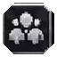

# Compagnons — six candidats UI, pas un pack de personnages terminé

Livraison partielle du 6 novembre 2026 pour la PR #116. Références : [catalogue des compagnons](../../CATALOGUE_COMPAGNONS.md) et [règles de recrutement](../../COMPAGNONS_ET_ALLIES_PREMIUM.md).

**Ce dossier contient réellement six PNG individuels 64 × 64 avec transparence. Aucun sprite de personnage conforme au catalogue, aucune animation et aucun quartier n'est livré par ce lot. La demande de sprites de compagnons fidèles 1:1 reste donc ouverte.**

| Recruter | Affecter | Actif | En mission | Réserve / repos | Verrouillé |
| --- | --- | --- | --- | --- | --- |
|  |  |  |  |  |  |

## Statut et usage

Ces six icônes sont des **candidats graphiques** pour les commandes et états du système de compagnons. Leur présence dans la bible ne raccorde aucun menu du jeu. Elles sont conservées hors de `public/` pour éviter leur activation implicite. Aucun compagnon n'est recruté, affecté ou rendu visible par cet ajout.

Le lit symbolise ici la réserve ou le repos ; il ne doit pas devenir une preuve qu'un allié est physiquement à bord. L'état actif, le lieu physique et le recrutement restent distincts conformément à ALL-01–ALL-10. Le cadenas ne doit pas révéler les portraits d'alliés encore inconnus. Les libellés doivent être produits par l'interface accessible, pas incrustés dans le PNG.

## Générations rejetées

Les planches composites produites pendant cette passe ne respectaient pas la bible : notamment Serekh présenté comme Yautja au lieu de l'Amengi original, Keth assimilé à un Yautja au lieu du partenaire inspiré du River Ghost, personnages étrangers au catalogue, textes annonçant à tort un roster terminé et des imports déjà réalisés. Certaines planches introduisaient aussi un Xénomorphe domestiqué standard, contraire au cadrage retenu.

**Ces planches ne sont ni une preuve de fidélité, ni un inventaire d'assets intégrés. Elles ne sont pas importées dans le dépôt et leurs portraits ne sont pas découpés pour remplacer les vrais personnages.** Seule leur petite région de pictogrammes génériques a été récupérée pour ce lot. Les tentatives de génération ciblée par le connecteur externe n'ont créé aucun job accepté ; aucun de leurs six personnages n'est compté comme livré.

## Fabrication des six fichiers

Source native : génération `10aa2d90-6fde-4091-bd61-3d76e5f24cf0`, SHA-256 du PNG source `c53e179075b534c565e2bab42746e29a44f705697afe72e6331cffb63ea463fa`.

Découpe sans texte, sans redimensionnement, masque alpha chanfreiné puis conversion en palette indexée de 32 couleurs. Cette conversion change des valeurs RGB : il ne s'agit pas d'une copie pixel à pixel de la source. Le format 64 × 64 ne prouve aucune fidélité lore « 1:1 ». La source composite rejetée n'est pas une référence artistique à suivre pour le roster.

[Manifeste](manifest.json) : identifiants, dimensions, empreintes, rectangles de découpe et états. [Contrôle local](verification.json) : six fichiers décodables et uniques, transparence effective et marges présentes. Les SHA Git des six blobs publiés ont été comparés aux SHA calculés sur les PNG locaux avant le commit.

Reproduire le contrôle technique dans un environnement disposant de Pillow :

```sh
python docs/campagne/compagnons-sprites/20261106-ui-candidates/verify.py
```

La vérification ne lance pas le jeu et ne valide ni la lisibilité sur ses écrans réels, ni les interactions, ni les proportions des personnages, ni la fidélité artistique humaine. Le suivi conserve `game_integrated=false`, `tested_in_game=false`, `art_validated=false` et `lore_1_to_1_certified=false`.

## Travail encore ouvert

Les sprites individuels de Brèche, Éclisse, Lance-Fendue, Opale et des autres compagnons doivent être produits avec leur identité exacte, une vue compatible avec la scène, une silhouette entière et de vrais fichiers distincts. Les Premium originaux et Héritage gardent leurs besoins de références, poses, costumes, animations et validation. Ne pas fermer ces lignes à partir des six pictogrammes de ce dossier.

Aucun code de jeu, sauvegarde, rang, affectation, capacité de navire ou campagne n'est modifié. Pas de fusion vers `main` ni de déploiement par ce lot.
