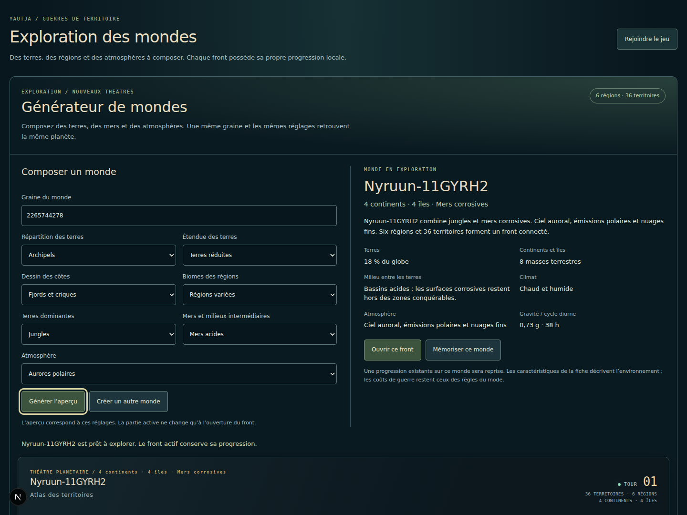
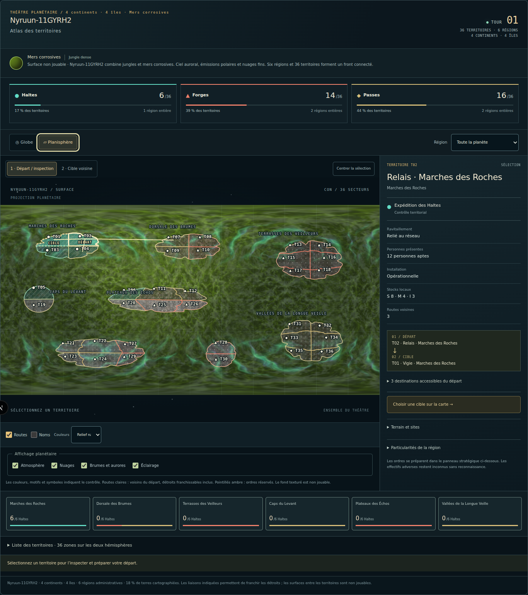

# Générateur modulaire de planètes — Guerres de territoire V102

Le générateur compose des mondes reproductibles à partir d’une graine et de modules indépendants : répartition des terres, couverture, côtes, biomes régionaux, milieu entre les terres et atmosphère. Chaque planète possède une géographie jouable, ses descriptions et un code de partage autonome.

Un monde contient **36 territoires conquérables répartis dans six régions administratives**, avec des routes propres à sa géographie. Il utilise le moteur stratégique existant. Les 30 planètes historiques restent disponibles avec leurs géographies et leurs archives.

## Aperçus du jeu

Les captures suivantes proviennent du parcours réel dans Chromium, avec les textures du projet.





La [capture mobile à 390 pixels](mobile-atlas.png) montre les mêmes contrôles de l’atlas et le renseignement territorial.

## Créer et ouvrir un monde

Le générateur est accessible par **Générer un monde** dans le sélecteur des théâtres planétaires. La page **`/planet-generator-v102`** donne également accès au générateur et à l’ouverture d’un front jouable.

1. Saisir une **Graine du monde** : un nombre de `0` à `4 294 967 295`, ou un nom. Le formulaire accepte jusqu’à 64 caractères. Un nom est converti en graine numérique reproductible ; cette valeur figure ensuite dans la recette.
2. Choisir les modules du tableau ci-dessous. Les modifications restent dans le brouillon tant qu’elles n’ont pas été appliquées.
3. Activer **Générer l’aperçu**. La carte, les dossiers régionaux, les descriptions, le code et les exports adoptent alors la recette appliquée. **Créer un autre monde** tire une nouvelle graine avec les modules choisis.
4. Explorer le globe ou le planisphère et sélectionner un territoire pour consulter sa région, ses particularités et ses voisins. L’aperçu utilise les définitions du monde généré.
5. Activer **Mémoriser ce monde** pour conserver son raccourci sur cet appareil, ou **Ouvrir ce front** pour jouer. Une archive locale existante pour ce code est reprise ; un code encore inédit ouvre son propre front.

La guerre active conserve sa progression pendant l’exploration. Si le brouillon a de nouveau été modifié, l’ouverture, la copie et les téléchargements utilisent toujours **l’aperçu effectivement appliqué**. Le message sous le formulaire indique si des réglages attendent encore leur génération.

| Module | Choix | Résultat |
|---|---|---|
| Répartition des terres | Supercontinent, Continents, Archipels, Îles fragmentées | Change le nombre et l’organisation des masses terrestres, les frontières et leurs liaisons. |
| Étendue des terres | Terres réduites, Équilibrée, Terres étendues | Modifie la couverture réelle des terres sur le globe. Le pourcentage affiché est calculé sur les polygones. |
| Dessin des côtes | Côtes douces, Caps et baies, Fjords et criques | Change les silhouettes et les découpes côtières. |
| Biomes des régions | Même famille de terres, Régions variées | Affecte un biome commun ou plusieurs familles compatibles aux six régions. |
| Terres dominantes | Treize familles de biomes | Détermine les matières terrestres, les descriptions et la famille des variantes régionales. |
| Mers et milieux intermédiaires | Eau, acide, glace, sable, lave, saumure, nappes radioactives, cristaux, spores, brume | Change le fond entre les terres et son éventuelle émission. Les étendues de glace, de sable et de cristaux restent des milieux solides ; la brume est un milieu atmosphérique. |
| Atmosphère | Ciel clair, Brumes et aérosols, Systèmes orageux, Aurores polaires | Règle les nuages, les effets atmosphériques et la diffusion visuelle. |

Une même recette complète retrouve le même monde. Tout changement de paramètre produit un autre code, donc un autre identifiant de front et une archive indépendante, même si le changement concerne uniquement une matière ou l’atmosphère. Pour reprendre une guerre précise, conserver son code d’origine.

## Partager le code et la fiche JSON

**Copier le code** partage la recette complète de la planète. Si le navigateur refuse la copie automatique, le champ est sélectionné et un message propose de copier son contenu manuellement.

Dans **Explorer un monde partagé**, coller le code puis activer **Retrouver le monde** reconstruit l’aperçu. Il n’est pas nécessaire que le monde figure déjà dans les raccourcis locaux. Un code invalide laisse l’aperçu précédent disponible.

**Télécharger la fiche** produit un fichier JSON contenant le code, la recette, le nom, l’environnement, les terres, les régions et les particularités. **Ou importer une fiche** accepte ce format jusqu’à 64 Kio. L’import vérifie la version et la correspondance exacte du code avec la recette, puis reconstruit la géographie et les descriptions depuis cette recette. Des textes modifiés dans un JSON ne deviennent pas une nouvelle source de règles ou de terrain.

Le code et la fiche partagent **le monde**. Les unités, les ordres, les stocks, le tour courant et les conquêtes sont conservés dans l’archive locale du front ; ils ne font pas partie de ces exports. Un code permet de recréer une planète après perte de ses raccourcis, mais ne remplace pas une archive de progression perdue.

Exemple de recette par défaut :

```json
{
  "version": 102,
  "seed": 1028507,
  "landform": "continents",
  "landCoverage": "balanced",
  "coast": "rugged",
  "landBiome": "temperate",
  "surface": "water",
  "biomeDiversity": "varied",
  "atmosphere": "haze"
}
```

Son code est **`proc-v102-m1ln-1110011-xkz70`**. Le bloc ci-dessus présente la recette seule ; pour l’import par fichier, utiliser la fiche complète produite par **Télécharger la fiche**, qui porte aussi son format, sa version et son code.

## Exporter les textures PNG séparées

Ouvrir **Exporter les textures par calque**, choisir un calque et une projection, puis activer **Télécharger le PNG**. L’export porte sur la planète de l’aperçu appliqué.

| Projection | Dimensions | Usage |
|---|---|---|
| Planisphère | 1 024 × 512 pixels | Carte longitude/latitude, nord en haut. |
| Globe | 512 × 512 pixels | Vue sphérique cadrée, avec transparence hors du globe. |
| Masque des terres | 1 024 × 512 pixels, planisphère imposé | Blanc sur les terres, noir sur le milieu environnant. |

Les calques disponibles comprennent la planète assemblée, les couleurs sans éclairage, les terres et biomes, la surface entre les terres, les nuages, les brumes et particules, l’atmosphère et la diffusion, l’ombre et le masque. Les aurores et l’émission lumineuse sont proposées lorsque la recette en contient.

La couche terrestre et les effets conservent leur alpha pour permettre un assemblage séparé. La surface entre les terres constitue le fond de composition. Changer de planète pendant une préparation d’export annule le téléchargement de l’ancien aperçu. Une erreur de rendu ou d’encodage est signalée dans le panneau.

Ces exports réutilisent les matières bitmap du [pack V101](../planet-materials-v101/README.md). La génération d’un nouveau monde calcule sa composition et sa géographie à la demande ; elle ne lance pas une nouvelle génération d’images par IA.

## Géographie, descriptions et règles de guerre

Le front garde les identifiants `CON-T01` à `CON-T36` et `CON-REG01` à `CON-REG06`, avec six territoires par région. Une région administrative peut occuper plusieurs îles, et une masse terrestre peut accueillir plusieurs régions. Le nombre de continents ou d’îles n’est donc pas le nombre de régions.

La répartition produit un supercontinent, de trois à cinq masses en mode Continents, de huit à dix en mode Archipels, ou de douze à seize en mode Îles fragmentées. Pour le dossier, une masse portant au moins six territoires est appelée continent ; les masses plus petites sont appelées îles. Cette classification est une convention de lecture du scénario.

Les territoires d’une même terre partagent leurs frontières. Leurs marqueurs sont placés à l’intérieur de leurs polygones. Les côtes et la carte de contrôle utilisent les mêmes données géographiques ; les effets atmosphériques ne déplacent pas les frontières.

Les adjacences terrestres et les traversées constituent le graphe utilisé par le moteur. Les traversées relient des territoires côtiers sélectionnés d’après la distance de leurs rives. Un arbre couvrant entre les masses terrestres assure la connexité ; des liaisons proches supplémentaires offrent d’autres passages. Chaque route est réciproque. Les distances angulaires documentent cette sélection ; elles n’introduisent pas de nouveau tarif de déplacement dans les règles V85.

Les rôles des sites, les factions initiales et les revenus proviennent du scénario V85. La géographie et les routes produisent des situations stratégiques différentes ; la conservation de ces données de départ ne promet pas un équilibrage compétitif identique pour chaque graine.

Les dossiers régionaux décrivent les biomes, le climat, le relief et les types de sites réellement présents. Les noms des terres et les particularités environnementales sont générés par des sous-flux déterministes. **La gravité, la durée du jour, les climats, les radiations et les atmosphères décrites n’ajoutent pas de modificateur de combat.** Les coûts, blessures, garnisons, approvisionnements et conditions de victoire continuent à suivre le moteur existant.

## Architecture déterministe et indépendance des modules

| Composant | Responsabilité |
|---|---|
| [`clanWarPlanetGeneratorV102.ts`](../../app/game/systems/clanWarPlanetGeneratorV102.ts) | Validation des recettes, conversion des graines, codes, définitions du monde, descriptions et cache de mondes. |
| [`clanWarPlanetGeographyV102.ts`](../../app/game/systems/clanWarPlanetGeographyV102.ts) | Partition des terres, silhouettes, frontières, centres et graphe des routes. |
| [`clanWarPlanetsV96.ts`](../../app/game/systems/clanWarPlanetsV96.ts) | Résolution commune des identifiants historiques et des codes V102. |
| [`planetRegionalMaterialsV102.ts`](../../app/game/planetRegionalMaterialsV102.ts) | Atlas des matières des six régions et carte catégorielle de leurs identifiants. |
| [`planetMaterialRendererV101.ts`](../../app/game/planetMaterialRendererV101.ts) | Rendu WebGL, projections et composition des calques indépendants. |
| [`PlanetGeneratorV102.tsx`](../../app/game/PlanetGeneratorV102.tsx) | Brouillon, aperçu appliqué, dossier, partage et ouverture du front. |
| [`PlanetLayerExportV102.tsx`](../../app/game/PlanetLayerExportV102.tsx) | Exports PNG du monde appliqué. |
| [`clanWarGeneratedCatalogV102.ts`](../../app/game/systems/clanWarGeneratedCatalogV102.ts) | Catalogue local borné de codes récemment mémorisés. |

### Recette et identité

`normalizeWarPlanetRecipeV102` complète un brouillon à partir des valeurs par défaut et refuse les valeurs inconnues. `validateWarPlanetRecipeV102` exige une recette complète, sans clé supplémentaire. `seedFromTextV102` normalise les noms en NFC avant leur conversion en uint32 ; deux noms peuvent théoriquement aboutir à la même graine.

`encodeWarPlanetV102` et `parseWarPlanetV102` utilisent un format canonique compact : version, graine en base 36, indices des sept modules et somme de contrôle. Le parseur impose une longueur maximale, les bornes uint32, les valeurs reconnues et un réencodage identique. La somme de contrôle détecte les erreurs de transcription ; elle ne constitue pas une signature d’authenticité.

`generateWarPlanetV102` reconstruit le monde sans donnée mutable préalable. `generatedWarPlanetV102` fournit la résolution par code avec un cache LRU limité à 24 mondes. Les objets générés sont gelés récursivement ; l’état mutable de la guerre reste dans sa simulation.

### Maillage et conservation des côtes

Les 36 cellules sont regroupées dans des rectangles de terres, puis transformées en silhouettes étoilées avec des harmoniques de côtes. Tous les territoires d’une terre partagent les mêmes nœuds. Le générateur vérifie une triangulation orientée de ce maillage et la simplicité du contour extérieur sur les coordonnées arrondies réellement utilisées.

Une cellule côtière concave peut être valide : le contrôle accepte l’une ou l’autre de ses diagonales. Cela préserve les caps et les baies au lieu de réduire les contours à des ovales. Si une découpe trop serrée produit une inversion après échantillonnage, le relief est adouci par paliers déterministes, avec un repli borné sur un quadrillage déformé. La déformation globale reste inférieure à la moitié de l’écart entre les boîtes des terres, ce qui maintient leur séparation.

### Séparation entre géographie et apparence

Les coordonnées, les frontières et les routes dépendent uniquement de **`seed`, `landform`, `landCoverage` et `coast`**. Modifier `surface`, `landBiome`, `biomeDiversity` ou `atmosphere` conserve cette géographie et les distances des routes.

En mode Régions variées, les six matières sont réunies dans un atlas GPU. Une carte d’identifiants régionaux séparée choisit la matière au bon emplacement géographique. Ses identifiants sont catégoriels ; leur filtrage ne fabrique pas de biome intermédiaire au bord d’une région. Le masque côtier conserve son propre filtrage et son alpha. Les matières restent ancrées dans le repère de la planète lors d’une rotation du globe.

Pour les recettes V102, le profil atmosphérique choisit ses nuages, ses aérosols, sa couleur de ciel et ses aurores indépendamment du biome ou de la surface. Changer le milieu entre les terres ne recolore pas les textures terrestres ; changer l’atmosphère ne redessine pas le sol. Les compositions finales reflètent naturellement les couches assemblées.

### Règle d’évolution après publication

Une recette V102 doit continuer à résoudre la même géographie et le même graphe après rechargement, déploiement ou partage. **Toute modification de l’algorithme qui change la signification d’un paramètre, les polygones, les identifiants ou les routes exige une nouvelle version de générateur.** L’ordre des valeurs encodées dans les listes de modules fait partie du format publié et doit rester stable.

Une future version doit conserver le parseur et le générateur V102 pour rouvrir les anciens codes et leurs fronts. Elle ne doit pas réinterpréter silencieusement une archive existante. Les évolutions du rendu qui conservent les données géographiques relèvent du renderer et doivent préserver les contrats d’indépendance des calques.

Trois codes fixes possèdent des empreintes SHA256 attendues de leur géographie et de leurs routes dans les tests : le défaut, un archipel à fjords et un monde à la graine uint32 maximale. Ces références couvrent coordonnées, appartenances, voisinages et distances de traversée. Les textes d’affichage sont exclus. Une mise à jour ordinaire du code ne doit pas remplacer ces empreintes pour masquer une modification du contrat V102.

## Raccourcis, archives et protection des sessions

**Mondes retrouvés sur cet appareil** conserve au maximum les 24 derniers raccourcis mémorisés. Ce catalogue contient des codes, pas les données autoritaires de la planète ni la progression. La sortie d’un ancien raccourci de cette liste **ne supprime pas son archive de guerre** : le code permet de retrouver le même front tant que cette archive est toujours présente sur l’appareil.

Chaque monde utilise sa propre archive locale, indexée par son code. Les archives générées passent par le même contrôle de validation et le même mécanisme transactionnel de protection contre les écritures concurrentes que les autres fronts. Un catalogue incompatible ou illisible est conservé sans modification ; une écriture de raccourci n’est annoncée comme persistée qu’après relecture confirmée.

Si le stockage refuse le catalogue, l’interface propose explicitement **Ouvrir avec ce code sans mémoriser le raccourci**. Le statut du front indique ensuite si sa progression est archivée ou seulement en mémoire. Les codes et fiches restent disponibles pour retrouver la planète ; leur conservation ne transforme pas une progression en mémoire en sauvegarde confirmée.

Les sessions ouvertes sont également bornées : le panneau garde l’exercice partagé de Korthas et jusqu’à 24 autres sessions. Lorsqu’une place doit être libérée, seules une session correctement archivée ou une session encore vierge peuvent être retirées de la mémoire. Un front modifié avec des progrès non enregistrés n’est pas sacrifié pour en ouvrir un autre. Si aucune session ne peut être libérée, l’ouverture est refusée avec un message ; l’exploration et les exports restent accessibles. Les changements de front attendent aussi la fin des écritures en cours.

Ce stockage est local au navigateur et à l’appareil. La V102 n’ajoute pas de synchronisation distante des guerres.

## Validation et rapports

Les [tests du domaine](../../tests/planet-generator-v102.test.mjs) comportent **dix tests réussis** : recettes et codes, graines, reconstruction, immutabilité et cache, empreintes de compatibilité V102, indépendance des modules, variation réelle des géographies, maintien de baies visibles, validité des centres et routes, absence de chevauchement et cohérence des descriptions. Ils couvrent notamment 72 combinaisons de topologie/côte/couverture et 24 cartes soumises aux vérifications de frontières et d’occupation.

Les [tests de persistance](../../tests/planet-generator-persistence-v102.test.mjs) complètent ce périmètre avec la résolution des codes, les archives de fronts générés, les clés et barrières d’écriture, le catalogue borné et la compatibilité des planètes historiques.

Les rapports de navigateur associés sont :

- [ui-qa.json](ui-qa.json) : parcours du brouillon à l’aperçu, clavier et mobile, code et JSON, téléchargement PNG, ouverture de fronts réels, tours joués, reprise après rechargement et refus de stockage.
- [regional-material-qa.json](regional-material-qa.json) : correspondance entre biomes, territoires, carte et globe ; alpha côtier ; indépendance des calques ; branches de précision graphique ; caches et restauration du contexte WebGL.
- [renderer-regression-qa.json](renderer-regression-qa.json) : contrôles du renderer V101 réexécutés avec l’intégration V102, pour suivre les projections, les effets et la compatibilité du rendu existant.

Le [bilan de validation](verification.json) rassemble les commandes et résultats : 102 tests de régression Node, six contrôles de raccordement existants, TypeScript, ESLint et 56 contrôles navigateur. Le workflow GitHub lance les nouveaux tests de domaine/persistance/rendu ainsi que les deux parcours navigateur V102 avec les véritables matières.

Les comptes et résultats détaillés de chaque parcours figurent dans son rapport. Les captures et contrôles utilisent Chromium avec WebGL logiciel ; la branche `mediump` peut être forcée pour vérifier son comportement. Cette validation ne remplace pas un essai sur tous les GPU mobiles physiques.

### Reproduire les contrôles

Depuis la racine du dépôt, avec l’environnement Node 24 utilisé pour cette validation :

```sh
node --test --test-isolation=none tests/planet-generator-v102.test.mjs tests/planet-generator-persistence-v102.test.mjs
npm run typecheck
```

Avec le serveur Next disponible sur `http://127.0.0.1:3101` et un exécutable Chromium :

```sh
CHROMIUM_EXECUTABLE_PATH=/chemin/vers/chromium node scripts/qa-planet-generator-v102.mjs
CHROMIUM_EXECUTABLE_PATH=/chemin/vers/chromium node scripts/qa-planet-regional-materials-v102.mjs
CHROMIUM_EXECUTABLE_PATH=/chemin/vers/chromium node scripts/qa-planet-material-renderer-v101.mjs
```

Le script d’interface accepte une autre URL dans `YAUTJA_QA_BASE_URL`. Les scripts de matières acceptent `YAUTJA_PLANET_MATERIAL_URL`. Le rapport d’interface est écrit directement dans ce dossier ; les rapports du renderer et des matières régionales sont produits dans leurs dossiers de sortie puis copiés ici pour accompagner la revue.

## Limites actuelles

- Le catalogue de graines et de modules est très vaste mais fini : les graines occupent 32 bits. Plusieurs graines peuvent partager des ressemblances visuelles, et les matières réutilisent les treize familles terrestres et les dix familles de surface du pack V101.
- Le format stratégique reste fixé à six régions et 36 territoires. Les silhouettes ne comportent pas encore de lacs intérieurs, de réseaux fluviaux traversants ou de trous jouables dans les masses terrestres.
- Le globe présente une géographie de surface. Il ne génère pas de terrain 3D physique, de volumes de roche, de bathymétrie navigable ou de collision dépendant d’une carte de hauteur.
- Les matières sont des images de couleur artistiques. Les exports ne constituent pas un jeu de textures PBR avec hauteur, normales, rugosité et métal mesurés.
- La diffusion atmosphérique est un effet visuel inspiré du scattering. Elle ne simule pas une atmosphère volumétrique physique ; la météo et les propriétés environnementales du dossier ne modifient pas les combats.
- Les fichiers PNG de l’interface ont les dimensions annoncées. Une projection ou un agrandissement ne crée pas de détail matériel au-delà des images sources.
