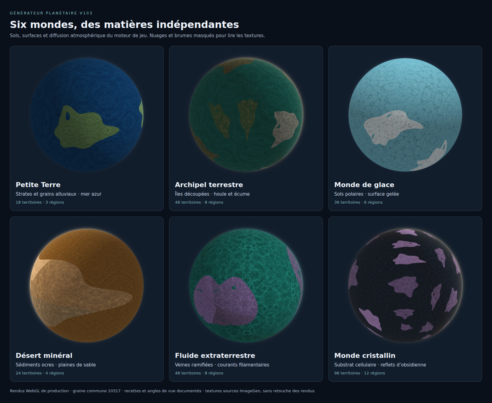

# Matières planétaires V103

V103 conserve les 13 biomes terrestres, les 10 types de surface et les quatre profils atmosphériques déjà disponibles. Il ajoute huit paramètres visuels indépendants. Les recettes V102 et les planètes historiques continuent d’utiliser le programme de rendu publié.

## Contrat visuel

| Module | Champ | Choix | Défaut |
| --- | --- | --- | --- |
| Sol | `landVariant` | `native`, `earthlike`, `alien` | `native` |
| Sol | `landScale` | `broad`, `medium`, `fine` | `medium` |
| Sol | `landContrast` | `soft`, `balanced`, `strong` | `balanced` |
| Sol | `landPalette` | `native`, `verdant`, `ochre`, `violet`, `ashen` | `native` |
| Surface | `surfaceVariant` | `native`, `earthlike`, `alien` | `native` |
| Surface | `surfaceScale` | `broad`, `medium`, `fine` | `medium` |
| Surface | `surfaceContrast` | `soft`, `balanced`, `strong` | `balanced` |
| Surface | `surfacePalette` | `native`, `azure`, `turquoise`, `amber`, `violet`, `obsidian` | `native` |

Toutes les combinaisons sont disponibles. Ces paramètres ne modifient ni les coordonnées, ni les routes, ni les noms géographiques, ni les règles du milieu choisi. Une palette azur appliquée à l’acide conserve une surface de type acide. Les caractéristiques atmosphériques, les nuages, les brumes et les aurores continuent de suivre leur propre profil.

Le contrat pur se trouve dans `app/game/systems/planetMaterialProfilesV103.ts`. Il peut être importé par la validation des recettes sans charger le catalogue ou un générateur. Les profils de sol ne lisent que les quatre champs du sol ; les profils de surface ne lisent que les quatre champs de surface.

L’échelle multiplie la fréquence spatiale du motif par `0.65`, `1` ou `1.6`. « Larges » donne donc des motifs plus grands, sans agrandir la planète. Le contraste utilise les facteurs `0.72`, `1` et `1.35`, autour du gris médian. La palette reste un réglage distinct de la structure et du contraste.

## Quatre nouvelles sources bitmap

Les quatre images ont été créées séparément avec l’outil intégré **ImageGen**. Les PNG originaux opaques de 1254 × 1254 pixels sont conservés intégralement. Les dérivés WebP de 512 × 512 pixels sont produits avec Sharp, réduction Lanczos3 et qualité 86.

| Source | Structure apportée | Fichiers |
| --- | --- | --- |
| `land-earthlike` | Strates érodées, limons et grains alluviaux | `public/game/planets/v103/{materials,runtime}/land-earthlike.{png,webp}` |
| `land-alien` | Cellules minérales, porosité et veines ramifiées | `public/game/planets/v103/{materials,runtime}/land-alien.{png,webp}` |
| `surface-earthlike` | Houle fine, rides et écume discontinue | `public/game/planets/v103/{materials,runtime}/surface-earthlike.{png,webp}` |
| `surface-alien` | Courants visqueux, volutes et filaments | `public/game/planets/v103/{materials,runtime}/surface-alien.{png,webp}` |

Le fichier `public/game/planets/v103/manifest.json` contient les quatre prompts complets, les identifiants des générations, les dimensions, les tailles et les SHA256 des sources et des dérivés. Les PNG totalisent 16 086 547 octets ; les quatre WebP totalisent 397 172 octets.

Les nouveaux bitmaps sont des détails d’albédo neutres, composés en mode `soft-light` à 78 % sur les matériaux V101. Le motif du biome ou de la surface reste présent. La variante change ainsi la structure réellement échantillonnée, indépendamment de la palette. `native` utilise directement la source historique, sans composition supplémentaire.

Ces sources ne sont pas des normal maps. Le rendu ne simule ni le relief physique de chaque grain, ni un écoulement de fluide. Les filaments clairs de la source alien sont de l’albédo ; l’émission éventuelle reste déterminée par le type de surface choisi.

## Projection et raccords

Les matériaux utilisent la projection triplanaire existante en coordonnées du monde. Une rotation de caméra ne fait pas glisser leur texture. Les coordonnées périodiques sont réfléchies : la qualité du rendu ne dépend pas d’une promesse de raccord parfait entre les bords des images générées.

La carte des régions est catégorielle et échantillonnée en `NEAREST`. Chaque région pointe vers sa cellule d’atlas selon son identifiant, indépendamment de l’ordre des descriptions. Le masque des côtes conserve son filtrage linéaire et son anticrénelage. Les limites entre biomes régionaux restent explicites ; V103 n’ajoute pas de mélange géographique implicite entre régions.

| Nombre de régions | Grille d’atlas V103 |
| --- | --- |
| 3 ou 4 | 2 × 2 |
| 5 à 8 | 4 × 2 |
| 9 à 12 | 4 × 3 |

Les choix de recette actuels sont 3, 4, 6, 8 et 12. Le helper graphique accepte tout entier de 3 à 12. La grille V102 reste exactement 4 × 2 pour six régions.

Les cellules sont bridées à une puissance de deux entre 16 et 1024 pixels selon la limite GPU et le budget de l’atlas. Chaque atlas reste sous 8 388 608 pixels. Pour 12 régions, une demande de source à 1024 pixels utilise des cellules de 512 pixels : l’atlas mesure 2048 × 1536 pixels. Il est compatible WebGL1 avec `CLAMP_TO_EDGE`, sans mipmaps.

La marge d’échantillonnage reste d’un demi-texel en haute précision. En `mediump`, V102 conserve `max(0.5 / tile, 0.004)`. V103 utilise `max(0.5 / tile + 0.002, 0.004)` : la marge supplémentaire protège aussi la division par trois des nouvelles lignes. Le test arithmétique émule l’arrondi IEEE binary16 après chaque opération ; 2205 coordonnées aux bords restent à au moins un demi-texel du bord de leur cellule.

## Hydrologie et exports

Les polygones de lacs et les rubans fluviaux fournis par le générateur percent le masque terrestre, avec les mêmes copies périodiques que les côtes. Ils exposent la matière de surface déjà sélectionnée. Ils ne constituent pas une texture d’eau indépendante cachée, ni de nouveaux territoires.

La couche `land` exportée conserve un alpha transparent dans ces trous. La couche `surface` reste un fond autonome complet, qui peut être recomposé sous les terres. Les nuages, brumes, aurores, éclairage nocturne et diffusion atmosphérique restent des couches séparées. La diffusion atmosphérique est le modèle artistique de type Rayleigh/Mie déjà utilisé, sans prétention de solveur physique.

Les grands exports chargent les PNG sources. Les compositions V103 sont limitées à 1024 pixels de côté et les atlas au budget ci-dessus, indépendamment de la résolution du PNG de sortie. Une sortie de 4096 pixels ne représente donc pas une nouvelle source détaillée en 4096 pixels.

## Mémoire et cycle de vie

| Ressource | Borne |
| --- | --- |
| Contextes WebGL partagés | 1 |
| Programmes GLSL par contexte | 2, historique et V103 |
| Samplers utilisés | 7 |
| Images décodées | 16, borne historique conservée |
| Compositions de détail | 6, chacune au plus 1024² pixels, soit 24 MiB de RGBA au maximum |
| Atlas régionaux CPU et GPU | 3, chacun au plus 8 388 608 pixels |
| Masques terrestres CPU | 6 |
| Masques régionaux CPU | 6 |
| Textures GPU, toutes catégories | 22 |
| Chargements d’image simultanés | 4 |

Les clés de composition et d’atlas V103 dépendent des bitmaps réellement nécessaires. Changer la graine géographique, la palette, le contraste ou l’échelle ne duplique pas une composition identique. Les caches sont des LRU ; le dernier consommateur n’a pas à libérer manuellement une texture partagée.

Une annulation empêche toute écriture du rendu sur sa cible. Un décodage partagé déjà engagé peut se terminer pour d’autres consommateurs. Une source absente fait échouer sa couche ; elle ne simule pas une variante réussie. Après perte et restauration du contexte, les programmes et les textures GPU sont reconstruits depuis les sources conservées.

## Preuves et reproduction

`tests/fixtures/planet-material-v102/` conserve les trois sources de rendu publiées au commit `6bd43c7c0185077783bfb9d6f2eb2929c469a03d`, avec SHA256. Le script `scripts/prepare-planet-material-v102-baseline.mjs` permet de les reconstruire depuis ce commit présent dans Git. Les fixtures sont textuelles et n’entrent pas dans l’application ; la CI n’a besoin d’aucun téléchargement de référence.

`scripts/qa-planet-materials-v103.mjs` crée un serveur local éphémère, bundle séparément ces sources historiques et les modules actuels, puis rend les mêmes données planétaires dans Chromium. Il vérifie :

- 132 comparaisons de pixels exactes : 30 planètes historiques et trois V102, projections carte et globe, couches terres et composite. Les SHA256 des pixels sont enregistrés dans le rapport.
- Les huit réglages visuels, dont les deux variantes supplémentaires par module : chaque changement modifie sa propre matière et conserve l’autre matière ainsi que l’atmosphère pixel pour pixel. Les nuages, brumes, aurores et masques restent également indépendants quand les huit paramètres changent ensemble.
- Les trous hydrologiques et l’alpha terrestre, avec plus de 40 000 points intérieurs comparés au masque réel.
- Les atlas 3/4/6/8/12 : 240 marqueurs et 33 centres de globe par mode de précision, avec des couleurs de diagnostic injectées dans les sources et tout le code de géographie, d’atlas et de shader de production.
- Les exports à partir des PNG, les coins transparents du globe, les caches après 26 mondes successifs, la restauration du contexte, une source volontairement manquante et les annulations avant ou pendant le chargement.

Les six tests unitaires de `tests/planet-material-profiles-v103.test.mjs` couvrent les profils indépendants, les bornes et clés d’atlas, les arrondis binary16 et la provenance exacte des huit fichiers image. Les sept tests de matières V102 restent verts.

```sh
node --test tests/planet-material-profiles-v103.test.mjs tests/planet-regional-material-v102.test.mjs
node scripts/qa-planet-materials-v103.mjs
```

La QA accepte `CHROMIUM_EXECUTABLE_PATH` ou `AUDIT_CHROME_CHANNEL`, comme les autres scripts du projet. Ses fichiers sont écrits dans `outputs/qa-planet-materials-v103/`, ou dans `YAUTJA_PLANET_V103_MATERIAL_QA_OUTPUT`. Le mode `--gallery-only` régénère uniquement la planche et les recettes ; il écrit un manifeste distinct et ne remplace pas le rapport de validation.

La vérification utilise WebGL logiciel. Les deux branches de précision sont exécutées et les arrondis minimums sont testés séparément, sans certifier chaque modèle de GPU mobile physique.

## Planche de référence



La planche est une capture navigateur de six PNG calculés par le renderer de production, avec la graine commune 10317. Les nuages et les brumes sont masqués pour montrer les matières ; la diffusion atmosphérique et l’éclairage restent actifs. Les six recettes exactes, identifiants et angles de vue figurent dans `material-gallery-recipes.json`. Aucun rendu de la planche n’est remplacé par une illustration ImageGen.
