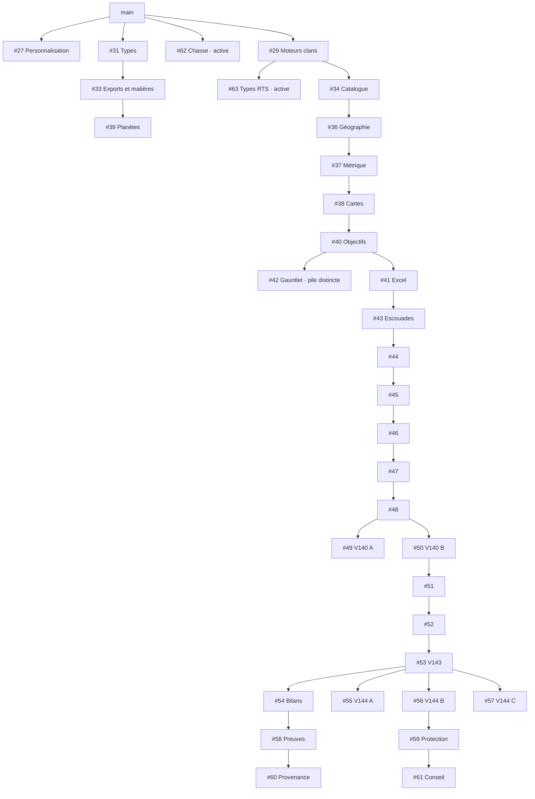

# Reprise des PR empilées et de leurs suivis Excel — 1er novembre 2026

Audit documentaire borné de **33 PR ouvertes**, inventoriées vers 00:30 UTC. Vérification des racines avant intégration : `main` `f1856f6670fd959ed012c38f84e6d90d6f86a361`, [#31](https://github.com/darknigthmare/yautja-la-longue-chasse/pull/31) alors ouverte à `67fa9fab2e580abb907fa5de0679cd73237c9407`, [#27](https://github.com/darknigthmare/yautja-la-longue-chasse/pull/27) à `0bf37a88401f840e3902f9566b3a805e258ce533`. Rédaction : `2026-11-01T00:40:01+00:00`.

**Progrès confirmé après ce snapshot : [#31](https://github.com/darknigthmare/yautja-la-longue-chasse/pull/31) fusionnée normalement le `2026-11-01T00:37:33Z`, commit [`81fc1916fc285ca85d3c434737bc35b1e5f2fb7f`](https://github.com/darknigthmare/yautja-la-longue-chasse/commit/81fc1916fc285ca85d3c434737bc35b1e5f2fb7f).** `main` pointe sur ce commit à la vérification suivante. Le coordinateur a exécuté 15 tests ciblés, lint sans erreur et TypeScript complet sur le code intégré ; cet audit documentaire ne s’attribue pas ces exécutions. Le snapshot initial des 33 PR et ses anciens états restent conservés dans le JSON.

**Suite confirmée le 1er novembre, sans réécriture du snapshot :**

| Événement postérieur | État confirmé | Preuve |
| --- | --- | --- |
| Première mise à jour #27 | Tête `05087a4bc1673a1df10ebb4435e800824883a0df`, confirmée REST et ls-remote ; commit créé à 00:57:35 UTC. À ce premier relevé, la réconciliation suivante de `main` n’était pas encore poussée. | [REST](pr-progress-events/pr27-05087-rest.json), [commit](pr-progress-events/pr27-05087-commit.json), [ls-remote](pr-progress-events/pr27-05087-ls-remote.txt) |
| Réconciliation #27 ensuite poussée | Tête `9ad29df77e8a11ca36bf1b37f6b4c6f08db3d05d`, avance rapide depuis `05087a4b`, intégrant le `main` revu `c5fc51dc`. REST et ls-remote la confirment ; commit créé à 01:11:42 UTC. La PR reste ouverte ; les 41 tests, types et lint ciblés sont rapportés par son agent dédié, sans réattribuer les anciens essais Atlas. | [REST](pr-progress-events/pr27-9ad-rest.json), [commit](pr-progress-events/pr27-9ad-commit.json), [ls-remote](pr-progress-events/pr27-9ad-ls-remote.txt), [diagnostic dédié](PR27_DIAGNOSTIC.md) |
| Correctif #39 poussé | Tête `04d9d4dd306cc4e27d4c44c6a1eca01be9328b26`, parent direct `f54dd68c` ; deux corrections de types et nouveau job de typecheck complet. | [Qualification et suivi](PLANETES-PR33-39.md), [identité du commit](planet-pr33-39/pr39-pushed-source-identity.json) |
| Fusion normale #33 | À **01:04:42 UTC**, merge `c5fc51dc42d8e04a4a8f0ca79273c44e4921f7e1`, arbre identique à la tête qualifiée `63c345fc`. | [Événement](planet-pr33-39/pr33-final-state.json), [arbre](planet-pr33-39/pr33-merge-tree.json) |
| Nouvelle base #39 | **`main` à `c5fc51dc`**, tête `04d9d4dd` inchangée ; API mise à jour à 01:07:22 UTC. Le contenu n’est pas réécrit. | [Rattachement confirmé](planet-pr33-39/pr39-retarget-main-event.json) |
| Nouvelle CI #39 terminée | Run **41259282388 success sur `04d9d4dd`**, domaine, nouveau typecheck complet et Chromium tous verts ; mise à jour finale à 01:19:01 UTC. La tête distante est revérifiée, sans reprendre les anciens verts. | [Résultat final](planet-pr33-39/pr39-new-head-final.json), [tête après CI](planet-pr33-39/pr39-final-head.json) |
| Fusion normale #39 | À **01:27:01 UTC**, merge `f3a1acec8c2603b3442da774457dfe75947d97d8`, arbre identique à la tête revue et testée `04d9d4dd`. Intégration au runtime de travail sous `035880ea`, en conservant `netShares` V136 et les entrées explicites Natural Earth. | [Événement](planet-pr33-39/pr39-merged-event.json), [arbre](planet-pr33-39/pr39-merge-tree.json), [intégration](planet-pr33-39/pr39-root-integration.json) |

Ces événements sont ajoutés à `PR-STACKS.json.progressAfterSnapshot` pour les suivis automatiques. Les 33 lignes `pullRequests` et les 29 arêtes d’origine restent inchangées ; leur empreinte canonique est contrôlée avant/après l’ajout. La nouvelle CI de #39, [41259282388](https://github.com/darknigthmare/yautja-la-longue-chasse/actions/runs/41259282388), reste distincte de ses anciens runs verts ; son [état observé](planet-pr33-39/pr39-new-head-monitor.json) ne doit pas être remplacé par un résultat historique.

**Barrière de métadonnées : neuf événements post-snapshot finalisés, fichiers de cet agent stables pour le classeur de coordination.** La pile planètes #31 → #33 → #39 est désormais intégrée ; le graphe et les lignes ci-dessous restent ceux du snapshot de départ. Ils ne sont pas réécrits pour faire disparaître l’historique ou clôturer les travaux artistiques et gameplay encore ouverts.

Cet audit avance le travail de réconciliation : il relève les vraies dépendances, les fichiers concurrents et les classeurs effectivement présents. Il ne fusionne aucune PR, ne réécrit aucun classeur et ne clôture aucun chantier. Les contrôles du Homeworld et les qualifications de chasse en cours restent suivis séparément.

À 00:36:10 UTC, les PR #64 et #65 venaient de paraître et la tête de #63 avait changé. Leurs travaux actifs ne sont pas repris ici. Les SHA complets et cette activité récente figurent dans [PR-STACKS.json](PR-STACKS.json). Actualiser les têtes avant chaque intégration.

## Ordre de reprise vérifié

Au snapshot initial, les quatre racines sont #27 (personnalisation), #29 (moteurs de guerre), #31 (types planétaires) et #62 (qualifications chasse en cours). Les 29 autres PR dépendent alors d’une branche ouverte. Le numéro de version seul ne donne pas leur ordre de fusion.

Ordre concret de travail :

1. **#31 intégrée le 1er novembre à 00:37:33 UTC.** Son correctif transverse de types a été qualifié par le coordinateur avant fusion. Poursuivre #33 puis #39 sur cette base réellement intégrée, avec codes V102/V103/V115, export/import et parcours navigateur. Le graphe reste celui du snapshot avant cette fusion.
2. Corriger les échecs propres à #27 avant toute intégration. À la dernière lecture, le job applicatif du [run 41255961460](https://github.com/darknigthmare/yautja-la-longue-chasse/actions/runs/41255961460) sur sa tête exacte avait quatre étapes en échec : chasse V112, lint runtime, annulation Atlas sous Chromium et validation des palettes étendues. Un échec Vercel pour quota n’explique pas ces quatre erreurs.
3. Stabiliser #29 et son correctif de types #63 avec le propriétaire actif, puis vérifier la chaîne #34 → #36 → #37 → #38 → #40. Les 1 200 variantes constituent un catalogue de conception ; elles ne deviennent pas 1 200 scènes jouées en fusionnant cette chaîne.
4. Après #40, traiter séparément #41 → #43 et #42. Leurs interfaces partagent notamment `ClanWarBibleV6Panel.tsx` ; la pile gauntlet n’inclut pas les évolutions de la pile escouades.
5. Poursuivre #43 → #44 → #45 → #46 → #47 → #48, puis réconcilier les deux V140 (#49/#50) avant de reporter leurs comportements dans #51 → #52 → #53. Garder les deux classeurs sources identifiables.
6. Réconcilier ensuite les quatre enfants V144 (#54/#55/#56/#57). #54 → #58 → #60 et #56 → #59 → #61 sont deux branches différentes ; ni l’une ni l’autre ne contient automatiquement les fonctions des autres enfants.
7. Relancer types/lint, tests cumulés, sauvegardes anciennes et parcours réels sur le résultat commun avant de promouvoir les lignes Excel concernées. Retargeter une PR après intégration de son parent demande de vérifier son nouveau diff, pas d’écraser sa branche.

La liste topologique complète et ses couches se trouvent dans le JSON. Elle indique un ordre de revue possible, pas une autorisation technique de fusion automatique.

## Collisions concrètes à réconcilier

| Branches | Fichiers communs modifiés | Travail nécessaire |
| --- | ---: | --- |
| #49 / #50 | 9 | Deux moteurs d’évolution V140, UI, workflow, test de production, tsconfig et **même chemin de classeur XLSX**. #49 ajoute `planWarAssaultWavesV140`, incidents et trafic RTS ; #50 ajoute profils de vagues, progression Outer Ops, patrouille et fenêtre météo RTS. Les suites de #51+ suivent #50. Conserver les exigences de #49 lors du rapprochement. |
| #54 / #55 / #56 / #57 | 6 à 10 selon la paire | Workflow `clan-war-v144.yml`, interfaces, test de production et tsconfig se recouvrent ; les évolutions de modes et leurs tests diffèrent. Donner des noms distincts aux tests/avenants avant un cumul, puis vérifier les interactions et les coûts. |
| #55 / #57 | 10 | Deux XLSX **différents sous le même chemin V144**, en plus des moteurs et tests concurrents. Aucun des deux ne remplace l’autre sans perte de suivi. |
| #56 / #57 | 10 | Même nouveau module `clanWarStealthReinforcementV144.ts`, mais blobs et exports différents : `commandWarStealthAlertReinforcementV144` d’un côté ; `warStealthReinforcementV144` / `warStealthSecondGuardStepV144` de l’autre. Réconcilier le format sauvegardé et les appels. |
| #60 / #61 | 4 | Même workflow/README/test de production/tsconfig V146, avec deux audits fonctionnels différents. Garder distincts l’audit de provenance V115/V85 et le dossier du Conseil avec reçus W133. |
| #42 / #43 | 1 | Point d’entrée Bible V6 partagé ; vérifier les deux entrées et les interfaces après intégration. |
| #42 / #39 | 0 dans leurs diffs bornés | Aucun fichier de diff commun constaté ; cela ne prouve pas l’absence d’interaction dans le runtime final. |

Les huit observations de blobs du JSON épinglent les chemins, tailles et SHA Git aux vraies têtes. Les deux collisions Excel les plus directes sont :

| Même chemin dans deux PR | Première version | Deuxième version |
| --- | --- | --- |
| `docs/clan-war-v140/Yautja_Guerres_Clans_Suivi_Production_V140_2026-10-31.xlsx` | #49 : blob `f9aa468ffbf60eadd01906e43d546f6547cebd06`, 357 776 octets, **49 feuilles** | #50 : blob `3cdd1d1d7f201e01e037e0a543e64a560e4514bc`, 379 347 octets, **52 feuilles** |
| `docs/clan-war-v144/Yautja_Guerres_Clans_Suivi_Production_V144_2026-10-31.xlsx` | #55 : blob `fe76b659c2955905bd05ae3cbaef1b83ef9afe45`, 34 819 octets, **9 feuilles** | #57 : blob `412dca71428ade3d28d462e3a0029e6a633544cf`, 33 228 octets, **9 feuilles** |

GitHub annonçait les PR fusionnables contre **leur propre base**. Cet audit n’a pas simulé de fusion entre branches sœurs : les collisions de chemins et de blobs sont établies, leur résolution finale reste à exécuter et tester.

## État des contrôles

Les métadonnées de **20 runs cités** ont été relues via l’API : conclusion `success` et SHA égal à la tête du snapshot. Cela porte sur les PR #39, #43, #44, #45, #46, #47, #48, #49, #50, #51, #52, #53, #54, #55, #56, #57, #58, #59, #60, #61. Le nombre de tests revendiqué dans un corps de PR n’a pas été recalculé depuis les logs par cet audit.

Le dernier run cité dans #27 et dans #42 était vert mais ne portait pas sur leur tête du snapshot. Il demeure une preuve de son ancien SHA ; il ne qualifie pas un commit ultérieur. Les PR sans run cité ne sont pas déclarées sans tests : leurs checks API sont listés séparément dans le JSON et doivent être relus sur le dernier SHA.

**28 PR** présentaient un statut Vercel pointant explicitement vers `upgradeToPro=build-rate-limit`. Ce quota est distinct des échecs de test, d’un job annulé ou d’un job en cours. CodeRabbit `SKIPPED` n’est pas une revue artistique ou une qualification gameplay.

Aucun test Node, parcours navigateur, essai manette, rendu natif Excel, recalcul de formule, mesure de performance ou déploiement n’a été exécuté par cet audit documentaire. Les contrôles ZIP/XML suivants sont les seules vérifications binaires locales de cette tâche.

## Classeurs binaires inspectés

Les douze vrais blobs XLSX ci-dessous ont été téléchargés au SHA immuable, ouverts comme ZIP, puis indexés par les relations du workbook. Les noms de feuilles, leurs parties XML, leurs empreintes et le SHA256 du fichier complet sont disponibles dans le JSON.

| PR et tête | Source XLSX | Octets | Feuilles |
| --- | --- | ---: | ---: |
| [#48](https://github.com/darknigthmare/yautja-la-longue-chasse/pull/48) · `86bc0816` | [Yautja_Guerres_Clans_Suivi_Production_V139_2026-10-31.xlsx](https://github.com/darknigthmare/yautja-la-longue-chasse/blob/86bc081601975874d323e67f535bc1668b89ccc0/docs/clan-war-v139/Yautja_Guerres_Clans_Suivi_Production_V139_2026-10-31.xlsx) | 338 291 | 45 |
| [#49](https://github.com/darknigthmare/yautja-la-longue-chasse/pull/49) · `d567d657` | [Yautja_Guerres_Clans_Suivi_Production_V140_2026-10-31.xlsx](https://github.com/darknigthmare/yautja-la-longue-chasse/blob/d567d657f0b9e316eb951a50132efc02e64f671f/docs/clan-war-v140/Yautja_Guerres_Clans_Suivi_Production_V140_2026-10-31.xlsx) | 357 776 | 49 |
| [#50](https://github.com/darknigthmare/yautja-la-longue-chasse/pull/50) · `0b64a5ff` | [Yautja_Guerres_Clans_Suivi_Production_V140_2026-10-31.xlsx](https://github.com/darknigthmare/yautja-la-longue-chasse/blob/0b64a5ffbbd3d58e10fbdfed6d55a9ce4613237d/docs/clan-war-v140/Yautja_Guerres_Clans_Suivi_Production_V140_2026-10-31.xlsx) | 379 347 | 52 |
| [#53](https://github.com/darknigthmare/yautja-la-longue-chasse/pull/53) · `37583f63` | [Yautja_Guerres_Clans_Suivi_Production_V143_2026-10-31.xlsx](https://github.com/darknigthmare/yautja-la-longue-chasse/blob/37583f63ea5c68554b06868b577b96cadb7bcfd3/docs/clan-war-v143/Yautja_Guerres_Clans_Suivi_Production_V143_2026-10-31.xlsx) | 523 571 | 73 |
| [#54](https://github.com/darknigthmare/yautja-la-longue-chasse/pull/54) · `cadd1242` | [Yautja_Guerres_Clans_Contrats_Bilans_V144_2026-10-31.xlsx](https://github.com/darknigthmare/yautja-la-longue-chasse/blob/cadd1242926a3ecfc0c19682f524294ac9641e3c/docs/clan-war-v144/Yautja_Guerres_Clans_Contrats_Bilans_V144_2026-10-31.xlsx) | 33 993 | 9 |
| [#55](https://github.com/darknigthmare/yautja-la-longue-chasse/pull/55) · `fa032280` | [Yautja_Guerres_Clans_Suivi_Production_V144_2026-10-31.xlsx](https://github.com/darknigthmare/yautja-la-longue-chasse/blob/fa0322800d5c51e16a4dd56ef6d0fc80d8020394/docs/clan-war-v144/Yautja_Guerres_Clans_Suivi_Production_V144_2026-10-31.xlsx) | 34 819 | 9 |
| [#56](https://github.com/darknigthmare/yautja-la-longue-chasse/pull/56) · `8452dc21` | [Yautja_Guerres_Clans_Avenant_Production_V144_2026-10-31.xlsx](https://github.com/darknigthmare/yautja-la-longue-chasse/blob/8452dc217e3b92469c156e54dc1be18280bbe141/docs/clan-war-v144/Yautja_Guerres_Clans_Avenant_Production_V144_2026-10-31.xlsx) | 30 273 | 8 |
| [#57](https://github.com/darknigthmare/yautja-la-longue-chasse/pull/57) · `f25cd7a3` | [Yautja_Guerres_Clans_Suivi_Production_V144_2026-10-31.xlsx](https://github.com/darknigthmare/yautja-la-longue-chasse/blob/f25cd7a33e04f789e7c6df231ccad9116a50b38c/docs/clan-war-v144/Yautja_Guerres_Clans_Suivi_Production_V144_2026-10-31.xlsx) | 33 228 | 9 |
| [#58](https://github.com/darknigthmare/yautja-la-longue-chasse/pull/58) · `a9a8dceb` | [Yautja_Guerres_Clans_Preuves_Transfert_V145_2026-11-01.xlsx](https://github.com/darknigthmare/yautja-la-longue-chasse/blob/a9a8dcebcd05774b73db1e371c04cbd6373c32da/docs/clan-war-v145/Yautja_Guerres_Clans_Preuves_Transfert_V145_2026-11-01.xlsx) | 61 088 | 19 |
| [#59](https://github.com/darknigthmare/yautja-la-longue-chasse/pull/59) · `985e036b` | [Yautja_Guerres_Clans_Avenants_Production_V144_V145_2026-11-01.xlsx](https://github.com/darknigthmare/yautja-la-longue-chasse/blob/985e036b5e4a3ef00077c515e102e9230b2b7bb4/docs/clan-war-v145/Yautja_Guerres_Clans_Avenants_Production_V144_V145_2026-11-01.xlsx) | 58 897 | 16 |
| [#60](https://github.com/darknigthmare/yautja-la-longue-chasse/pull/60) · `9e595ef5` | [Yautja_Guerres_Clans_Provenance_V146_2026-11-01.xlsx](https://github.com/darknigthmare/yautja-la-longue-chasse/blob/9e595ef585412f75958d22174ebacf50d188d2d8/docs/clan-war-v146/Yautja_Guerres_Clans_Provenance_V146_2026-11-01.xlsx) | 79 555 | 26 |
| [#61](https://github.com/darknigthmare/yautja-la-longue-chasse/pull/61) · `dfa21d9d` | [Yautja_Guerres_Clans_Avenants_Production_V144_V146_2026-11-01.xlsx](https://github.com/darknigthmare/yautja-la-longue-chasse/blob/dfa21d9d6a65d484e61792b201185fd5ea98f288/docs/clan-war-v146/Yautja_Guerres_Clans_Avenants_Production_V144_V146_2026-11-01.xlsx) | 85 510 | 24 |

Les avenants sont distincts du gros historique V143 à 73 feuilles. Leur tableau de bord peut évoluer ; le mot « historique » ne suffit pas à revendiquer des octets identiques.

| Parent → enfant | Feuilles du parent encore nommées | Parties de feuille XML identiques | Feuilles renommées ou supprimées |
| --- | ---: | ---: | --- |
| #48 → #49 | 45/45 | 19/45 | Aucune |
| #48 → #50 | 45/45 | 23/45 | Aucune |
| #54 → #58 | 9/9 | 8/9 | Aucune |
| #56 → #59 | 8/8 | 7/8 | Aucune |
| #58 → #60 | 19/19 | 17/19 | Aucune |
| #59 → #61 | 16/16 | 14/16 | Aucune |

Exemples constatés : #54 → #58 actualise `00_PILOTAGE` ; #58 → #60 actualise `00_PILOTAGE` et `18_PILOTAGE_V145` ; #56 → #59 actualise `SUIVI_V144` ; #59 → #61 actualise `SUIVI_V144` et `SUIVI_V145`. Aucune feuille de ces parents n’est absente. Ces mises à jour ne sont pas qualifiées d’erreurs ; elles doivent rester décrites comme des mises à jour, et non comme une conservation binaire intégrale.

Pour réconcilier les branches, conserver leurs fichiers originaux et leurs empreintes, aligner les IDs d’exigence/QA/source, puis créer un nouvel avenant cumulatif avec références aux deux variantes. Un simple remplacement du XLSX en conflit perdrait un des suivis.

## Inventaire des 33 PR du snapshot

| PR | Parent | État observé | Tête complète | XLSX dans le diff |
| --- | --- | --- | --- | ---: |
| [#27](https://github.com/darknigthmare/yautja-la-longue-chasse/pull/27) | main | Ouverte | `0bf37a88401f840e3902f9566b3a805e258ce533` | 14 |
| [#29](https://github.com/darknigthmare/yautja-la-longue-chasse/pull/29) | main | Brouillon | `d4d00129a7f09376cdce2f969ea2e00acc2ad75b` | 0 |
| [#31](https://github.com/darknigthmare/yautja-la-longue-chasse/pull/31) | main | Ouverte | `67fa9fab2e580abb907fa5de0679cd73237c9407` | 0 |
| [#33](https://github.com/darknigthmare/yautja-la-longue-chasse/pull/33) | #31 | Ouverte | `63c345fc7eaf999225df8f35cab787b8152f0b2c` | 0 |
| [#34](https://github.com/darknigthmare/yautja-la-longue-chasse/pull/34) | #29 | Brouillon | `bfd3aba70ca2c7d95985182d7e8e6607ab86c86c` | 0 |
| [#36](https://github.com/darknigthmare/yautja-la-longue-chasse/pull/36) | #34 | Brouillon | `cb60036cd362363c2e066506916c4cd65bbe18e7` | 0 |
| [#37](https://github.com/darknigthmare/yautja-la-longue-chasse/pull/37) | #36 | Brouillon | `2ce26d31dae0f339775d141cb486f8886b6a9dfe` | 0 |
| [#38](https://github.com/darknigthmare/yautja-la-longue-chasse/pull/38) | #37 | Brouillon | `77e8699ce838e08a68e40ece2d1811411287c022` | 0 |
| [#39](https://github.com/darknigthmare/yautja-la-longue-chasse/pull/39) | #33 | Ouverte | `f54dd68ce1a8708409d0075f0dcc7a76f2be647b` | 0 |
| [#40](https://github.com/darknigthmare/yautja-la-longue-chasse/pull/40) | #38 | Brouillon | `769e1fe16e0e141b39d12d0fafab6a5341a60f8f` | 0 |
| [#41](https://github.com/darknigthmare/yautja-la-longue-chasse/pull/41) | #40 | Brouillon | `c63e74d018533f8fa2d596d9203b1b9c93438698` | 1 |
| [#42](https://github.com/darknigthmare/yautja-la-longue-chasse/pull/42) | #40 | Brouillon | `c722c4e67cdb064b2d607eb6eabbd98f769227c4` | 18 |
| [#43](https://github.com/darknigthmare/yautja-la-longue-chasse/pull/43) | #41 | Brouillon | `d91363c465f7fc3aaa0dfd270bdce84921efcb3d` | 2 |
| [#44](https://github.com/darknigthmare/yautja-la-longue-chasse/pull/44) | #43 | Brouillon | `1e5c835cfc72774a1c0a9c76684fffbd650144e5` | 1 |
| [#45](https://github.com/darknigthmare/yautja-la-longue-chasse/pull/45) | #44 | Brouillon | `91e0f5bf2033c2e9123d34fbe4498c5565ecd6c7` | 1 |
| [#46](https://github.com/darknigthmare/yautja-la-longue-chasse/pull/46) | #45 | Brouillon | `504a4d63850802583bcdb68222f67c9536f2c7c7` | 1 |
| [#47](https://github.com/darknigthmare/yautja-la-longue-chasse/pull/47) | #46 | Brouillon | `fa5bd464b4a39fa8d34975ac02820ef34e513d37` | 1 |
| [#48](https://github.com/darknigthmare/yautja-la-longue-chasse/pull/48) | #47 | Brouillon | `86bc081601975874d323e67f535bc1668b89ccc0` | 1 |
| [#49](https://github.com/darknigthmare/yautja-la-longue-chasse/pull/49) | #48 | Brouillon | `d567d657f0b9e316eb951a50132efc02e64f671f` | 1 |
| [#50](https://github.com/darknigthmare/yautja-la-longue-chasse/pull/50) | #48 | Brouillon | `0b64a5ffbbd3d58e10fbdfed6d55a9ce4613237d` | 1 |
| [#51](https://github.com/darknigthmare/yautja-la-longue-chasse/pull/51) | #50 | Brouillon | `fc4de092bd179d4cf0da1a6c203bd2001029702a` | 1 |
| [#52](https://github.com/darknigthmare/yautja-la-longue-chasse/pull/52) | #51 | Brouillon | `b70a0492566600d2a308ca95c3ee9f83dd6dfdc2` | 1 |
| [#53](https://github.com/darknigthmare/yautja-la-longue-chasse/pull/53) | #52 | Brouillon | `37583f63ea5c68554b06868b577b96cadb7bcfd3` | 1 |
| [#54](https://github.com/darknigthmare/yautja-la-longue-chasse/pull/54) | #53 | Brouillon | `cadd1242926a3ecfc0c19682f524294ac9641e3c` | 1 |
| [#55](https://github.com/darknigthmare/yautja-la-longue-chasse/pull/55) | #53 | Brouillon | `fa0322800d5c51e16a4dd56ef6d0fc80d8020394` | 1 |
| [#56](https://github.com/darknigthmare/yautja-la-longue-chasse/pull/56) | #53 | Brouillon | `8452dc217e3b92469c156e54dc1be18280bbe141` | 1 |
| [#57](https://github.com/darknigthmare/yautja-la-longue-chasse/pull/57) | #53 | Brouillon | `f25cd7a33e04f789e7c6df231ccad9116a50b38c` | 1 |
| [#58](https://github.com/darknigthmare/yautja-la-longue-chasse/pull/58) | #54 | Brouillon | `a9a8dcebcd05774b73db1e371c04cbd6373c32da` | 1 |
| [#59](https://github.com/darknigthmare/yautja-la-longue-chasse/pull/59) | #56 | Brouillon | `985e036b5e4a3ef00077c515e102e9230b2b7bb4` | 1 |
| [#60](https://github.com/darknigthmare/yautja-la-longue-chasse/pull/60) | #58 | Brouillon | `9e595ef585412f75958d22174ebacf50d188d2d8` | 1 |
| [#61](https://github.com/darknigthmare/yautja-la-longue-chasse/pull/61) | #59 | Brouillon | `dfa21d9d6a65d484e61792b201185fd5ea98f288` | 1 |
| [#62](https://github.com/darknigthmare/yautja-la-longue-chasse/pull/62) | main | Brouillon · travail actif | `c7a179ef2fa34bda7d0dfd8e99f63e7d39e6c6c9` | 0 |
| [#63](https://github.com/darknigthmare/yautja-la-longue-chasse/pull/63) | #29 | Brouillon · travail actif | `8225a05181b166db80fbf8bbb61cb229db83b9a7` | 0 |

## Sources Excel des autres piles

Les chemins ci-dessous proviennent des vrais diffs paginés. Ils sont liés à la tête du snapshot : leur présence est constatée, leur contenu binaire n’a pas tous été qualifié par cet audit.

**[#27](https://github.com/darknigthmare/yautja-la-longue-chasse/pull/27)** — V113 — Ateliers chromatiques Yautja et textures PHG liées à la campagne

- [Yautja_PHG_Backlog_Production_V136.xlsx](https://github.com/darknigthmare/yautja-la-longue-chasse/blob/0bf37a88401f840e3902f9566b3a805e258ce533/docs/production/Yautja_PHG_Backlog_Production_V136.xlsx)
- [Yautja_PHG_Backlog_Production_V137.xlsx](https://github.com/darknigthmare/yautja-la-longue-chasse/blob/0bf37a88401f840e3902f9566b3a805e258ce533/docs/production/Yautja_PHG_Backlog_Production_V137.xlsx)
- [Yautja_PHG_Fidelite_1to1_V136.xlsx](https://github.com/darknigthmare/yautja-la-longue-chasse/blob/0bf37a88401f840e3902f9566b3a805e258ce533/docs/production/Yautja_PHG_Fidelite_1to1_V136.xlsx)
- [Yautja_PHG_Fidelite_1to1_V137.xlsx](https://github.com/darknigthmare/yautja-la-longue-chasse/blob/0bf37a88401f840e3902f9566b3a805e258ce533/docs/production/Yautja_PHG_Fidelite_1to1_V137.xlsx)
- [Yautja_PHG_Implementation_Status_V136.xlsx](https://github.com/darknigthmare/yautja-la-longue-chasse/blob/0bf37a88401f840e3902f9566b3a805e258ce533/docs/production/Yautja_PHG_Implementation_Status_V136.xlsx)
- [Yautja_PHG_Implementation_Status_V137.xlsx](https://github.com/darknigthmare/yautja-la-longue-chasse/blob/0bf37a88401f840e3902f9566b3a805e258ce533/docs/production/Yautja_PHG_Implementation_Status_V137.xlsx)
- [Yautja_PHG_Personnalisation_Audit_Production_V133.xlsx](https://github.com/darknigthmare/yautja-la-longue-chasse/blob/0bf37a88401f840e3902f9566b3a805e258ce533/docs/production/Yautja_PHG_Personnalisation_Audit_Production_V133.xlsx)
- [Yautja_PHG_Personnalisation_Audit_Production_V134.xlsx](https://github.com/darknigthmare/yautja-la-longue-chasse/blob/0bf37a88401f840e3902f9566b3a805e258ce533/docs/production/Yautja_PHG_Personnalisation_Audit_Production_V134.xlsx)
- [Yautja_PHG_Personnalisation_Audit_Production_V135.xlsx](https://github.com/darknigthmare/yautja-la-longue-chasse/blob/0bf37a88401f840e3902f9566b3a805e258ce533/docs/production/Yautja_PHG_Personnalisation_Audit_Production_V135.xlsx)
- [Yautja_PHG_Personnalisation_Audit_Production_V136.xlsx](https://github.com/darknigthmare/yautja-la-longue-chasse/blob/0bf37a88401f840e3902f9566b3a805e258ce533/docs/production/Yautja_PHG_Personnalisation_Audit_Production_V136.xlsx)
- [Yautja_PHG_Personnalisation_Audit_Production_V137.xlsx](https://github.com/darknigthmare/yautja-la-longue-chasse/blob/0bf37a88401f840e3902f9566b3a805e258ce533/docs/production/Yautja_PHG_Personnalisation_Audit_Production_V137.xlsx)
- [Yautja_PHG_QA_Visual_Morphologies_V138.xlsx](https://github.com/darknigthmare/yautja-la-longue-chasse/blob/0bf37a88401f840e3902f9566b3a805e258ce533/docs/production/Yautja_PHG_QA_Visual_Morphologies_V138.xlsx)
- [Yautja_PHG_QA_Visual_Morphologies_V139.xlsx](https://github.com/darknigthmare/yautja-la-longue-chasse/blob/0bf37a88401f840e3902f9566b3a805e258ce533/docs/production/Yautja_PHG_QA_Visual_Morphologies_V139.xlsx)
- [Yautja_PHG_QA_Visual_Morphologies_V140.xlsx](https://github.com/darknigthmare/yautja-la-longue-chasse/blob/0bf37a88401f840e3902f9566b3a805e258ce533/docs/production/Yautja_PHG_QA_Visual_Morphologies_V140.xlsx)

**[#41](https://github.com/darknigthmare/yautja-la-longue-chasse/pull/41)** — V130 — Excel de production guerre des clans par game mode et QA fidélité 1:1

- [Yautja_Guerres_Clans_Plan_Production_V130_2026-10-30.xlsx](https://github.com/darknigthmare/yautja-la-longue-chasse/blob/c63e74d018533f8fa2d596d9203b1b9c93438698/docs/clan-war-v130/Yautja_Guerres_Clans_Plan_Production_V130_2026-10-30.xlsx)

**[#42](https://github.com/darknigthmare/yautja-la-longue-chasse/pull/42)** — V131–V148 [draft] — 54 gauntlets, 30 planètes, 4 modes, garde-fous multionglets et Excel

- [Yautja_ClanWar_V144_Conflits_Onglets.xlsx](https://github.com/darknigthmare/yautja-la-longue-chasse/blob/c722c4e67cdb064b2d607eb6eabbd98f769227c4/docs/Yautja_ClanWar_V144_Conflits_Onglets.xlsx)
- [Yautja_ClanWar_V145_Multiplanetes.xlsx](https://github.com/darknigthmare/yautja-la-longue-chasse/blob/c722c4e67cdb064b2d607eb6eabbd98f769227c4/docs/Yautja_ClanWar_V145_Multiplanetes.xlsx)
- [Yautja_ClanWar_V146_30Planetes_Chrome.xlsx](https://github.com/darknigthmare/yautja-la-longue-chasse/blob/c722c4e67cdb064b2d607eb6eabbd98f769227c4/docs/Yautja_ClanWar_V146_30Planetes_Chrome.xlsx)
- [Yautja_ClanWar_V147_Quatre_Modes.xlsx](https://github.com/darknigthmare/yautja-la-longue-chasse/blob/c722c4e67cdb064b2d607eb6eabbd98f769227c4/docs/Yautja_ClanWar_V147_Quatre_Modes.xlsx)
- [Yautja_ClanWar_V148_Securite_Multionglets.xlsx](https://github.com/darknigthmare/yautja-la-longue-chasse/blob/c722c4e67cdb064b2d607eb6eabbd98f769227c4/docs/Yautja_ClanWar_V148_Securite_Multionglets.xlsx)
- [Yautja_Gauntlets_V132_Arsenal_Clans.xlsx](https://github.com/darknigthmare/yautja-la-longue-chasse/blob/c722c4e67cdb064b2d607eb6eabbd98f769227c4/docs/Yautja_Gauntlets_V132_Arsenal_Clans.xlsx)
- [Yautja_Gauntlets_V133_Arsenal_Clans.xlsx](https://github.com/darknigthmare/yautja-la-longue-chasse/blob/c722c4e67cdb064b2d607eb6eabbd98f769227c4/docs/Yautja_Gauntlets_V133_Arsenal_Clans.xlsx)
- [Yautja_Gauntlets_V134_Arsenal_Clans.xlsx](https://github.com/darknigthmare/yautja-la-longue-chasse/blob/c722c4e67cdb064b2d607eb6eabbd98f769227c4/docs/Yautja_Gauntlets_V134_Arsenal_Clans.xlsx)
- [Yautja_Gauntlets_V135_Arsenal_Clans.xlsx](https://github.com/darknigthmare/yautja-la-longue-chasse/blob/c722c4e67cdb064b2d607eb6eabbd98f769227c4/docs/Yautja_Gauntlets_V135_Arsenal_Clans.xlsx)
- [Yautja_Gauntlets_V136_Arsenal_Clans.xlsx](https://github.com/darknigthmare/yautja-la-longue-chasse/blob/c722c4e67cdb064b2d607eb6eabbd98f769227c4/docs/Yautja_Gauntlets_V136_Arsenal_Clans.xlsx)
- [Yautja_Gauntlets_V137_Arsenal_Clans.xlsx](https://github.com/darknigthmare/yautja-la-longue-chasse/blob/c722c4e67cdb064b2d607eb6eabbd98f769227c4/docs/Yautja_Gauntlets_V137_Arsenal_Clans.xlsx)
- [Yautja_Gauntlets_V138_Arsenal_Clans.xlsx](https://github.com/darknigthmare/yautja-la-longue-chasse/blob/c722c4e67cdb064b2d607eb6eabbd98f769227c4/docs/Yautja_Gauntlets_V138_Arsenal_Clans.xlsx)
- [Yautja_Gauntlets_V139_Arsenal_Clans.xlsx](https://github.com/darknigthmare/yautja-la-longue-chasse/blob/c722c4e67cdb064b2d607eb6eabbd98f769227c4/docs/Yautja_Gauntlets_V139_Arsenal_Clans.xlsx)
- [Yautja_Gauntlets_V140_Arsenal_Clans.xlsx](https://github.com/darknigthmare/yautja-la-longue-chasse/blob/c722c4e67cdb064b2d607eb6eabbd98f769227c4/docs/Yautja_Gauntlets_V140_Arsenal_Clans.xlsx)
- [Yautja_Gauntlets_V141_Arsenal_Clans.xlsx](https://github.com/darknigthmare/yautja-la-longue-chasse/blob/c722c4e67cdb064b2d607eb6eabbd98f769227c4/docs/Yautja_Gauntlets_V141_Arsenal_Clans.xlsx)
- [Yautja_Gauntlets_V142_Arsenal_Clans.xlsx](https://github.com/darknigthmare/yautja-la-longue-chasse/blob/c722c4e67cdb064b2d607eb6eabbd98f769227c4/docs/Yautja_Gauntlets_V142_Arsenal_Clans.xlsx)
- [Yautja_Gauntlets_V143_Controle_Tours.xlsx](https://github.com/darknigthmare/yautja-la-longue-chasse/blob/c722c4e67cdb064b2d607eb6eabbd98f769227c4/docs/Yautja_Gauntlets_V143_Controle_Tours.xlsx)
- [Yautja_Gauntlets_V144_Controle_Campagne.xlsx](https://github.com/darknigthmare/yautja-la-longue-chasse/blob/c722c4e67cdb064b2d607eb6eabbd98f769227c4/docs/Yautja_Gauntlets_V144_Controle_Campagne.xlsx)

**[#43](https://github.com/darknigthmare/yautja-la-longue-chasse/pull/43)** — V133–V134 — RTS W3 multi-escouades, ordres synchronisés, escortes et Excel de production

- [Yautja_Guerres_Clans_Suivi_Production_V133_2026-10-31.xlsx](https://github.com/darknigthmare/yautja-la-longue-chasse/blob/d91363c465f7fc3aaa0dfd270bdce84921efcb3d/docs/clan-war-v133/Yautja_Guerres_Clans_Suivi_Production_V133_2026-10-31.xlsx)
- [Yautja_Guerres_Clans_Suivi_Production_V134_2026-10-31.xlsx](https://github.com/darknigthmare/yautja-la-longue-chasse/blob/d91363c465f7fc3aaa0dfd270bdce84921efcb3d/docs/clan-war-v134/Yautja_Guerres_Clans_Suivi_Production_V134_2026-10-31.xlsx)

**[#44](https://github.com/darknigthmare/yautja-la-longue-chasse/pull/44)** — V135 — Guerres de clans : assaut, Outer Ops, infiltration et RTS développés en parallèle

- [Yautja_Guerres_Clans_Suivi_Production_V135_2026-10-31.xlsx](https://github.com/darknigthmare/yautja-la-longue-chasse/blob/1e5c835cfc72774a1c0a9c76684fffbd650144e5/docs/clan-war-v135/Yautja_Guerres_Clans_Suivi_Production_V135_2026-10-31.xlsx)

**[#45](https://github.com/darknigthmare/yautja-la-longue-chasse/pull/45)** — V136 — 4 modes avancés : défense d’assaut, ravitaillement Outer Ops, couvert d’infiltration et veille RTS

- [Yautja_Guerres_Clans_Suivi_Production_V136_2026-10-31.xlsx](https://github.com/darknigthmare/yautja-la-longue-chasse/blob/91e0f5bf2033c2e9123d34fbe4498c5565ecd6c7/docs/clan-war-v136/Yautja_Guerres_Clans_Suivi_Production_V136_2026-10-31.xlsx)

**[#46](https://github.com/darknigthmare/yautja-la-longue-chasse/pull/46)** — V137 — Guerres des clans : quatre game modes poursuivis, 31 onglets Excel et QA source

- [Yautja_Guerres_Clans_Suivi_Production_V137_2026-10-31.xlsx](https://github.com/darknigthmare/yautja-la-longue-chasse/blob/504a4d63850802583bcdb68222f67c9536f2c7c7/docs/clan-war-v137/Yautja_Guerres_Clans_Suivi_Production_V137_2026-10-31.xlsx)

**[#47](https://github.com/darknigthmare/yautja-la-longue-chasse/pull/47)** — V138 — Quatre game modes : percée, bulletins Outer Ops, écoute furtive et secouristes RTS

- [Yautja_Guerres_Clans_Suivi_Production_V138_2026-10-31.xlsx](https://github.com/darknigthmare/yautja-la-longue-chasse/blob/fa5bd464b4a39fa8d34975ac02820ef34e513d37/docs/clan-war-v138/Yautja_Guerres_Clans_Suivi_Production_V138_2026-10-31.xlsx)

**[#51](https://github.com/darknigthmare/yautja-la-longue-chasse/pull/51)** — V141 — 4 modes : tirs simultanés, Outer Ops pondérées, leurres 2D, IA RTS et Excel 59 feuilles

- [Yautja_Guerres_Clans_Suivi_Production_V141_2026-10-31.xlsx](https://github.com/darknigthmare/yautja-la-longue-chasse/blob/fc4de092bd179d4cf0da1a6c203bd2001029702a/docs/clan-war-v141/Yautja_Guerres_Clans_Suivi_Production_V141_2026-10-31.xlsx)

**[#52](https://github.com/darknigthmare/yautja-la-longue-chasse/pull/52)** — V142 — 4 modes : ciblage, itinéraires réels, guidage physique et Excel 66 onglets (132 tests)

- [Yautja_Guerres_Clans_Suivi_Production_V142_2026-10-31.xlsx](https://github.com/darknigthmare/yautja-la-longue-chasse/blob/b70a0492566600d2a308ca95c3ee9f83dd6dfdc2/docs/clan-war-v142/Yautja_Guerres_Clans_Suivi_Production_V142_2026-10-31.xlsx)

## Travail produit encore ouvert par pile

| Pile | Résultat à vérifier sur le cumul | Limite de portée à conserver dans les Excel |
| --- | --- | --- |
| Personnalisation #27 | Corriger les quatre échecs applicatifs observés, comparer sauvegardes et rendu réel des palettes/classes/assets ; refaire les preuves du dernier SHA. | Contrôle de palette ou XLSX présent ne certifie pas une morphologie PHG 1:1. |
| Planètes #31 → #33 → #39 | Types complets, recette versionnée, déterminisme, liens entre régions, surfaces traversables et eaux/laves/glaces, import/export ZIP, contrôles WebGL et interface après cumul. | Matière exportable, rendu observé et déplacement physique sont trois états différents ; aucune fidélité filmique n’est induite par le générateur. |
| Clans #29 → #40 | Dernier moteur source avec correctif de types, vraie navigation des cartes, objectifs joués, persistance et retour depuis les quatre modes. | Les 1 200 variantes et 6 000 plans IA ne sont pas tous des niveaux exécutés ; multijoueur décrit ne signifie pas transport serveur livré. |
| Clans #41 → #53 + #49 | Réconcilier le fork V140, garder les IDs/personnes/coûts et les actions réelles, compléter les parcours navigateur/manette et les sources du nouveau suivi cumulatif. | Conserver la distinction prototype V6, carte W3, territoire V85 et lieu réel ; pas de récompenses/conquêtes implicites. |
| Clans #54/#55/#56/#57 → #60/#61 | Rapprocher les fonctions V144 concurrentes, les sauvegardes, workflows/tests et avenants. Tester le résultat commun et ses imports documentaires. | `W3-Kxx` et `CON-Txx` ne sont pas une correspondance autorisée ; ni l’audit de provenance ni un dossier Conseil ne finalise la campagne V85. |
| Gauntlet #42 | Refaire un contrôle au dernier SHA, préserver sa pile et vérifier l’entrée Bible, les quatre modes, les conflits multionglets et les preuves déclarées. | L’existence de nombreux XLSX n’établit ni les 54 modèles/animations complets ni toutes les scènes/30 planètes jouées ; vérifier chaque lot selon son propre contrat. |
| Chasse #62 et correctif #63 | Laisser les agents propriétaires terminer leurs lots actifs ; réintégrer ensuite les nouveaux SHA avec les tests appropriés. | Aucune clôture ou modification de ces travaux actifs par le présent audit. |

Les travaux restants du produit ne sont pas tous des blocages de fusion d’un lot borné. Chaque PR doit décrire ce qu’elle livre, ce qu’elle a réellement vérifié et ce qu’elle laisse au suivi. Le registre courant doit ensuite refléter le code intégré et ses preuves, sans promouvoir toute une famille à « terminé ».

## Provenance et vérification documentaire

Sources : API GitHub des PR, diffs paginés (jusqu’à 462 fichiers pour #42), métadonnées des derniers runs cités, Git blobs immuables des douze XLSX et relations XML internes. Les JSON bruts volumineux restent dans le répertoire temporaire de travail ; le rapport portable garde les champs utiles, les SHA et les observations bornées. Aucune donnée d’authentification ou URL signée de logs n’est incluse.

Le JSON ne prétend pas être un gel runtime. Sa structure, ses dépendances, la correspondance des 33 numéros, ses 12 empreintes XLSX et ses liens locaux sont contrôlés lors de sa génération. Les protocoles de preuve de chaque chantier restent applicables.

