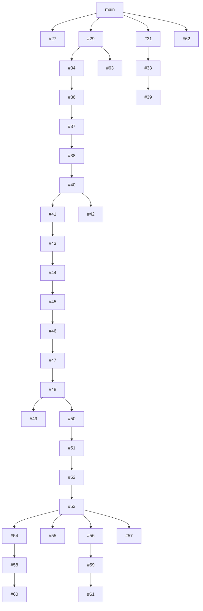

# Reprise des PR ouvertes — observation du 1er novembre 2026

Instantané de lecture de **33 PR ouvertes** autour de 00:30 UTC. Base distante `f1856f6670fd959ed012c38f84e6d90d6f86a361`. Les jobs en cours, nouveaux commits et nouvelles PR peuvent modifier cet état. Le [registre JSON](PR_INVENTORY.json) conserve les têtes exactes, bases et liens des contrôles ; aucune fusion n’est certifiée par cet inventaire.

## Travail historique déjà intégré

- PR #23 (chasse V112) fusionnée le 28 octobre ; commit de fusion `3943522296dff8cdb2d183dd7f9b7132b2a912c6`.
- PR #24 (Homeworld/Pit V112) fusionnée le 30 octobre ; commit de fusion `c7d25cde16e6876bbf840fa8064ae1a13fb7a304`. Sa dernière tête est `e0d68d40c2f32215b521a475a102903f02c2c24f`, après intégration de la chasse.
- Le correctif de reprise R5 reste nécessaire : sur cette base `main`, le nouveau repère des registres est encore en `(6140, 5020)` et la garde des points/parcours d’activités V104–V111 n’existe pas. Les preuves compilées R4 restent historiques ; une nouvelle publication doit désigner le nouveau runtime.

## Ordre et dépendances

Les flèches représentent les **bases GitHub déclarées**, pas une validation du contenu. La mention `MERGEABLE` indique seulement l’absence de conflit avec la base courante. Les frères #49/#50 et #54/#55/#56/#57 contiennent des variantes parallèles ; leur réunion exige une revue des recouvrements et de nouveaux tests.

## Lots à traiter

| Lot | Dépendances | État observé et prochaine action |
| --- | --- | --- |
| Types planétaires #31 | main | Petite racine de six fichiers ; contrôles de domaine/compatibilité verts, ancienne application annulée. Revue et reproduction isolées avant intégration. |
| Masques et matières #33 → #39 | #31 | Racines non draft. Les jobs ciblés de #39 sont verts sur `f54dd68c` ; revue de la pile et validation de l’application réunie nécessaires. |
| Personnalisation #27 | main | Contrôles spécialisés et TypeScript verts. Le job application encore en cours a déjà échoué sur chasse V112, lint runtime et Atlas Chromium ; conserver ces échecs, diagnostiquer et refaire les contrôles après correction. |
| Modes de clan #29 → #34 → #36 → #37 → #38 → #40 | main, puis chaîne | Drafts ; #29 a un échec gameplay-cloud et une application annulée. La chaîne ne devient pas prête par ses seuls tests de domaine. |
| Scénarios et progression #41 → #43 → #44 → #45 → #46 → #47 → #48 | #40 | Drafts empilées ; tests spécialisés majoritairement verts. Intégrer dans cet ordre seulement après validation de la racine et des contrats communs. |
| Branches après #48 | #49 ou #50 → #51 → #52 → #53 | #49 et #50 sont deux enfants de #48, à comparer avant réunion. |
| Branches après #53 | #54 → #58 → #60 ; #55 ; #56 → #59 → #61 ; #57 | Quatre enfants distincts de #53. Ne pas écraser un frère avec un descendant d’un autre. |
| Gauntlet #42 | #40 | Grande branche parallèle aux progrès #41+. Les contrats et collisions de fichiers doivent être comparés avant intégration. |
| Qualification chasse #62 | main | Draft et jobs actifs ; propriétaire concurrent, lecture seule dans cette reprise. |
| Réduction de type RTS #63 | #29 | Nouvelle draft active ; un fichier, tests/build explicitement encore à exécuter selon le corps de PR. Ne pas la déclarer livrée. |

## Vérifications et limites

- Vercel affiche souvent une limite de débit de builds. Ce statut d’infrastructure est distinct d’un échec de test ; il ne faut ni l’appeler validation produit, ni lui attribuer les véritables erreurs du job application.
- Les PR #46 et #52 étaient `CLEAN` mais restent des drafts sur des bases non fusionnées.
- Les 1 134 contrôles visuels de personnalisation et les dossiers de fidélité artistique ne sont pas clôturés par des tests de coordonnées, d’alpha, de SHA ou de TypeScript.
- Une nouvelle tête, une base changée ou une réunion de branches impose une vérification de ce code précis. Les anciens rapports conservent leurs commits, ressources et périmètres.

## Inventaire des têtes

| PR | Base | Tête | Draft | Fusion GitHub | Sujet |
| --- | --- | --- | --- | --- | --- |
| [#27](https://github.com/darknigthmare/yautja-la-longue-chasse/pull/27) | main | `0bf37a88401f` | non | UNSTABLE | V113 — Ateliers chromatiques Yautja et textures PHG liées à la campagne |
| [#29](https://github.com/darknigthmare/yautja-la-longue-chasse/pull/29) | main | `d4d00129a7f0` | oui | UNSTABLE | V115–V123 — Guerres de clans : 4 modes, 6 RTS W3 scénarisés et rapports persistants |
| [#31](https://github.com/darknigthmare/yautja-la-longue-chasse/pull/31) | main | `67fa9fab2e58` | non | UNSTABLE | V122 — Compatibilité TypeScript V103/V115 du générateur de planètes |
| [#33](https://github.com/darknigthmare/yautja-la-longue-chasse/pull/33) | #31 | `63c345fc7eaf` | non | UNSTABLE | V124–V125 — Masques modulaires, surface physique et 32 nouvelles matières planétaires |
| [#34](https://github.com/darknigthmare/yautja-la-longue-chasse/pull/34) | #29 | `bfd3aba70ca2` | oui | UNSTABLE | V120 — 1 200 variantes de guerres de clans : 4 gameplays × 3 contextes × 100 |
| [#36](https://github.com/darknigthmare/yautja-la-longue-chasse/pull/36) | #34 | `cb60036cd362` | oui | UNSTABLE | V126 — Terre WGS84, cohérence des 1 200 lieux, 6 000 profils IA et protocole multijoueur |
| [#37](https://github.com/darknigthmare/yautja-la-longue-chasse/pull/37) | #36 | `2ce26d31dae0` | oui | UNSTABLE | V127 — Terre WGS84 métrique et 6 000 plans IA à quatre phases |
| [#38](https://github.com/darknigthmare/yautja-la-longue-chasse/pull/38) | #37 | `77e8699ce838` | oui | UNSTABLE | V128 — 12 cartes W3 aux dimensions source, navigation et extraction réellement jouables |
| [#39](https://github.com/darknigthmare/yautja-la-longue-chasse/pull/39) | #33 | `f54dd68ce1a8` | non | UNSTABLE | V128–V155 — Planètes : générateur, biomes PBR, relief, pentes et traversée jouable |
| [#40](https://github.com/darknigthmare/yautja-la-longue-chasse/pull/40) | #38 | `769e1fe16e0e` | oui | UNSTABLE | V129 — 24 missions RTS W3 : 72 objectifs physiques, escortes et preuves de réussite |
| [#41](https://github.com/darknigthmare/yautja-la-longue-chasse/pull/41) | #40 | `c63e74d01853` | oui | UNSTABLE | V130 — Excel de production guerre des clans par game mode et QA fidélité 1:1 |
| [#42](https://github.com/darknigthmare/yautja-la-longue-chasse/pull/42) | #40 | `c722c4e67cdb` | oui | UNSTABLE | V131–V148 [draft] — 54 gauntlets, 30 planètes, 4 modes, garde-fous multionglets et Excel |
| [#43](https://github.com/darknigthmare/yautja-la-longue-chasse/pull/43) | #41 | `d91363c465f7` | oui | UNSTABLE | V133–V134 — RTS W3 multi-escouades, ordres synchronisés, escortes et Excel de production |
| [#44](https://github.com/darknigthmare/yautja-la-longue-chasse/pull/44) | #43 | `1e5c835cfc72` | oui | UNSTABLE | V135 — Guerres de clans : assaut, Outer Ops, infiltration et RTS développés en parallèle |
| [#45](https://github.com/darknigthmare/yautja-la-longue-chasse/pull/45) | #44 | `91e0f5bf2033` | oui | UNSTABLE | V136 — 4 modes avancés : défense d’assaut, ravitaillement Outer Ops, couvert d’infiltration et veille RTS |
| [#46](https://github.com/darknigthmare/yautja-la-longue-chasse/pull/46) | #45 | `504a4d638508` | oui | CLEAN | V137 — Guerres des clans : quatre game modes poursuivis, 31 onglets Excel et QA source |
| [#47](https://github.com/darknigthmare/yautja-la-longue-chasse/pull/47) | #46 | `fa5bd464b4a3` | oui | UNSTABLE | V138 — Quatre game modes : percée, bulletins Outer Ops, écoute furtive et secouristes RTS |
| [#48](https://github.com/darknigthmare/yautja-la-longue-chasse/pull/48) | #47 | `86bc08160197` | oui | UNSTABLE | V139 — 4 modes en parallèle : replis physiques, Outer Ops figées, sabotage discret et évacuations RTS |
| [#49](https://github.com/darknigthmare/yautja-la-longue-chasse/pull/49) | #48 | `d567d657f0b9` | oui | UNSTABLE | V140 — 4 points ouverts du suivi Excel : garnisons PC, incidents Outer Ops, circuits infiltration et trafic RTS |
| [#50](https://github.com/darknigthmare/yautja-la-longue-chasse/pull/50) | #48 | `0b64a5ffbbd3` | oui | UNSTABLE | V140 — Guerres de clans : 4 modes cohérents, patrouilles physiques, 108 tests et Excel 52 onglets |
| [#51](https://github.com/darknigthmare/yautja-la-longue-chasse/pull/51) | #50 | `fc4de092bd17` | oui | UNSTABLE | V141 — 4 modes : tirs simultanés, Outer Ops pondérées, leurres 2D, IA RTS et Excel 59 feuilles |
| [#52](https://github.com/darknigthmare/yautja-la-longue-chasse/pull/52) | #51 | `b70a04925666` | oui | CLEAN | V142 — 4 modes : ciblage, itinéraires réels, guidage physique et Excel 66 onglets (132 tests) |
| [#53](https://github.com/darknigthmare/yautja-la-longue-chasse/pull/53) | #52 | `37583f63ea5c` | oui | UNSTABLE | V143 — 4 modes : assaut défensif, incidents Outer Ops, sprint furtif, marche RTS et Excel 73 onglets (145 tests) |
| [#54](https://github.com/darknigthmare/yautja-la-longue-chasse/pull/54) | #53 | `cadd1242926a` | oui | UNSTABLE | V144 — Bilans source-vérifiés des quatre modes, sécurité V6/V85 et suivi QA Excel |
| [#55](https://github.com/darknigthmare/yautja-la-longue-chasse/pull/55) | #53 | `fa0322800d5c` | oui | UNSTABLE | V144 — 4 modes : regroupement, inspections, patrouilles et relève RTS (157 tests + Excel) |
| [#56](https://github.com/darknigthmare/yautja-la-longue-chasse/pull/56) | #53 | `8452dc217e3b` | oui | UNSTABLE | V144 — Guerres des clans : 4 modes améliorés, 157 tests verts et Excel QA 8 onglets |
| [#57](https://github.com/darknigthmare/yautja-la-longue-chasse/pull/57) | #53 | `f25cd7a33e04` | oui | UNSTABLE | V144 — Guerres des clans : quatre modes avancés, 157 tests et registre de production |
| [#58](https://github.com/darknigthmare/yautja-la-longue-chasse/pull/58) | #54 | `a9a8dcebcd05` | oui | UNSTABLE | V145 — 4 modes : preuves V115 archivables dans V85 sans conquête, Excel 19 onglets et 174 tests |
| [#59](https://github.com/darknigthmare/yautja-la-longue-chasse/pull/59) | #56 | `985e036b5e4a` | oui | UNSTABLE | V145 — 4 modes progressent, 171 tests verts et Excel de production 16 onglets |
| [#60](https://github.com/darknigthmare/yautja-la-longue-chasse/pull/60) | #58 | `9e595ef58541` | oui | UNSTABLE | V146 — 4 modes : provenance W3-K/CON-T, rosters non appariés, 26 onglets Excel et QA |
| [#61](https://github.com/darknigthmare/yautja-la-longue-chasse/pull/61) | #59 | `dfa21d9d6a65` | oui | UNSTABLE | V146 — Conseil des clans : 4 modes, dossiers source vérifiables et Excel 24 onglets (184 tests) |
| [#62](https://github.com/darknigthmare/yautja-la-longue-chasse/pull/62) | main | `c7a179ef2fa3` | oui | UNSTABLE | Chasse V112 : clôturer les qualifications ouvertes du classeur |
| [#63](https://github.com/darknigthmare/yautja-la-longue-chasse/pull/63) | #29 | `8225a05181b1` | oui | UNSTABLE | Corriger le type des scénarios RTS source |
