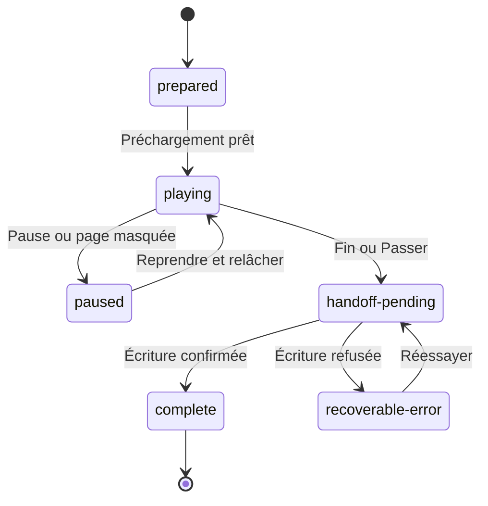

# Arrivée planétaire — contrat de séquence de 62 secondes

**État dans la PR #104 : storyboard et contrat d’implémentation conservés, hors du périmètre implémenté ici.** Les travaux des worktrees parallèles ne sont pas évalués par ce document. La séquence donne une continuité visuelle entre la préparation d'une chasse et le terrain. Elle conserve une capsule distincte du vaisseau personnel et du Clan Ship AVP.

## 1. Référence et intention

Le brief demande une inspiration de l'ouverture de *Predator* (1987), jusqu'à 1:02, avec le nom de la planète à la place du titre, un largage de capsule, sa descente, son arrivée en vue latérale et la sortie du chasseur. La [page officielle de 20th Century Studios](https://www.20thcenturystudios.com/movies/predator) confirme l'identité du film, sa réalisation par John McTiernan et sa sortie en 1987. Elle ne fournit pas le découpage de l'ouverture demandé. Le montage exact et les timecodes de la copie de référence n'ont donc pas été vérifiés.

Les huit plans ci-dessous constituent **un montage original de 62 secondes fondé sur le brief**. Le titre est rendu par l'interface et jamais peint dans une image. La musique, les logos et les cartons du film ne font pas partie des assets. Le storyboard conserve la logique départ → séparation → descente → terrain, avec une adaptation aux silhouettes effectivement possédées par le joueur.

## 2. Destination et passage au jeu

Le point d'entrée actuel est `launchMission` dans `app/game/GameClient.tsx`. Il faut préserver ses vérifications de campagne, la configuration de chasse et l'identité d'exécution gérée par `activeHuntSave.ts`. L'arrivée doit s'intercaler **après validation de la mission, avant l'activation de la simulation**, sans relancer `launchMission` à la fin de chaque plan.

Le contrat d'entrée proposé comprend : `ownerCreatedAt`, `runId`, `missionId`, `destinationId`, `destinationDisplayName`, `biomeId`, `personalShipId`, `hunterPresetId`, `spawnId`, `seed` et `sequenceVersion`. Tous les identifiants viennent des catalogues et de la campagne ; aucune chaîne fournie par l'interface ne devient directement un chemin d'asset. Le nom de planète accepte la localisation et l'affichage multiligne avec une limite prévue par l'UI. Le transport affiché ne modifie pas la coque sélectionnée.

Le `spawnId` désigne un point de départ validé par le niveau. La capsule doit se poser près de ce point ; le niveau n'est pas régénéré à chaque rechargement de la cinématique. Un retour au menu avant la prise de contrôle reprend la même mission, le même `runId`, la même graine et la même destination.

## 3. Découpage proposé

Les intervalles utilisent un début inclus et une fin exclue. Le dernier plan se termine exactement à 62 000 ms. Les entrées sonores sont des intentions de production, sans fichier audio livré.

| Plan | Intervalle | Durée | Image et action | Caméra et lisibilité | Événement métier |
|---|---:|---:|---|---|---|
| `orbit` | 0–7 s | 7 s | Planète et champ spatial ; destination identifiable | Plan large stable, planète hors de la zone du titre | Aucun |
| `title` | 7–13 s | 6 s | Nom de planète, sous-titre de région facultatif | Texte UI sobre, fondu, temps de lecture complet | Aucun |
| `carrier` | 13–23 s | 10 s | Passage du vaisseau personnel ou transport réellement choisi | Silhouette entière ; la caméra n'en coupe pas le nez | Aucun |
| `release` | 23–31 s | 8 s | Capsule se détache, transporte le chasseur, devient indépendante | Point de séparation clairement visible ; aucun objet fusionné | Aucun spawn, aucune consommation nouvelle |
| `descent` | 31–41 s | 10 s | Capsule descend vers la couche atmosphérique | Trajectoire continue et orientation cohérente | Aucun |
| `atmosphere` | 41–49 s | 8 s | Entrée atmosphérique ; traînée et lueur séparées | Vitesse suggérée sans flash plein écran ni roulis violent | Aucun |
| `landing` | 49–57 s | 8 s | Coupe vers le sol latéral ; arrivée et poussière | Sol horizontal aligné sur le niveau, sortie libre | Préparer le point initial, sans activer la simulation |
| `egress` | 57–62 s | 5 s | Porte ouverte, chasseur sort puis se place au point initial | Même échelle et direction que le gameplay | À la fin seulement : confirmer le relais unique |

La somme des durées est une donnée calculable de production. Le montage peut évoluer en modifiant les durées, mais le déclenchement métier n'est jamais attaché à une frame d'image ou à un callback `animationend` susceptible d'être sauté.

### Composition du dernier plan

Le sol et la caméra partagent les unités du niveau. La capsule reste derrière l'acteur une fois la sortie terminée. Son battant et sa poussière sont des objets séparés ; ils ne deviennent pas un grand rectangle de collision. La position finale du chasseur correspond au `spawnId`. Sa première pose de gameplay conserve costume, équipement, orientation et échelle ; une image de chasseur générique n'est pas substituée au preset sélectionné.

## 4. Horloge et état déterministes

État documentaire proposé : `prepared`, `playing`, `paused`, `handoff-pending`, `complete`, `recoverable-error`. Les noms définitifs doivent être harmonisés avec le système de mission lors de l'implémentation.

La progression utilise une horloge monotone en millisecondes de temps actif. La durée passée en pause, dans les réglages ou en arrière-plan est exclue. À la reprise après interruption longue, ne pas intégrer le grand delta de temps mur : le plan reprend à son temps actif enregistré. Le rendu calcule directement le plan, son avancement normalisé et les poses à partir de ce temps. Il ne rejoue pas une série d'événements pour rattraper des frames manquées.

Une version courte est un paramètre de présentation distinct, sans changer la mission. La version « mouvements réduits » conserve le texte, les huit étapes narratives et les actions métier ; elle remplace les grands déplacements par des plans fixes et fondus sobres. Elle n'accélère pas une séquence sans décision du joueur.

## 5. Commandes et interruption

La cinématique possède seule ses entrées. Clavier : Échap ouvre la pause, une action explicite « Passer l'arrivée » termine le montage. Pointeur et tactile : boutons visibles Pause, Reprendre et Passer, accessibles à 320 px. Manette : navigation de menu existante et confirmation au front montant. Le bouton maintenu qui a lancé la mission doit être relâché avant qu'une action de la cinématique soit autorisée.

Le saut utilise la même fonction de relais que la fin naturelle. Il ne synthétise pas tous les plans intermédiaires et ne simule pas plusieurs atterrissages. La pause bloque l'horloge et les actions du niveau. La fermeture des réglages réinitialise les touches et attend un état neutre de la manette. Le retour au menu conserve l'arrivée préparée ; il ne la transforme pas en échec de chasse.

Le mute et le volume suivent les réglages existants. Un éventuel échec de lecture audio ne bloque pas l'arrivée. Les effets d'entrée atmosphérique et d'impact n'exigent ni vibration ni tremblement pour expliquer l'action. Aucun son n'est déclenché une deuxième fois à la reprise dans la même phase.

## 6. Sauvegarde et relais unique

Le propriétaire de l'état reste la campagne. L'état de présentation doit être versionné et inclus dans les mêmes chemins d'archive et d'emplacement que la mission. Ne pas créer une nouvelle clé `localStorage` isolée sans l'inclure aux transactions et contrôles existants. `ownerCreatedAt`, `runId` et `sequenceVersion` sont obligatoires ; un état d'une autre campagne ou version future est refusé avant écriture.

### Préparation

1. Valider destination, mission, coque, preset et point de départ.
2. Créer une seule identité de chasse. Les coûts éventuels restent ceux du flux de mission existant.
3. Enregistrer l'arrivée préparée et les données nécessaires à une reprise déterministe.
4. Après confirmation de l'écriture, précharger les assets requis puis afficher la cinématique.

### Fin naturelle et saut

1. Bloquer une nouvelle demande de fin pour ce `runId`.
2. Construire le snapshot initial du niveau à partir du même `spawnId` et de la même graine.
3. Écrire ensemble la fin d'arrivée et l'état reprenable du niveau par le mécanisme de transaction existant ou une extension explicitement testée.
4. Relire et vérifier la confirmation. Une incertitude d'écriture ouvre la récupération et ne lance pas le niveau en parallèle.
5. Monter la scène de chasse une seule fois, puis lui attribuer les entrées après relâchement.

Il n'est pas possible de déduire cette atomicité de deux `setItem` consécutifs. Le raccordement doit réutiliser les gardes d'archive et de campagne du projet, tester l'arrêt entre chaque étape d'écriture, et définir la règle de récupération avant d'annoncer le relais comme achevé.

### Reprise

Un checkpoint `playing` reprend au début du plan courant pour éviter une demi-pose incohérente, en conservant le même `runId`. Un checkpoint `handoff-pending` examine l'état durable : s'il contient déjà le snapshot initial validé, il reprend le jeu ; sinon il reprend la récupération. `complete` ne rejoue jamais l'arrivée lors de Continuer. Un replay de cinématique depuis les archives est purement visuel et ne peut écrire de mission, donner une récompense ou déclencher un spawn.

## 7. Assets et ancrages

Les dimensions sont des cibles de production ; aucun des nouveaux fichiers listés n'est déclaré généré par cette fiche. Les candidatures existantes sont le vaisseau personnel et `avp-predator-drop-pod` du catalogue, à vérifier visuellement. La capsule du catalogue ne certifie pas une capsule de *Predator* (1987).

| ID | Asset individuel | Cible px | Alpha | Pivot | Usage / plan |
|---|---|---:|---|---|---|
| `arrival-space` | Champ d'étoiles | 2048 × 1024 | Non | 0.5, 0.5 | Fond orbital, sans texte |
| `arrival-planet` | Disque planétaire | 1024 × 1024 | Oui | 0.5, 0.5 | Matériau selon destination, atmosphère séparée |
| `arrival-carrier` | Vaisseau de transport | Catalogue | Oui si disponible | Centre de masse | Silhouette réelle du vaisseau choisi |
| `arrival-pod-flight` | Capsule fermée en vol | 768 × 1024 | Oui | Centre de masse | Trajectoire orbitale et descente |
| `arrival-release-fx` | Jet de séparation | 512 × 512 | Oui | Point d'éjection | VFX bref, arrière de capsule |
| `arrival-clouds` | Couche atmosphérique | 2048 × 1024 | Oui | 0.5, 0.5 | Arrière / avant selon plan, sans collision |
| `arrival-heat-trail` | Traînée thermique | 1024 × 512 | Oui | 0, 0.5 | Attachée à la direction de vitesse |
| `arrival-ground` | Fond de terrain latéral | 2048 × 1024 | Non | Ligne de sol | Raccord au biome et à la caméra de chasse |
| `arrival-pod-ground` | Capsule au sol | 1024 × 1024 | Oui | 0.5, 1 | Base fixe, contour solide explicite |
| `arrival-pod-door` | Battant de capsule | 512 × 1024 | Oui | Charnière documentée | Élément séparé, pas de collision après ouverture |
| `arrival-dust` | Poussière d'impact | 1024 × 512 | Oui | 0.5, 1 | Devant le sol, derrière la sortie du chasseur |
| `arrival-hunter-egress` | Sortie du chasseur | Atlas existant | Oui | Pieds | Preset courant, poses et cadence du projet |

Le nom de planète, la progression, les sous-titres et les contrôles restent du texte UI. L'image ne contient pas de typographie imitée du générique. Précharger seulement les vues nécessaires à la destination courante ; libérer les ressources de montage après le relais. Les variantes de biome partagent les mêmes ancres de capsule et de sol.

Les [fiches individuelles](individual-asset-prompts.md#arrivée-planétaire) fournissent dix prompts de génération et deux instructions de réemploi. Le transport et la sortie du chasseur conservent leurs ressources de campagne. Les poses éventuellement absentes du rig devront être commandées individuellement après constat du manque. Les images futures et les variantes par biome ne sont pas comptées comme déjà générées.

## 8. Échecs prévus

| Situation | Comportement attendu |
|---|---|
| Asset décoratif absent | Fond sobre et nom de destination conservés ; possibilité de passer |
| Capsule absente | Présentation de secours statique ; même relais de mission, sans faux véhicule de remplacement |
| Mission ou destination non valide | Retour contrôlé au briefing, sans nouveau coût ni nouveau run |
| Campagne changée pendant le chargement | Annuler le chargement devenu obsolète ; aucune écriture dans la nouvelle campagne |
| Écriture refusée ou non confirmée | Écran de récupération, réessai explicite, aucun double montage de niveau |
| Page masquée ou appareil mis en veille | Pause du temps actif et du son, reprise sur commande explicite |
| Manette débranchée | Conserver pause/pointeur/clavier ; ne pas avancer automatiquement |
| Nom long ou caractères localisés | Mise en page sur deux lignes, taille minimale lisible, zone sûre |

## 9. Recette future

Le futur test unitaire doit vérifier les frontières `0`, `6999`, `7000`, `12999`, chaque début et chaque fin de plan, `61999` et `62000`, la pause, le grand delta après suspension et la sélection de version. Un test d'intégration doit couvrir deux demandes simultanées de fin, le maintien d'une touche, l'échec de chaque étape d'écriture, le retour au menu dans chaque phase, le changement de propriétaire et l'import d'un état futur.

La recette navigateur doit suivre une arrivée complète, un saut depuis chaque plan, un rechargement pendant la descente et une reprise après relais confirmé. Elle contrôle le `runId`, le nombre de montages de niveau, la position initiale et la conservation de la coque. Les captures doivent montrer le titre de destination, la capsule séparée du vaisseau et la sortie du chasseur à l'échelle du jeu. Les mouvements réduits et les formats 1440, 390 et 320 px ont leur propre parcours.

Ces contrôles sont des exigences d'acceptation de la cinématique. Ils ne sont pas inclus dans les tests Clan Ship déjà réussis.

## 10. Audio et effets séparés

| ID | Plan | Ressource sonore prévue | Règle d’exécution |
|---|---|---|---|
| `AR-S01` | Orbite | Ambiance spatiale basse en boucle | Volume du jeu ; arrêt à la sortie du montage |
| `AR-S02` | Transport | Passage du véhicule à l’échelle de la caméra | Une occurrence par entrée naturelle dans le plan |
| `AR-S03` | Largage | Déverrouillage puis impulsion de séparation | Aucun effet métier ; pas de redéclenchement à la reprise |
| `AR-S04` | Atmosphère | Turbulence progressive | Intensité liée au temps actif, pause avec l’image |
| `AR-S05` | Atterrissage | Impact puis retombée | Intensité limitée ; aucune vibration obligatoire |
| `AR-S06` | Sortie | Battant et pas du chasseur courant | Synchro avec les poses utilisées ; arrêt au relais |

Ces six cues sont à produire ou à raccorder à des fichiers originaux ou licenciés. Leurs identifiants de production n’ajoutent pas encore de piste au manifeste audio. Un échec audio conserve les commandes, le nom de destination et le relais de mission.

Le jet de séparation, la traînée thermique, les nuages et la poussière restent des images indépendantes. Leur durée, opacité et orientation sont calculées par la séquence. Le mode de mouvements réduits retire le tremblement, réduit les traversées rapides et garde l’ordre narratif. Le choix « Passer » arrête les effets et emprunte la même confirmation durable que la fin naturelle.
