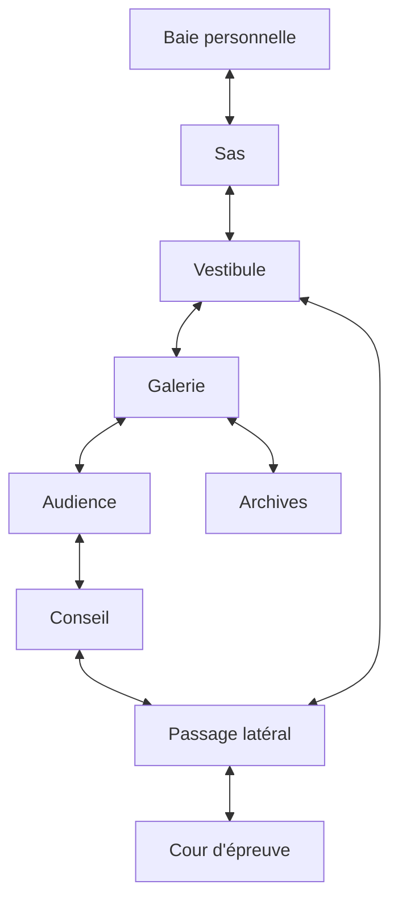

# Château orbital — contrat de conception

**État dans la PR #104 : dossier de conception conservé, hors du périmètre implémenté ici.** Les travaux château des worktrees parallèles ne sont pas évalués par ce document. Le château constitue une destination autonome du projet Yautja : La Longue Chasse. Le Clan Ship AVP reste le vaisseau collectif déjà relié à l'amarrage et aux services. Le château reçoit sa propre identité, son parcours et sa progression.

## 1. Référence et périmètre

Le brief utilisateur situe le château du Predator King dans le Wolf System et l'associe à *Predator vs. Black Panther*. La [fiche Marvel du numéro 1](https://www.marvel.com/comics/issue/120985/predator_vs_black_panther_2024_1_variant/variant) confirme la série de 2024, Benjamin Percy et Chris Allen, ainsi qu'un conflit entre rois. Le [catalogue du distributeur de l'édition Marvel](https://www.penguinrandomhouse.com/books/769516/predator-vs-black-panther-by-benjamin-percy/) confirme que le recueil rassemble les numéros 1 à 4 et décrit la rivalité de deux frères Yautja autour du vibranium. Ces descriptions ne suffisent pas à certifier la forme d'un château orbital, son échelle ou le plan de ses pièces.

Les sources consultées et leurs limites figurent dans [references.md](references.md). « Wolf System » et « château orbital » restent les références demandées par le brief tant qu'une page primaire accessible n'établit pas précisément le lieu. Les proportions, portes, pièces et interactions ci-dessous sont des choix de conception pour le jeu. Aucun numéro de planète, nom de roi, lien de parenté supplémentaire ou événement de succession n'est ajouté au codex comme fait établi.

### Choix de réalisation

Première version proposée : **une audience de campagne avec visite limitée et retour garanti au vaisseau personnel**. Le trajet est pacifique. Le joueur y consulte un ordre de mission et peut accepter ou différer cette mission. Le château n'accorde ni nouvelles armes, ni statistiques, ni propriété de vaisseau par le seul fait d'y entrer. Les extensions « hub permanent » et « instance d'assaut » restent deux modes futurs utilisant le même lieu et des données de mission distinctes.

L'accès de campagne dépendra d'un événement explicite de la chronicle, choisi dans les données narratives existantes. Aucun rang chiffré ni coût inventé n'est imposé par ce document. Avant raccordement, la donnée de mission doit fournir un `invitationId` stable et le motif d'ouverture. Une invitation absente conserve la destination visible dans les archives mais ne lance aucun voyage.

## 2. Lecture extérieure

La silhouette doit lire comme une forteresse fixe : cœur massif, tours ou contreforts périphériques, couronne défensive, baies encastrées et axe cérémoniel perceptible. La petite coque du joueur reste une entité séparée. Les surfaces n'ont pas à reproduire une coque AVP agrandie.

Trois vues sont à produire avant le kit final : silhouette extérieure trois quarts, coupe de circulation simplifiée et salle d'audience à hauteur de personnage. La coupe est un document de conception et ne devient pas un décor jouable. Les images n'intègrent ni titres, ni légendes, ni personnages imposés. La planète de fond et le champ d'étoiles restent séparés pour permettre leur localisation et leur profondeur propres.

Les points visibles qui guident le joueur sont la baie d'accueil, la porte du vestibule, un axe central de lumière et la silhouette de l'estrade. Les zones non accessibles ont une fonction visuelle claire sans fausse porte interactive.

## 3. Parcours et pièces

Les identifiants ci-dessous sont **proposés**, réservés au dossier de conception. Ils ne sont pas ajoutés à `ClanShipRoomId`.

| ID proposé | Lieu et usage | Repère visuel | Entrées et sorties | Interaction prévue |
|---|---|---|---|---|
| `royal-berth` | Baie d'accueil du vaisseau personnel | Silhouette de la coque du joueur et ancrages monumentaux | Vaisseau personnel, sas | Repartir ou rejoindre le sas |
| `royal-airlock` | Contrôle d'accès et transition de pression | Deux cadres de porte et une console isolée | Baie, vestibule | Contrôler l'invitation sans la consommer |
| `royal-vestibule` | Orientation et seuil cérémoniel | Perspective vers la grande galerie | Sas, galerie, passage latéral | Lire l'objectif et la destination courante |
| `royal-gallery` | Axe principal des trophées et du clan | Socles latéraux, sol central dégagé | Vestibule, audience, archives | Consulter uniquement les entrées de codex déjà autorisées |
| `royal-audience` | Audience de campagne | Estrade et siège dominant, espace d'approche libre | Galerie, conseil | Déclencher la scène narrative éligible une seule fois |
| `royal-council` | Préparation d'une mission royale | Table tactique et témoins de décision | Audience, passage latéral | Consulter, accepter ou différer l'ordre prévu par la campagne |
| `royal-archives` | Lecture historique facultative | Terminal et parois de données | Galerie | Lire les documents accessibles sans fabriquer de lore |
| `royal-court` | Cour d'épreuve facultative future | Grande aire centrale vide et portiques | Passage latéral | Emplacement réservé, sans récompense ni combat par défaut |
| `royal-service-pass` | Retour court et évacuation | Conduits et repère de baie | Conseil, vestibule, cour | Rejoindre le sas sans retraverser l'audience |

Le chemin de campagne est baie → sas → vestibule → galerie → audience → conseil. Après la décision, le passage latéral permet de revenir au vestibule. Les archives sont facultatives. La cour reste fermée dans la première version, avec une raison d'accès explicite. Toutes les portes du chemin de retour restent praticables, indépendamment de l'acceptation de mission.

### Rythme proposé

La baie enseigne le déplacement sans enjeu. Le sas montre la première interaction. Le vestibule révèle l'échelle. La galerie ménage la marche et la lecture. L'audience concentre le dialogue. Le conseil permet une décision active, puis le retour est court. Ces durées sont des cibles de mise en scène : 30–45 s de découverte jusqu'à la galerie, 20–30 s de traversée de galerie, dialogue librement avançable, moins de 30 s de retour après le conseil. Elles devront être mesurées avec la vitesse et la caméra réellement retenues.

## 4. Géométrie et collisions

La conception utilise une vue latérale avec une faible profondeur de sol, compatible avec le chemin DOM/CSS du Clan Ship. La position du personnage désigne ses pieds. Les collisions utilisent l'empreinte au sol, distincte du rectangle de l'image. Une nervure haute ou un effet lumineux ne devient pas un obstacle invisible.

Les métriques se dérivent du contrôleur intégré au moment de l'implémentation : diamètre d'acteur `D`, vitesse `V`, portée d'interaction `R`. Un passage obligatoire doit mesurer au moins `3D` de largeur libre. Chaque service réserve une aire de stationnement d'au moins `2D × 2D`, reliée au chemin principal et séparée de l'animation de porte. Les ouvertures de porte conservent un dégagement d'au moins `D` de chaque côté du point d'apparition. Aucune valeur de pixel de cette fiche ne remplace les métriques du module réel.

Chaque pièce doit contenir une apparition sûre, une sortie sûre et des volumes d'usage séparés des collisions. Les props ne traversent pas l'enveloppe réservée au service. La vérification du graphe doit prouver le retour depuis toute pièce accessible avec l'invitation courante. Un trajet refusé reste dans la pièce d'origine et laisse le personnage sur un point praticable.

## 5. Contrat des assets individuels

Les dimensions ci-dessous sont des **cibles de production**, pas les dimensions de fichiers déjà livrés. Les pivots sont normalisés : `(0,0)` en haut à gauche, `(0.5,1)` au centre inférieur. Le JSON [design-data.json](design-data.json) contient les mêmes identifiants pour le suivi de production. Les valeurs pourront être ajustées avant génération, puis les dimensions mesurées devront être enregistrées dans un manifeste d'assets effectifs.

| ID | Élément individuel | Cible px | Alpha | Pivot | Plan et collision |
|---|---|---:|---|---|---|
| `castle-space` | Fond spatial | 2048 × 1024 | Non | 0.5, 0.5 | Arrière lointain, aucune |
| `castle-planet` | Planète séparée | 1024 × 1024 | Oui | 0.5, 0.5 | Arrière lointain, aucune |
| `castle-exterior` | Forteresse complète | 2048 × 1536 | Oui | 0.5, 0.5 | Vue orbitale, aucune |
| `castle-berth-wall` | Paroi de baie | 1536 × 1024 | Non | 0.5, 1 | Arrière, aucune |
| `castle-bay-anchor` | Ancre de baie | 512 × 512 | Oui | 0.5, 1 | Objet, empreinte dédiée |
| `castle-airlock-frame` | Cadre de sas | 512 × 768 | Oui | 0.5, 1 | Avant de porte, ouverture exclue |
| `castle-airlock-leaf` | Battant séparé | 512 × 768 | Oui | 0.5, 1 | Porte, collision selon état |
| `castle-floor` | Module de sol | 1024 × 256 | Oui | 0, 0 | Structure, surface définie en code |
| `castle-column` | Pilier monumental | 512 × 1024 | Oui | 0.5, 1 | Objet trié par pied, empreinte étroite |
| `castle-gallery-wall` | Paroi de galerie | 1536 × 1024 | Non | 0.5, 1 | Arrière, aucune |
| `castle-trophy-plinth` | Socle de trophée vide | 512 × 512 | Oui | 0.5, 1 | Objet, empreinte dédiée |
| `castle-audience-wall` | Fond d'audience | 1536 × 1024 | Non | 0.5, 1 | Arrière, aucune |
| `castle-dais` | Estrade séparée | 1024 × 512 | Oui | 0.5, 1 | Structure, périmètre explicite |
| `castle-throne` | Siège du pouvoir vide | 768 × 1024 | Oui | 0.5, 1 | Objet, aucune action au seul clic image |
| `castle-council-table` | Table tactique | 1024 × 768 | Oui | 0.5, 1 | Objet, contour + aire d'usage |
| `castle-archive-console` | Terminal d'archives | 512 × 768 | Oui | 0.5, 1 | Objet, contour + aire d'usage |
| `castle-court-wall` | Fond de cour | 1536 × 1024 | Non | 0.5, 1 | Arrière, aucune |
| `castle-service-wall` | Passage latéral | 1536 × 1024 | Non | 0.5, 1 | Arrière, aucune |
| `castle-beacon` | Balise d'accès | 256 × 256 | Oui | 0.5, 1 | Signal visuel, aucune |
| `castle-fog` | Brume basse séparée | 1024 × 512 | Oui | 0.5, 1 | Effet arrière, aucune |

Les PNJ royaux sont un lot indépendant. Le chef assis du prologue et le véhicule `royal-predator-ship` ne sont pas renommés pour simuler un roi identifié ou un château. Les éventuels figurants doivent respecter le contrat d'atlas et de revue humaine du projet.

Chaque module dispose désormais de son [prompt individuel](individual-asset-prompts.md#château-orbital), conservé également dans `design-data.json`. Le contrat inclut le mode de livraison, la référence, le plan de profondeur, le pivot cible et les contrôles attendus. Les vingt fiches sont des demandes de production ; aucun asset du château n’est compté comme généré dans cette livraison.

### États et VFX

Le cadre ne bouge pas quand le battant s'ouvre. Les états autorisé, fermé et verrouillé reposent sur un libellé et une forme lisibles, en complément de la couleur. Les balises utilisent une pulsation lente, sans flash blanc plein écran. La brume reste derrière les pieds et les zones de service. Une version « mouvements réduits » supprime la parallaxe, les tremblements et la brume animée sans supprimer l'indication d'accès. Les éléments audio restent à produire séparément ; aucune musique ou piste extraite du film n'est incluse.

## 6. Routes, sauvegarde et événements

Les points de raccordement existants à examiner sont `GameClient.tsx` pour le propriétaire d'écran, `campaignSlots.ts` pour la localisation de reprise, `save.ts` pour la validation et `completeArchive.ts` pour l'archive intégrale. Le château ne doit pas être représenté par `clanShipDocking` : cette donnée identifie le seul vaisseau mère AVP.

Contrat proposé pour une future extension versionnée : `ownerCreatedAt`, `locationId`, `personalShipId`, `invitationId`, `phase`, `roomId`, `lastSafeEntrance`, `audienceEventId`, `audienceResolved`. Cette structure est documentaire. Avant de l'ajouter à `SaveGame`, définir migration, bornes de taille, refus de version future et cohérence avec la flotte. Les coordonnées précises restent transitoires ; la reprise durable utilise une entrée sûre de la pièce enregistrée.

Une transition doit suivre cet ordre : vérifier propriétaire/invitation/coque → préparer le nouvel état → écrire et relire durablement → changer d'écran/pièce → attribuer les entrées à la nouvelle scène. Une écriture refusée conserve l'ancien état. La fin d'audience utilise un identifiant d'événement stable : fermeture, rechargement, retour au menu et reprise ne peuvent accorder deux fois un objectif ou une récompense. L'interface de dialogue consomme ses commandes tant qu'elle est ouverte et attend leur relâchement avant de rendre la main au déplacement.

## 7. Recette d'acceptation à exécuter après implémentation

1. Invitation absente, présente, étrangère à la campagne et déjà résolue : accès conforme, retour toujours disponible.
2. De chaque entrée, atteindre le service et chaque sortie autorisée sans traverser un obstacle ; vérifier également les trajets inverses.
3. Quitter pendant l'audience, recharger et reprendre : même décision, aucun événement dupliqué.
4. Refuser une écriture au changement de pièce : scène et position restent cohérentes avec la sauvegarde.
5. Importer une archive cohérente ; refuser propriétaire ou coque incompatibles avant remplacement.
6. Maintenir confirmation ou Retour pendant une transition : une seule action, sans démarrer immédiatement une nouvelle activité.
7. Jouer clavier, pointeur, manette et tactile à 320 px ; garder le repère de sortie et l'action proche accessibles.
8. Activer les mouvements réduits ; conserver tous les repères d'orientation et d'accès.
9. Vérifier les assets demandés et leur alpha à l'échelle du chasseur, puis revoir les occultations et collisions dans les pièces réelles.
10. Mesurer charge, temps de trame et mémoire sur les pièces décorées. Les budgets sont des cibles jusqu'à cette mesure.

Cette recette décrit le critère de livraison futur. Aucun de ces dix points n'est compté comme test château exécuté dans la PR actuelle.

## 8. Extension en hub et en instance

Les trois usages partagent les ressources architecturales et le graphe de pièces. Ils conservent des règles d’entrée, de progression et de reprise propres. Le choix du mode ne renomme pas le château en Clan Ship et ne remplace pas la coque personnelle.

| Mode | Accès prévu | Activités | État durable | Fin et retour |
|---|---|---|---|---|
| Audience de campagne | Invitation rattachée à un événement de la campagne | Parcours cérémoniel, dialogue, mission à accepter ou différer | Invitation, pièce, décision et identifiant d’audience | Retour par le passage latéral ; événement résolu une seule fois |
| Hub royal | Accès durable ouvert par la campagne | Archives autorisées, dialogues disponibles et ordres de mission | Droit d’accès, dialogues résolus et documents consultables | Sorties vers le vaisseau toujours accessibles, sans gain à chaque visite |
| Instance de mission | Mission dédiée avec `instanceId` et propriétaire | Infiltration ou défense choisie par la mission, objectif et extraction | Graine, objectif, acteurs, obstacles modifiés et checkpoint versionné | Extraction, abandon ou échec suivant le mode ; résolution unique |

### Hub royal

Les activités permanentes doivent avoir une utilité propre : accès aux ordres royaux, consultation des documents débloqués et dialogues de campagne. Un service ne duplique pas une deuxième économie ou un deuxième inventaire quand le service existant convient. Le menu présente uniquement les activités disponibles et leur condition réelle. Entrer dans le lieu, parler plusieurs fois ou fermer un dialogue n’accorde aucune ressource supplémentaire.

### Instance d’infiltration ou de défense

Le designer de mission choisit un objectif concret avant de peupler les pièces : atteindre une archive, escorter un acteur défini par la mission, protéger un accès ou quitter avec une preuve. Les factions et les personnages viennent des catalogues du projet et de leurs références. Aucun conflit royal inventé n’est automatiquement écrit dans la chronicle pour justifier le mode.

Le chemin obligatoire conserve au moins une solution compatible avec les capacités du joueur. Les portes verrouillées, patrouilles et zones d’alerte sont des données d’instance. Une porte décorative ne devient pas un verrou parce qu’une texture paraît fermée. Les acteurs doivent pouvoir percevoir, poursuivre, perdre le contact et revenir à un état cohérent avec les portes. La sortie reste identifiée ; si un objectif peut la fermer, le mode doit prévoir sa condition de réouverture ou son écran de récupération.

La reprise conserve la même instance et sa graine. Elle ne repeuple pas les gardes, ne restaure pas les objets consommés et ne relance pas une récompense déjà confirmée. Une nouvelle tentative reçoit une nouvelle identité seulement après clôture de l’ancienne. La décision « abandonner » doit préciser sa conséquence réelle avant de l’appliquer.

### Lots encore nécessaires

Le noyau de vingt images couvre l’architecture proposée. Il ne couvre pas encore les PNJ royaux, les poses de garde et d’audience, les animations manquantes, l’audio, les dialogues, les missions ou les variantes d’instance. Les neuf lignes `CH-F01` à `CH-F09` du classeur rendent ces dépendances visibles. Pour chaque pose additionnelle, prévoir un fichier individuel et une identité de personnage ; une recoloration seule n’est ni une pose ni un comportement nouveau.
