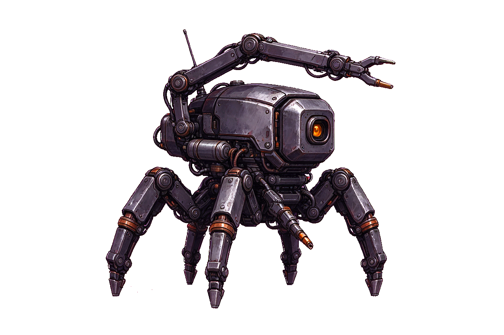

# Éclisse — sprite individuel entier

Nouvelle image créée le 6 novembre 2026 pour ORG-10 du catalogue de compagnons.

## Fichier de sprite

[PNG transparent, corps entier, une seule vue](sprites/eclisse/eclisse__trois-quarts-droite__entier.png)

1248 × 832 pixels natifs, un seul robot complet et ses outils, sans titre, cadre ou personnages supplémentaires. Ce fichier n'est pas une découpe des anciennes planches. Il n'est pas un atlas ni un cycle d'animation.

La source native sur fond chroma est conservée à l'identique dans `sources/`. `tools/normalize_eclisse.py` reproduit le détourage sans redimensionner le corps. Les vues sur fonds clair et sombre sont uniquement des preuves de revue, pas deux sprites supplémentaires.

## Fidélité et intégration

Éclisse est une création originale décrite par la bible comme un petit robot multipode à noyau protégé et bras-outils. Cette image propose son premier design complet. L'équipement, les proportions et les détails doivent encore recevoir une validation artistique ; elle n'est pas annoncée certifiée 1:1 ni jouable. Les six attaches de pattes ne sont pas toutes vérifiables dans cette vue et les bras-outils sont déployés.

Aucun recrutement, occupant de vaisseau ou module n'est activé. Les 39 PNG de revue précédents sont conservés dans leur dossier, avec leur statut historique. Les autres compagnons et poses restent à produire.
